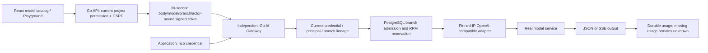

# AI Gateway: current implementation and historical protocol v1

Current implementation: API/Worker/AI 0.74.0, schema 061. Native Anthropic/Gemini provider discovery and publication are accepted in the [provider contract](AI-NATIVE-PROVIDERS.md) and [0.74 receipt](DELIVERY-2026-10-23-AI-NATIVE-PROVIDERS.md). Native Responses, Embeddings, Messages, Gemini and Chat extensions, native streaming, explicit versioned tariffs and cumulative branch budgets are accepted within the [current contract](AI-NATIVE-PROTOCOLS-BUDGETS.md) and [delivery receipt](DELIVERY-2026-10-22-AI-NATIVE-BUDGETS.md). Dynamic provider management has its separate [I01 receipt](AI-PROVIDERS.md). Commercial accounts, further vendor coverage, full multimodal/persistent references, credits and BYOK remain open. The text below records the original text-only v1 baseline; its future-gate descriptions do not supersede these later receipts.

## Original protocol v1 contract and scope

This implementation adds an independent Go inference process, React model catalog,
Playground, application credential authentication and durable PostgreSQL request
usage. It implements **text Chat Completions**, including SSE. It is not full Neon
commercial AI Gateway parity: Responses, Anthropic, Gemini, embeddings, monetary
credits, dynamic provider administration and production HA/TLS remain separate gates.
The existing platform design is the evolution target; this document describes code.

Ollama is a real upstream, not a canned test response. `qwen2.5:0.5b` is sufficient
for transport/product verification; model quality is not a database acceptance gate.
Local Ollama ignores API keys. Applications still authenticate at our gateway.
See [Ollama compatibility](https://docs.ollama.com/api/openai-compatibility) and
[model artifact](https://ollama.com/library/qwen2.5:0.5b).

## Interfaces

| Interface | Authorization / behavior |
| --- | --- |
| GET `/api/v1/projects/{project}/branches/{branch}/ai-gateway` | Project Viewer+; public approved model catalog, capability and branch base URL |
| POST `.../ai-gateway/request` | Console Editor+ and CSRF; scoped signed Playground request; no persisted application token |
| GET `.../ai-gateway/usage` | Project Viewer+; latest 50 requests and 24h totals; no content or secrets |
| GET `/ai/v1/{branch}/v1/models` | `ai_gateway:invoke` application credential; filters model restrictions |
| POST `/ai/v1/{branch}/v1/chat/completions` | Same scope plus requested model; one upstream attempt, never automatic replay |

OpenAPI 0.18.0 bundles the implemented control and public operations.
Request: `{model,messages:[{role,content}],max_tokens,stream?,temperature?}`.
Text only; unsupported fields such as tools/images are rejected. Body <=32 KiB,
input <=16,000 UTF-8 bytes, <=32 messages. Output is capped by the approved model
route; forwarding <=1 MiB. Deadline is operator-configured between 5 and 180 seconds.

Application parent/descendant semantics reuse the existing Backend credential
contract. Self credentials cannot reach another branch. Expiry, revocation,
disabled user, removed membership and model restrictions are checked in metadata.
Console cookies/control API keys do not authenticate the public endpoint. Signed
Playground tickets bind body, model, branch and actor; current authorization is
rechecked in the gateway. Ticket request IDs are unique ledger primary keys.

## Data and failure semantics

Migration 026 creates `ai_gateway_requests`: request/project/branch/actor/credential,
model alias and config generation, streaming mode, state, start/expiry/finish,
provider token usage, latency and upstream status. Branch and project use a
composite foreign key. Prompt, completion, credential values and provider URLs
never enter this table, access logs or evidence receipts.

An advisory transaction lock plus database reservations enforce per-branch
concurrency and RPM across cooperating gateway instances. The runtime currently
deploys one gateway; this admission mechanism does not certify HA or the Compute
scale-to-zero fence. A crash can leave a running row: after reservation expiry it
does not block admission, but its token usage remains unknown for investigation.
Provider token counts are used only when valid; no estimated zero or financial
charge is fabricated. No provider fallback or retry occurs after submission.

Protocol errors are sanitized. Redirects and HTTP proxy environment variables are
disabled for provider requests. Every DNS resolution must match operator-pinned IPs.
An HTTP upstream requires explicit `lab_allow_http`; HTTPS verifies native trust.
These checks complement, rather than replace, network egress controls.

## Deployment

1. Keep API/Worker independent and Backend credential keyring enabled.
2. Use `config/ai-gateway.example.json` as an operator-approved route snapshot.
   Map stable platform model aliases to actual upstream names; no caller URL input.
3. Create an operator-managed Secret with `config.json`. If authenticated, include
   the provider key as a separate file and reference `/run/ai-config/<key>` in the
   route's `api_key_file`. API projects only `config.json`; provider keys reach only
   the gateway. Rotation publishes a new Secret/config generation and rolls out.
4. Provision a separate metadata LOGIN role: SELECT only users, projects,
   organizations, branches, organization_members, project_grants and
   backend_credentials; SELECT/INSERT/UPDATE only ai_gateway_requests. No schema
   ownership, DDL, project creation or Kubernetes privileges. Store its DSN in an
   existing Secret key `database-url`; apply migration with the control API identity.
5. Helm: `aiGateway.enabled=true`, digest-pinned `aiGateway.image`,
   `existingConfigSecret`, `existingDatabaseSecret`, explicit preview `labHTTP=true`.
   Defaults stay disabled; Helm rejects latest tags and missing laboratory consent.
   Gateway has bounded resources, read-only root, non-root UID and no API token.
6. Open a project → **AI Gateway** → select branch/model → enter prompt → send.
   Check actual output, Request ID, streaming and persisted usage. Application
   credentials are created separately on the existing Credentials page.

Windows loopback Ollama is unreachable directly from a Kubernetes Pod. For this
lab, keep Ollama bound to Windows loopback; use an authenticated SSH reverse
tunnel to Linux loopback and the optional `ai-provider-relay` binary with a private
bearer key. Only that laboratory relay binds the Linux LAN address. No Windows
firewall/global Ollama settings need changing. Restarting a tunnel is an explicit
operator step. The relay is not the model and is not a production TLS endpoint.

## Acceptance

Run Go tests on disposable Linux PostgreSQL: `TestAI*` and `TestOpenAPI*`.
Run `web/e2e/ai-gateway.spec.ts` against the deployed React console and real
approved model. Check nonstream, SSE `[DONE]`, nonempty real model output and token
usage; application model listing, allowed/denied branch/model, revoke and malformed
request; upstream transport failure must not replay or leak provider error text.
Assertions do not judge the correctness of natural-language model answers.
Use one browser worker, zero retries; preserve every failure attempt. This slice
does not start a database Compute, so it consumes no VM workload slots.
