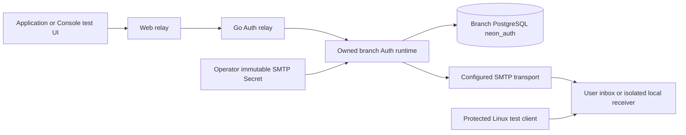
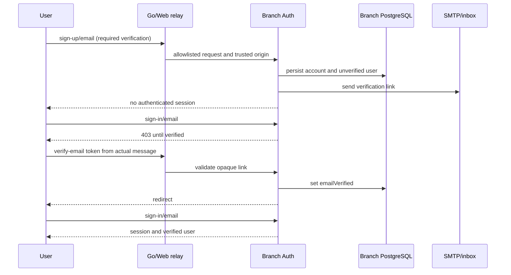
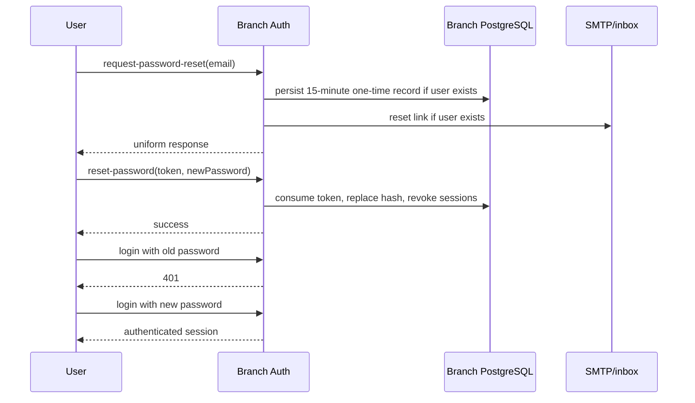

# Managed Auth email verification and password recovery

## Scope and status

The branch Auth service uses pinned Better Auth and Nodemailer with the actual branch PostgreSQL database. This phase implements email delivery, optional mandatory verification before password login, password recovery, and invalidation of server sessions after reset. It extends application identity; it does not register Console administrators.

Implementation and disposable PostgreSQL/SMTP tests are present. Real Linux UI acceptance and immutable-image deployment remain required before marking this phase accepted. The local mailbox is an operator test receiver, not a production email provider. SMTP TLS, deliverability, abuse prevention, mailbox privacy, and HA have separate production gates.

## Architecture and trust boundaries



The caller never selects the SMTP host, port, sender, credential, CA, or template. SMTP credentials are not part of ManagedAuthSpec, OpenAPI examples, metadata rows, operation payloads, values.yaml, or per-branch API responses. Only the owned branch Auth runtime mounts the SMTP Secret read-only. API and Worker receive its name. The independent local mailbox reader Secret is never mounted into API, Web, Worker, or branch Auth.

Mail transport is configured platform-wide, while verification policy is branch-scoped. Existing branches without the new policy retain their original request hash: the false boolean is omitted from the canonical Go request. Immutable branch runtime configuration changes require disabling and enabling Auth through durable Operations. Disable does not delete application accounts.

## Configuration

Helm settings, disabled by default:

```yaml
managedAuth:
  mail:
    enabled: true
    existingSecret: operator-auth-smtp
  labMailbox:
    enabled: false
    acknowledged: false
    existingAuthSecret: ""
```

`operator-auth-smtp` must be an **immutable** Kubernetes Secret in the application namespace. Its `config.json` is a strict JSON object:

```json
{
  "version": 1,
  "host": "smtp.example.com",
  "port": 465,
  "from": "noreply@example.com",
  "secure": true,
  "labCleartext": false,
  "username": "operator-smtp-user",
  "password": "REPLACE_IN_PRIVATE_FILE"
}
```

Create the private configuration on Linux with mode 0600, then use `kubectl create secret generic operator-auth-smtp --from-file=config.json=/protected/config.json`; set `immutable: true` before enabling the Helm setting. Do not commit the input or put credentials in command arguments. Optional `caFile` must be `/run/auth-mail/ca.crt`, with the certificate under the same Secret's `ca.crt` key. Real SMTP requires certificate verification and TLS; `secure: false` still requires STARTTLS. Username and password must be supplied together.

Cleartext is only permitted with `labCleartext: true`, no SMTP credentials or CA, and either loopback in disposable tests or exact `neon-auth-mailbox.<namespace>.svc.cluster.local`. It is an explicit laboratory exception. Connections do not pool and have bounded connection, greeting and socket timeouts. Transport failures are sanitized.

### Local receiver

For local acceptance, opt in to `managedAuth.labMailbox.enabled` and `acknowledged`, supply an independent immutable `existingAuthSecret`, and configure SMTP port 1025 to the fixed internal service name. The reader Secret contains `authfile` in the format supported by pinned Mailpit; a separate `password` key may be used by a protected test fixture. Generate the random credential on Linux and never expose it as Helm values.

The receiver uses an immutable vendor digest and a retained PVC. Its ClusterIP inbox on 8025 requires Basic authentication. SMTP ingress is restricted to branch Auth Pods, and inbox ingress to Pods labelled `neon-control/test-fixture=auth-mail`. Egress is denied, remote checks and version checks are disabled, and message auto-deletion is disabled so failure evidence remains available. No NodePort or public Ingress is created. This receiver's SQLite file is a third-party mail fixture; the control-plane metadata and Auth accounts remain PostgreSQL.

The PVC is retained on uninstall. Operators must inspect it and make an explicit retention decision; neither test cleanup nor Helm removes mailbox evidence. Restrict operator Secret access and protect retained mail because it contains bearer verification/recovery links.

## Data model and API

`ManagedAuthSpec.require_email_verification` is an optional boolean, default false. Enabling true without platform mail configuration fails validation. Read responses include `mail_operator_enabled` and `mail_runtime_enabled`. The latter requires the currently owned workload to contain the expected read-only Secret mount and configuration-file environment entry; neither flag proves successful mail delivery.

Existing `neon_auth` user, account, session and verification tables are used by the maintained Auth library. No second password store or ad hoc token format is introduced. Reset records expire after 900 seconds. Verification links expire after 3600 seconds. Runtime recreation at a new generation clears copied sessions, rate-limit records, JWKS and opaque verification records; retrying the same generation retains pending links. User/account rows remain.

Conditional raw relay actions under `/auth/v1/{branch_id}`:

| Method | Action | Input / effect |
|---|---|---|
| POST | `send-verification-email` | email, optional callbackURL; sends actual mail |
| GET | `verify-email` | query token; library validation, usually a 302 callback |
| POST | `request-password-reset` | email, optional redirectTo; uniform success for unknown users |
| GET | `reset-password/{token}` | bounded opaque-token path; validates callback and redirects |
| POST | `reset-password` | token, newPassword; consumes once and revokes server sessions |

These actions are only exposed when operator mail is configured. The official versioned OpenAPI contract defines ManagedAuthSpec and the raw relay. Raw library responses and redirects are preserved; a 302 alone is not evidence that an email was verified. The UI confirms state by logging in and reading the real user.

## Flows





Already issued offline application JWTs can remain valid for at most their existing five-minute lifetime; revoking server sessions does not falsely claim immediate offline JWT revocation.

## UI and safe callbacks

The Auth page exposes the mandatory-email policy before enabling the service. The application workbench can request mail, enter masked verification/recovery credentials, and set a new password. Tokens and new passwords are cleared after use. Reset callbacks are consumed only for a validated authorized branch, then removed from browser history. They are not persisted in localStorage. Nginx redacts reset-token paths from access logs and suppresses raw upstream error logging on the Auth relay; status/latency access records and sanitized API errors remain.

## Local Linux acceptance

Use a dedicated retained branch/database owner fixture. Tests grant the managed bootstrap role permission through the SQL UI, enable Auth through the UI, and preserve the durable Operation IDs. Use one worker at a time on a resource-constrained cluster.

The protected fixture selected by `NEON_E2E_MAILBOX_FIXTURE` contains only an internal receiver URL, reader username and password-file path. The password itself stays in a mode-0600 Linux file. Supported test URLs are `http://neon-auth-mailbox:8025` inside the labelled test Pod or a protected Linux `127.0.0.1:18025` port-forward. Do not publish the inbox.

Run on Linux using the exact deployed source and pinned browser image:

```sh
npm run test:e2e -- auth-mail.spec.ts
```

Required observations: unauthenticated inbox is 401; required-email signup creates no session; login is denied before verification; actual SMTP message unlocks the actual account; password reset is delivered and consumed once; old password is denied and new password works; replay is rejected. Final cleanup disables owned Auth and suspends the owned Compute, retaining accounts, messages, PVC, operation records and all evidence. Save private message bodies outside public artifacts. Never restart a failed flow with a new account before examining its original operation/message state.

Disposable library tests additionally verify actual PostgreSQL session revocation, token expiry, unknown-email behavior, clone/generation cleanup and SMTP configuration rejection. CI tests are not substitutes for the real UI delivery acceptance.

## Remaining production gates

Production SMTP certificates and delivery, provider limits, mail-abuse controls and enumeration timing, safe forwarding logs, authorized callback origins, shared rate-limit behavior, mail retention/privacy, HA/failover, and application JWT immediate-revocation requirements need independent acceptance. Email OTP, Magic Link, Admin plugin, OAuth/SSO and MFA are separate product features. This phase does not claim those features or production certification.

## Primary references

- [Neon Auth roadmap](https://neon.com/docs/auth/roadmap)
- [Nodemailer SMTP transport](https://nodemailer.com/smtp)
- [Mailpit HTTP authentication and host protection](https://mailpit.axllent.org/docs/configuration/http/)
- [Mailpit runtime and retained messages](https://mailpit.axllent.org/docs/configuration/runtime-options/)
- [Mailpit supported password files](https://mailpit.axllent.org/docs/configuration/passwords/)
