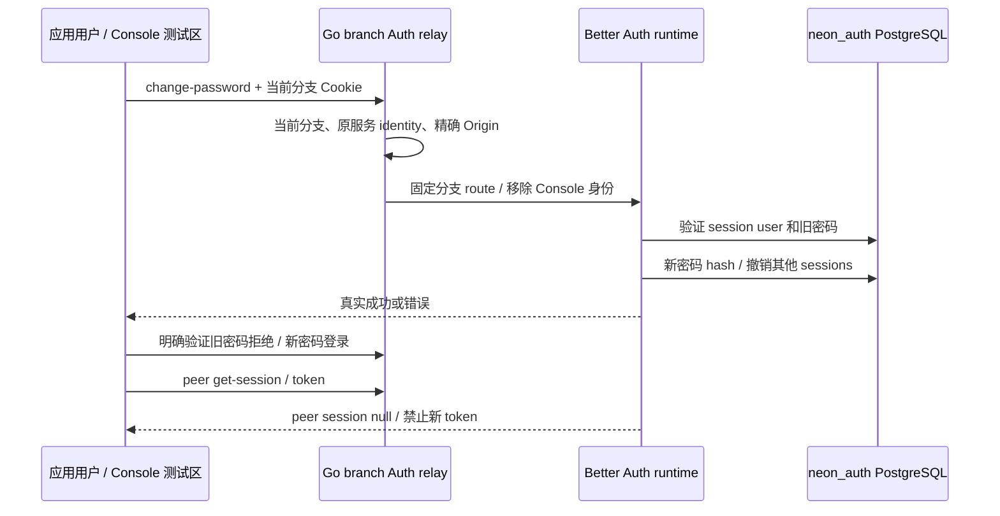

# Managed Auth：本地账号安全流程

## 范围

本增量使用已锁定 Better Auth 的实际账号/会话实现，不另造密码或 JWT 算法。
增加 Console 应用测试区的密码更新、会话列表、指定会话撤销与其他会话撤销 UI。
应用用户属于 Neon 分支 `neon_auth`，不属于 Console 的 Go metadata users。
邮件验证/找回投递、MFA、OAuth/OIDC/SSO、恢复与 HA 继续单独准入。

## 接口合同

所有接口基于 `/auth/v1/{branch}`，Cookie 为该分支的应用 session，来源必须通过
已配置精确 Origin 校验。Console Cookie/API key 不能替代应用会话。Go relay 只
选择当前 ready branch 的已拥有 Auth runtime；Body、方法、转发 header 均有边界。

| 方法与路径 | 输入 | 行为 |
|---|---|---|
| GET `/list-sessions` | 当前应用会话 | 返回当前用户有效会话；含 revoke token 的 API 返回只供当前用户，不能公开记录 |
| POST `/change-password` | currentPassword、newPassword、revokeOtherSessions=true | 验证旧密码，保存 library 密码 hash，撤销其他会话；新密码 12–128 字符 |
| POST `/revoke-session` | token | 只撤销当前用户拥有的指定会话；未知/他人 token 返回同样 200，但不删除，避免泄露归属 |
| POST `/revoke-other-sessions` | `{}` | 保留当前会话，撤销其余会话 |
| POST `/revoke-sessions` | `{}` | 撤销全部会话，包括当前会话 |
| GET `/get-session` | 应用 Cookie | 返回当前用户/会话或 null |
| GET `/token` | 应用 Cookie | 仅有效会话可签发短期分支 JWT |

精确错误状态/格式由锁定 Better Auth 返回；Go relay 不包装成成功。
密码更新是一次真实操作，UI 不自动重试。失败时不得猜测密码是否已更新，需检查
请求 ID/原响应，并用旧/新密码显式验证。库异常日志关闭，不输出密码或 DSN。

JWT 是离线签名凭据。撤销会话立即阻止后续会话请求和新 JWT 签发，**不是立刻
撤销已经签发的 JWT**；当前最大有效期 5 分钟。即时 token blocklist/introspection
是另一个接口与资源门槛，不得混为已实现。

## UI 与数据边界

`AuthSecurityPanel` 只在当前已登录的应用用户下显示。密码输入 type=password，
完成后清空；session revoke tokens 只进入组件 ref Map，不渲染 DOM、不写 URL、
local/sessionStorage、截图、审计或 JSON 报告。页面显示创建/过期时间和客户端。
跨分支切换卸载原组件并清除凭据；异步结果检查 epoch，避免旧分支结果污染页面。
UI 清理内存不能替代服务端会话撤销。

## Linux 验收

库级 `services/auth/test/security.test.ts` 使用仅本地专用 auth_ci，验证真实密码更新、
错误密码不改变会话、指定/其他/全部撤销。现场套件 `web/e2e/auth-security.spec.ts`
从 SQL Workbench 开始，由已保存 database owner 明确委托 CREATE/CONNECT，然后
UI 启用 Auth、注册应用用户、测试安全面板。独立浏览器请求上下文作为 peer 与
其他用户，以实际会话仍有效验证跨用户撤销无效（库返回 200 无操作，不约定 403）。测试结束正常停用自有 Auth runtime、SQL compute
缩到 0，应用账号行与全部证据保留。状态以本次精确版本的交付报告为准。
