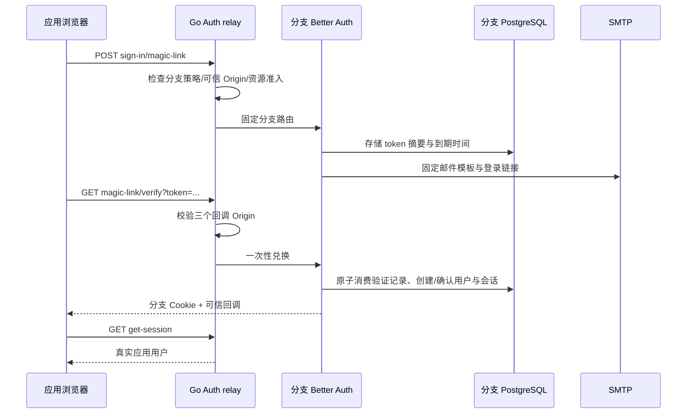

# Magic Link 邮箱免密码登录

## 目标与当前状态

对齐 Neon Managed Better Auth 的 Magic Link：启用开关、链接有效期 5–1440 分钟、新用户注册开关、真实邮件登录、可信回调和分支会话。本项目复用固定的 Better Auth 1.7.7 插件；不自行实现身份或签发邮件登录凭据。

本地 Kubernetes 与真实 Linux UI 已通过，精确版本/失败修复/原 fixture 续测/八组结果见 [交付回执](DELIVERY-2026-10-14-LOCAL-MAGIC-LINK.md)。真实 PostgreSQL/SMTP 原生插件还验证摘要存储、300 秒期限、并发消费仅一成功、重放/过期拒绝、未知账号注册拒绝和恶意回调。公网 SMTP 和全链路可信 TLS 仍是独立门槛。

## API 与模型

控制面启用接口：`POST /api/v1/projects/{project}/branches/{branch}/auth`，沿用组织授权、`If-Match` generation 和 `Idempotency-Key`。新增可选字段：

| 字段 | 类型 | 含义 |
|---|---|---|
| `magic_link_enabled` | boolean | 默认 false；需要 operator SMTP |
| `magic_link_expires_in` | integer | 单位秒，300–86400；省略或内部 0 使用 300 |
| `magic_link_allow_registration` | boolean | 默认 false；明确允许邮件链接创建新用户 |

关闭插件时不得提交有效期或开放注册选项。默认字段省略，保持旧请求的规范化哈希不变。UI 输入分钟，转换成秒提交。修改策略需要正常停用并重新启用，生成不可变配置 Secret；旧 generation 的会话、验证记录和签名密钥按现有恢复规则撤销。用户和账号不删除。

应用接口由独立 `contracts/application-auth-v1.json` 记录：

| 方法与分支路径 | 请求 | 结果 |
|---|---|---|
| POST `/auth/v1/{branch}/sign-in/magic-link` | email；可选 name、callbackURL、newUserCallbackURL、errorCallbackURL | 200 请求已处理；不返回 token |
| GET `/auth/v1/{branch}/magic-link/verify` | token；可选三种回调 URL | 设置 HttpOnly 分支 cookie，200 会话或 302 可信回调；失败不能以 302 判为登录成功 |

分支未启用插件时返回 404，且不会先唤醒 Compute。原生数据库限流在插件入口生效。`/api/application-auth-openapi.json?branch_id=...` 只读取文档，不联系数据库或 Kubernetes。

## 生命周期与安全

采用 `storeToken: hashed`，禁止通过控制台 API 读取存储凭据。注册关闭默认不为未知邮箱建账号。原生库对既有未验证账号的首次邮箱所有权确认会移除旧密码并撤销旧会话，UI 显示这一规则。链接 token 不进入 localStorage、不出现在公开报告。nginx 原有 Auth 日志省略 query；SMTP 原始异常经过清理。

UI 的本地邮件工具只允许当前 Origin、精确分支 verify 路径的 URL，并使用浏览器真实跳转建立 HttpOnly cookie。返回后读取真实会话；有 `error` 的跳转不以旧 cookie 假装本次成功。SMTP 不是控制台注册系统，两个账号空间严格分离。

## Linux 本地复测

1. 按 [邮箱恢复手册](AUTH-EMAIL-RECOVERY.md)配置已存在的 operator SMTP；本地收件箱保留邮件，阅读入口仍需独立凭据。
2. 按 [Linux 本地开发](LOCAL-LINUX-DEVELOPMENT.md)构建 `api,web,auth`，三个节点导入摘要，升级控制面 Helm。
3. 准备已有数据库 owner fixture、控制台管理员密码文件、受保护收件箱 fixture；不把密码写进命令行。使用测试源码的同一构建快照。
4. 执行 `auth-magic-link.spec.ts`：从 UI 启用并开放注册，真实 SMTP 新账号登录、重放和非法回调拒绝、同账号重新登录；从 UI 关闭注册并重新启用，未知邮箱不能建账号、已有账号仍可登录。
5. 保存操作 ID、用户 ID、邮件 ID、失败原记录和截图；停用该测试分支 Auth 并将其 Compute 缩至 0。保留用户、数据、邮件和复测资料。

参考：[Neon Magic Link](https://neon.com/docs/auth/guides/plugins/magic-link)、[Better Auth 1.7.7 Magic Link](https://better-auth.com/docs/plugins/magic-link)。完整 Admin/Organization/OAuth/MFA 与公网邮件准入不由本页单项测试替代。
