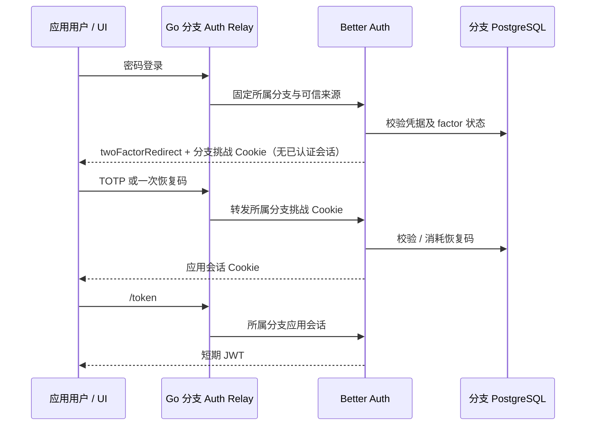

# 应用 Auth：可选 TOTP 双重认证

## 1. 范围与兼容性

本功能是自托管 Better Auth 的可选扩展，面向分支中的**应用用户**，不是控制台管理员 MFA。基于固定 Better Auth 1.7.7 插件；不开启 `two_factor_enabled` 时保持旧请求序列化与哈希兼容。当前版本的实际 Linux/UI 验收回执另见交付文档。

Neon 官方 Auth 的分支身份目标参考 [官方概览](https://neon.com/docs/auth/overview)；本扩展不能视为 Neon 托管服务完全相同的实现。协议依据 [Better Auth 2FA](https://better-auth.com/docs/plugins/2fa)，实际行为以本仓库固定依赖与测试为准。

## 2. 模型与接口

控制面启用请求在原 `ManagedAuthSpec` 中增加 `two_factor_enabled: true`。省略或 false 不加载插件。使用现有异步 Operation、分支/项目授权和启停流程；不增加独立部署或监听端口。

所有下列应用接口均位于 `/auth/v1/{branch_id}`，POST JSON，使用分支 HttpOnly Cookie；不得传控制台 Token。完整结构见 `contracts/application-auth-v1.json`（0.26.0）。

| 路径 | 输入 | 作用 |
| --- | --- | --- |
| `/two-factor/enable` | password，method=totp | 返回私密 totpURI、backupCodes；验证前不算已启用 |
| `/two-factor/verify-totp` | code 六位，trustDevice=false | 确认绑定或完成待验证登录 |
| `/two-factor/verify-backup-code` | code，trustDevice=false | 一次性恢复码完成登录；重放拒绝 |
| `/two-factor/get-totp-uri` | password | 已登录用户重新读取自己的绑定资料 |
| `/two-factor/generate-backup-codes` | password | 重新生成恢复码，旧码失效 |
| `/two-factor/disable` | password | 当前用户停用自己的双重认证 |

应用用户模型可增加 `twoFactorEnabled`。数据库的 `neon_auth."user"` 增加同名 boolean；`neon_auth."twoFactor"` 保存加密 secret/backupCodes、userId、verified、failedVerificationCount、lockedUntil。DDL 从固定插件迁移生成结构核对，通过控制面已有 schema 所有权标记及事务增量安装；允许重试，不删除用户/密码，不授予运行角色 DDL 或超级用户权限。

## 3. 用户流程

控制台项目 → Auth：启用“应用 TOTP 双重认证”，启用 Auth。应用用户以密码注册/登录，输入当前密码生成绑定资料，把 URI 保存到验证器，安全保存恢复码，输入当前六位代码确认。资料默认遮罩；不能把 URI 发送给第三方二维码网站。后续密码登录进入第二步，完成前 `/get-session` 无用户、`/token` 不发 JWT。

界面提供恢复码重置、绑定资料重读与用户停用。显示/隐藏私密资料只保存在组件内存，分支切换清除。不存在可信设备记忆；`trustDevice:true` 请求在 Go 边界拒绝，trusted-device Cookie 不转发。

## 4. 密钥、启停与分支边界

TOTP 的密文必须在同分支 Auth 启停后可解密。选择启用 TOTP 时，分支密钥由稳定控制面签名密钥以 HMAC-SHA256 及独立用途字符串、项目 ID、分支 ID 派生；不依赖服务 generation。必须备份并保留原签名密钥。**当前不支持在线轮换该根密钥**；直接替换会使绑定资料无法解密。

停用 Auth 会撤销运行服务，重启会按原流程清除旧会话/JWKS/待用链接并保留用户和 factor 密文。已有已绑定用户时，不允许改成无 MFA 插件的分支策略。先让用户按密码停用自己的 factor，或实现专门的安全迁移；不可直接编辑数据库绕过。

克隆分支包含已绑定 factor 时，默认仍返回 `auth_factor_migration_required`。0.72 可在实际物理子分支显式开启 `inherit_two_factor`，通过来源验证后原子重封装、清除复制会话与未完成绑定、重置子分支恢复码。详见 [迁移合同](AUTH-FACTOR-MIGRATION.md)和 [真实验收](DELIVERY-2026-10-22-AUTH-FACTOR-MIGRATION.md)。完整生命周期恢复、在线根密钥轮换继续单列。

## 5. 真实本地验收

新增 Linux Playwright 套件 `web/e2e/auth-totp.spec.ts`，单 worker、零重试，使用保留的授权数据库 fixture。检查 UI 原生启用、真实 PostgreSQL 中的应用账户、独立 RFC6238 生成代码确认绑定、密码挑战无 JWT、分支挑战 Cookie、恢复码使用与重放、Auth 禁用重启后的原身份和验证器、恢复码重置、用户停用以及最终 compute 缩零。

独立 Go 测试验证默认哈希兼容、Cookie/方法边界、分支密钥隔离、增量迁移重试、运行角色权限、策略降级和克隆拒绝。Provider 测试直接使用本仓库 SQL 资产建立真实临时 PostgreSQL，再执行固定库流程；不以 mock 替代加密或验证码算法。测试保留失败回执与私密输入（后者不进入公开仓库）。

## 6. 当前限制

密码登录的第二因子与 Email OTP/Magic Link 免密登录是不同策略：本插件默认不拦截免密登录，不宣称所有登录方式强制 MFA。Console 自助 MFA 已有独立验收；OAuth/SSO、短信、可信设备、在线根密钥轮换、全链路可信 TLS、生产攻击矩阵与 HA 仍有独立实现或验收门槛。
