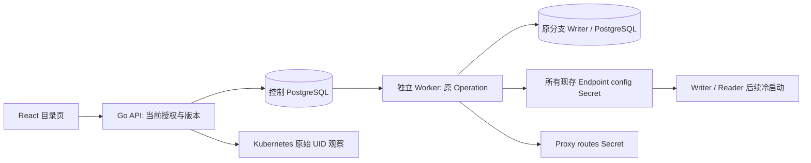
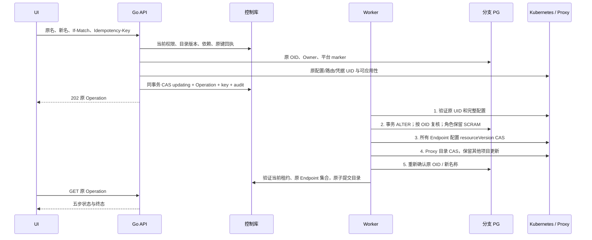

# 数据库和角色重命名

## 1. 范围与官方语义

此功能把 PostgreSQL 的重命名扩展为可追踪的控制面操作，涵盖 UI、授权、
Operation、实际 SQL、所有现存 Compute 配置和 Proxy 凭据目录。它保留对象
OID、业务数据、ACL 和平台管理的 SCRAM 密码。最新现场状态以
[当前交付](DELIVERY-2026-10-16-CURRENT.md)为准；本文本身不是验收证明。

本地官方文档 `content/docs/manage/databases.md` 描述数据库改名和连接字符串
更新。PostgreSQL 要求从其他数据库执行重命名，并要求合适的所有权和 CREATEDB
权限，见 [ALTER DATABASE](https://www.postgresql.org/docs/16/sql-alterdatabase.html)。
角色改名需要相应管理权限；MD5 密码包含角色名，改名会清除该密码，见
[ALTER ROLE](https://www.postgresql.org/docs/16/sql-alterrole.html)。本实现重新使用
原不可变凭据 Secret 内的 SCRAM verifier，不生成新密码，也不支持导入的 MD5 身份。

### 1.1 当前边界

- 只允许 `ready` 项目、分支和平台管理的非系统目录对象。
- 角色不能仍被任一保留的 Endpoint 默认连接引用。数据库不能仍被 Endpoint
  默认连接、Data API、Auth、产品 Storage 或 Function 引用。这些依赖，包括
  保留的删除记录，返回 409；不擅自改变 Backend 的数据库身份。
- 新名称不能占用任何现存或保留的受管理目录记录；实际 PostgreSQL 的同名
  非原始 OID 也拒绝。名称按 UTF-8 最多 63 字节校验并安全引用 SQL 标识符。
- 不强制终止客户数据库连接。PostgreSQL 拒绝繁忙数据库时，保留原 Operation
  和错误；管理员先处理连接，再通过受控恢复处理原操作。
- 系统/默认角色迁移、未知外部 DDL 自动对账、跨实例外部栅栏分别有独立门槛。
  PostgreSQL 锁和控制库租约不能被描述为完整分布式 fencing。

## 2. 架构与数据模型

没有新增业务表；使用现有迁移 039 的表和事务约束：

| 对象 | 变更和约束 |
|---|---|
| `branch_roles` | 分支内名称主键由原名变新名；`credential_ref` 保持原 Secret；状态 `ready → updating → ready`，成功版本加一 |
| `branch_databases` | 数据库改名更新名称主键，Owner 不变；角色改名同时更新其所有 Owner 引用，每个受影响数据库版本加一 |
| `operations` | `resource_type=branch_catalog`，`resource_id=branch_id`；action 为 `rename_role` 或 `rename_database` |
| `operation_steps` | 五步持久状态，继续原操作时验证已完成步骤；不会产生另一个目录对象 |
| `idempotency_keys` | actor、原键哈希、规范请求哈希、原 Operation；与目录状态及审计在同一控制库事务提交 |
| `audit_events` | actor/action/branch/request ID/accepted；不写密码、verifier、原始 Secret 或 SQL 内容 |

Operation payload 除项目、分支、Writer、原名、新名、原版本外，还绑定实际
PostgreSQL `object_oid`、数据库 Owner 或角色 `credential_ref`、
`config_uids: {endpoint_id: original_secret_uid}`、`routes_uid` 和角色
`credential_uid`。没有凭据明文或 verifier。所有未删除 Endpoint（包括零实例
Reader）均纳入原始集合；最多 128 个，集合在入队及最终提交时复核。

## 3. 接口合同

Swagger 以 [OpenAPI](../contracts/openapi-v1.json) 为准，索引见 [API](API.md)。

| 方法与路径 | 授权 | 请求 | 成功 |
|---|---|---|---|
| `POST /api/v1/projects/{project}/branches/{branch}/roles/{role}/rename` | 当前项目 Editor/Admin | `{"new_name":"app_next"}` | 202，原 `operation` |
| `POST /api/v1/projects/{project}/branches/{branch}/databases/{database}/rename` | 当前项目 Editor/Admin | `{"new_name":"data_next"}` | 202，原 `operation` |

两个接口都要求 `Idempotency-Key` 和唯一、规范、带双引号的 `If-Match: "N"`。
N 取目录 GET 返回的 `version_token`。Cookie 会话另需原 CSRF header；API Key
按现有 scope 规则授权。DTO 只接受 `new_name`，不接受额外字段和系统名称。

| 状态 | 含义与客户端处理 |
|---|---|
| 202 | 意图持久提交；轮询返回的 Operation，不能仅凭 202 声称已改名 |
| 403/404 | 当前权限或资源范围拒绝；不要用旧权限缓存重试 |
| 409 | 依赖、保留名称、非受管理对象、原 OID/Owner 冲突、原键不同请求、分支已有活动操作 |
| 412 | 原版本变化；刷新目录后由用户重新确认意图 |
| 422/428 | 名称/严格请求/版本格式错误，或缺少版本 |
| 503、网络断开 | 结果可能未知；保留原路径、原 body、原版本和原 key，仅重发原意图 |

重放首先检查同 actor 的持久回执，之后才查原目录名称。因此成功后原名已经
消失，同一请求仍取得原 Operation；不同 body 或版本使用同一 key 返回 409。
没有承诺与 Neon 公共 API 的路径逐字兼容；这里是自托管控制面的显式异步合同。

## 4. 执行流程和恢复

SQL 事务设 5 秒 lock timeout、30 秒 statement timeout，使用分支级协作锁。
改名前后均验证实际 OID、平台 marker、名称和 Owner。响应丢失后，只接受原
OID 已处于原名或新名；原名被其他对象重建、目标被其他 OID 占用都拒绝。

Kubernetes 更新始终重新 GET 原 UID 和 resourceVersion。并发冲突最多六次
重新读改写，成功后再读验证；不替换同名新 Secret。Proxy 只改变原项目/分支
的原角色项，保留其他路由，包括 CAS 期间新增的路由。已提交但 PUT 响应丢失
会保留未知状态；下一次调谐观察原 UID 上的已完成效果，避免第二次写入。

目录改名已在 PostgreSQL WAL 持久提交后才改 Compute desired catalog。
不追加按旧名称删除对象的 delta，避免后续独立对象复用旧名时被误删。
现有 Writer 的实际 SQL 和所有保留 Reader 的冷启动配置都必须独立验证。

控制库、分支 PG 和 Kubernetes 之间没有分布式原子事务。中间状态由五步
Operation 解释；应保留并恢复原 Operation，不能把目录状态手工改成 ready，
也不能用新 ID/新密码/新数据库掩盖失败。运行中租约丢失可由后继 Worker
继续；终态失败按原错误和原外部身份诊断，不会自动盲目补偿已经提交的 DDL。

## 5. 手动操作与本地验收

1. 以当前项目 Editor/Admin 登录，进入“数据库与角色”。创建一个专用受管理角色
   和以它为 Owner 的专用数据库；不要用默认连接或 Backend 正在使用的对象。
2. 从 SQL 工作台使用这个角色连接其数据库，创建表并写入可识别记录。记录
   `pg_roles.oid`、`pg_database.oid`、Owner、ACL；密码仅保存私密位置。
3. 先建立一个 Reader，再缩为零。在目录页选“角色”、原角色、新名，确认更新
   应用连接名后提交。观察同一 Operation 五步全部成功。
4. 用新角色名、原密码连接原数据库，确认原 OID、数据和 ACL。目录 Owner
   应同步变为新角色，不能出现重新生成的凭据。
5. 在同页把专用数据库改为新名；用新数据库名与新角色名、原密码验证原数据。
6. Writer 缩零后用新连接 SQL 冷醒；随后 Writer 再缩零，通过原 Reader 冷醒
   查询，确认只读、原数据/OID/Owner、Proxy 目录和冷启动配置一致。
7. 将测试 Reader 正常删除、Writer 缩零，保存原操作/UID/日志/SQL 证据。
   不删除业务表、数据库、角色、凭据和失败回执。

自动化新增用例为 [catalog-rename.spec.ts](../web/e2e/catalog-rename.spec.ts)。
在 Linux 的固定依赖浏览器环境执行，`NEON_E2E_CATALOG_RENAME_FIXTURE`
指向 checkout 外 JSON，仅含 `project_id`、`branch_id`、`writer_id`。
首次运行在私有目录写密码和精确 checkpoint；恢复必须使用同一密码、对象、
operations/checks，指定 `resume` 和原失败 Job，不能另建替代资源。
用例从 UI 发起变更，另用实际 202 丢失响应验证 UI 原键恢复，并用同键不同
body、陈旧版本验证拒绝；Go 测试补足真实 PG、审计回滚、当前权限、UID/CAS
与未知提交。运行结果及失败记录另按每次交付归档。

## 6. 后续演进

当前切片完成后，C02 继续覆盖默认身份、Backend 依赖迁移和未知外部 DDL。
跨实例外部栅栏、HA/DR、全链路可信 TLS 仍按独立门槛推进。
不以一个改名页面或单次 PostgreSQL DDL 成功宣称完整生产准入。

原结果与后续密码/名字的保留恢复已单独通过，见[2026-10-21 交付](DELIVERY-2026-10-21-CATALOG-RENAME-RESULTS.md)。054 原结果与元数据改名、关联 Owner 更新和成功审计原子提交；结果恢复先于外部依赖访问，旧的最终名称不能自动推断原回执。
