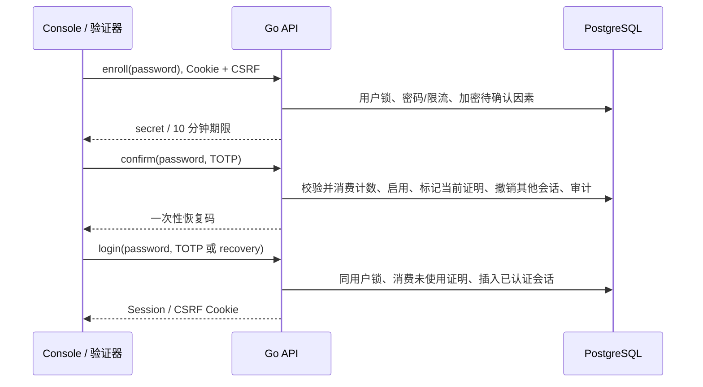

# Console 双重验证

## 状态与边界

本功能保护 Go 控制面账号，独立于分支 Better Auth 的应用 TOTP。迁移 034、Control
OpenAPI 0.38.0、独立 Chart 0.9.25。实现不需要 SMTP、OAuth 或公网域名。现场验收见
[本地交付](DELIVERY-2026-10-16-CONSOLE-MFA.md)：原账号累计十二项 UI 和两个 Linux
race/PG 测试通过。组织强制策略、WebAuthn/硬件密钥、SSO 和
全链路 TLS 仍是后续需求；当前实验室 HTTP 也不能作为可信传输认证。

TOTP 采用 [pquerna/otp v1.5.0](https://github.com/pquerna/otp/tree/v1.5.0)
的标准 RFC 6238/HOTP 原语，SHA-1、6 位、30 秒；接受当前和相邻各一个计数窗。
服务端持久化最后成功计数，必须严格递增，不将库的时钟容差当作可重复使用许可。

## 模型与事务

`console_mfa`：user_id 主键、key_version、sealed_secret、pending_until、enabled_at、
last_step、recovery_hashes。密钥由现有 backend keyring 的版本化 AES-GCM envelope
加密，AAD 为 `['console-totp-v1', user_id]`，不同于 SQL/应用凭据。恢复码各含 128 bit
随机数，只持久化带账号/目的的 SHA-256；明文只在启用成功时返回一次，不写审计。
十分钟待确认记录不参与登录校验。启用前密码登录保持现有语义。

所有操作以用户行锁与现有账号锁串行；登录也锁用户行，避免启用与新会话竞争。
确认启用、验证码消费、会话认证时间、撤销其他登录和审计同事务提交。恢复码登录的
消费与会话插入同事务，失败回滚不消耗码；并发请求只能一个成功。状态查询不返回
secret、URI、hash 或恢复码。没有 API Key 管理个人因素的入口。

会话增加 mfa_verified_at。启用后必须不早于因素 enabled_at；其他会话同时标记撤销
并截短 expires_at。数据库 INSERT trigger 还会拒绝旧 API 插入缺少因素证明的会话，
避免简单代码回滚绕过 MFA。该保护不代表支持混合旧新版本生产 HA。不要删除该迁移
或改造触发器绕过密码/因素；完整回滚应维护兼容的新身份服务。

## API

| 方法与路径 | 输入 | 结果 |
|---|---|---|
| GET `/api/v1/account/mfa` | Console Cookie | enabled、pending_until、剩余恢复码数和密钥可用性 |
| POST `/api/v1/account/mfa/enroll` | password | 新 secret/otpauth URI，10 分钟有效；已启用时 409 |
| POST `/api/v1/account/mfa/confirm` | password、code | 消费待确认因素，返回一次十个恢复码，撤销其他会话 |
| POST `/api/v1/account/mfa/disable` | password、code、可选 recovery=true | 必须消费未使用证明；撤销其他会话 |
| POST `/auth/login` | username、password、可选 mfa_code/recovery | 启用 MFA 后无证明返回 401 mfa_required，不签发 Cookie |

写操作必须有同源 Cookie/CSRF。错误密码/因素计入 PostgreSQL 15 分钟账户限流；登录
另有账户/IP 限流。过期/错误/重放证明统一拒绝。仅在密码正确后提示 MFA 所需证明。
所有敏感响应 no-store；不通过 Idempotency replay 重放 secret/恢复码。
提交结果不明确返回 503，应先读当前状态，不能盲目重复启用或猜测成功。

## 手工操作和恢复

进入“组织”页面的“控制台双重验证”区域，加载状态，输入当前密码并设置验证器。
在本地验证器中手工添加屏幕密钥（Neon Console / 6 位 / 30 秒 / SHA-1），重新输入
密码和当前验证码确认。立即将十个恢复码存入密码管理器后隐藏。后续登录展开“双重
验证”，输入当前码，或勾选恢复码。每个恢复码只能用一次。

更换验证器：用密码及未使用验证码/恢复码先关闭，再重新绑定。当前版本不提供码的
明文重新读取。丢失全部因素和恢复码属于运营方账号恢复事件：经过组织确认，在受控
维护窗口、备份元数据库并记录独立审计后处理；不提供无认证的“找回 MFA”后门。
密钥版本须随数据库备份保留；丢失加密 keyring 不得静默取消 MFA。

## Linux 验收

`TestConsoleMFAReplayRecoveryIsolationAndLegacyGuard` 在独立 control_ci schema 测试
实际 PG 事务、过期/错误证明、密文、跨账号隔离、旧会话失效、旧 API INSERT 拒绝、
TOTP 重放与恢复码并发消费；`TestConsoleMFACounterWindowAndReplay` 测窗口与过期。
真实 Playwright `web/e2e/console-mfa.spec.ts` 从邀请注册新 viewer 开始，完整通过
Console 启用、错误/真实登录、恢复码重放、刷新不回显、关闭和恢复密码登录。只使用
独立测试账号，绝不改变运营方 admin 的 MFA。私有 checkpoint 保存可接续凭据；公开
结果只列检查项。串行、0 自动重试，不创建 Compute，不访问业务 SQL。
