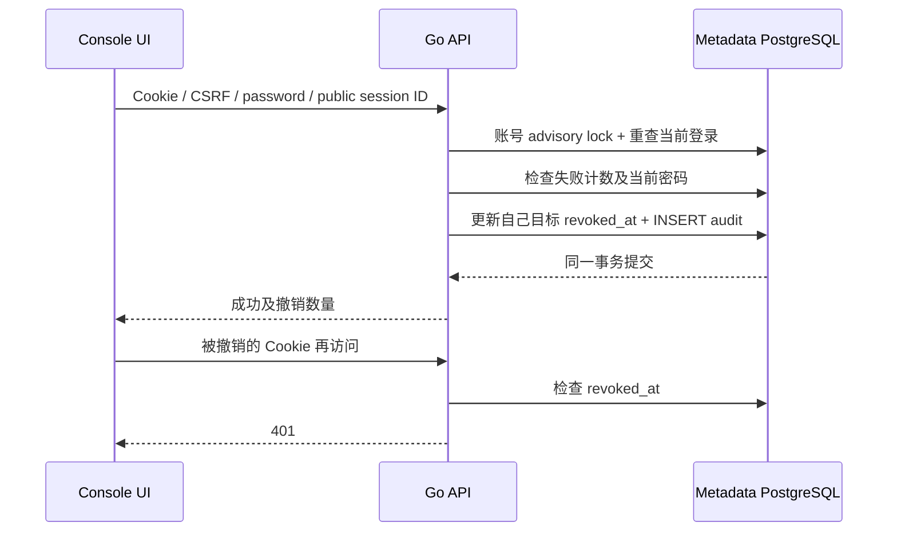

# 控制台账号会话管理

## 范围与账号边界

组织与安全页增加“我的控制台会话”。所有 Console 用户，包括 Viewer，都可以管理自己的浏览器登录；不能查看或撤销另一账号的会话。此功能属于本控制台的账号安全，不冒充官网管理后台内部实现，也不等于应用 Better Auth 的会话或 MFA。

展示最近 50 个有效会话，当前会话优先；含公开 ID、创建/过期时间和 current 标志。超过 50 个时显示 has_more；“撤销其他全部会话”覆盖所有当时有效的其他会话，不只列表中 50 条。未采集 IP/UA/device 名称，不凭这些不可信字段宣称设备身份。

## 数据模型与 API

Forward-only migration 033 为 sessions 增加独立随机 cs_ public ID、revoked_at 与索引。现有 token/CSRF hash、创建和到期时间保留，不重新生成所有登录。撤销同时将 token 的 expires_at 截短到当前时间，旧 API 即使不认识 revoked_at 也不会重新接受该 token；当前新版清理器额外保留已撤销行八小时，审计独立保留。公开 ID 独立于认证 hash，任何响应不返回 token/CSRF/hash/password。

| API | 输入与结果 |
| --- | --- |
| GET /api/v1/account/sessions | 仅 Console cookie；返回 items、limit=50、has_more；Cache-Control: no-store |
| POST /api/v1/account/sessions/{session}/revoke | CSRF + JSON password；仅自己非当前会话；返回 revoked_count、session_id、revoked_at、current_session_retained |
| POST /api/v1/account/sessions/revoke-others | CSRF + JSON password；保留当前登录，撤销其他当时有效会话；返回同一结果结构 |

严格 OpenAPI schema 见 contracts/openapi-v1.json。无 API Key/应用凭据放行；无跨账号 Admin 例外。错密码 401、CSRF 403、别人的 ID 404、当前会话 409（使用现有 logout）、格式 422、账号密码失败限流 429、数据库/审计故障 503。密码字段 writeOnly，浏览器在完成/失败后清除，页面切换不保存。

## 原子性与撤销语义

包括回滚到旧 API 的 expiry 判断也有真实 PG 负例；仅恢复代码不能恢复已撤销的有效期。同一账号的撤销事务串行化；密码每次重新验证。独立的账号密码确认失败计数在 15 分钟内达 10 次后拒绝，失败计数持久化。当前 session 在事务内重查并锁定，不能用请求前已撤销的身份完成操作。

撤销与审计必须同一事务成功，审计写入失败则不提交撤销。重复单个撤销保留原 revoked_at，不重复审计，返回 changed=0；撤销全部的重试作用也是幂等，但数量反映该次实际变化。提交结果未知时返回明确 503，由用户刷新检查，不自动重放。

后续请求从共享 PostgreSQL 检查 revoked_at；不靠进程内缓存。已经完成身份校验并开始执行的 SQL/Operation/stream 不被强制中断；这不是跨实例数据面栅栏或账号永久禁止登录。之后合法密码登录可产生新会话；API Key、Managed Auth session、已有数据库连接不受这种 Console 会话撤销替代。

## 复测与保留

新定向真实 PostgreSQL 检查覆盖当前/过期/其他账号隔离、public ID、CSRF、错密码、单个/全部撤销、后续 401、幂等时间/审计及限流；另验 API Key 身份拒绝。

web/e2e/console-sessions.spec.ts 从 UI 邀请注册独立 Viewer 测试账号，登录三个浏览器上下文；在 UI 查看、错密码拒绝、撤销指定/其他会话，并在各原上下文检查访问结果。管理员原账号保持有效，最终注销测试当前会话。该切片不创建 Compute、不发送 SQL；账号、邀请、审计和私有复测输入保留，不撤销运营方自己的会话。现场版本和实际结果以对应交付报告为准。
