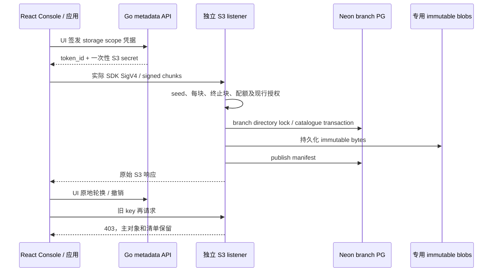

# 2026-10-14：Auth 账号安全与真实 S3 SDK 交付

## 1. 当前结论

这是可复测的自托管预览版本，未宣称官网全部功能或生产准入。
本次完成应用密码/会话安全的实际 UI 十组验收，以及 S3 基础协议的真实 SDK 闭环。
Functions 独立 HTTP/SSE、自动零与一次冷醒已在 0.1.28 通过十组实际 UI，见
[Functions 回执](DELIVERY-2026-10-14-FUNCTIONS-HTTP.md)。新代码只修改本控制面；
Neon/PostgreSQL/autoscaling fork 和已锁定 guest base image 未修改。

| 交付项 | 精确版本 / 证据 | 结论 |
|---|---|---|
| Go API/Worker/Web 与八个镜像 | `be04cb41d4be029cd59bb1c291f02e683d26ce46` | 同源，公开匿名 OCI 校验、三节点 24 次串行 digest 导入 |
| 公开 Linux CI | [38517735954](https://github.com/william-lbn/control-plane/actions/runs/38517735954) | 14 个任务成功；788 Go/真实 PG 检查，0 失败、0 跳过 |
| Auth 实际 UI | runtime `96260ac`、测试修复 `5884a08`、Job `publication-ui-20261014045422` | 十组通过；后续版本未修改 Auth runtime，另有公开真实 PG 安全测试 |
| S3 实际 UI | runtime/SDK `be04cb4`、test-only `875e48b`、Job `publication-ui-20261014060907` | 下列 22 个不同 checkpoint 已通过；原写入保留续测 |
| 统一 Helm | 0.1.29 / 八阶段，10 charts、15 tool tests、30 配置负例 | inspect/preflight/apply/verify 与 PVC、Secret、manifest 审计通过 |
| 模型/API 合同 | migration 029 / OpenAPI 0.21.0，75 paths、111 operations | API.md 自动生成并受 Linux CI 同步检查 |

精确八镜像与源码锁见统一仓库 `locks/control-plane-be04cb4.json`。公开 Git 只保留
已脱敏结论和源/镜像锁；完整 UI 文件、Pod UID、日志、原 Operation、账号/密码
与邮件/对象正文属于维护者受保护证据目录，不能提交 Git。

## 2. 架构、模型与接口

[Auth 安全合同](AUTH-LOCAL-ACCOUNT-SECURITY.md) 定义 Better Auth 1.7.7 的密码更新、
会话列表、指定/其他/全部撤销。应用身份存储于 branch `neon_auth`，与 Console
metadata users 独立。撤销阻止新 JWT 签发；已经签发的 JWT 最多仍有效五分钟。
跨用户 revoke-session 返回无操作 200，须以另一用户实际会话仍有效判定隔离。

[S3 合同](OBJECT-STORAGE-S3-CORE.md) 定义独立 listener、SigV4、chain chunk、
分支清单、blob、scope、一次性 secret、generation/expiry/revoke 和扩展门槛。
`backend_storage_signing` 只存 purpose-separated AES-GCM ciphertext，绑定 credential
ID/generation。AI 限定 metadata 角色对这个新表的 SELECT/UPDATE 均被实际拒绝。
读写仍验证当前 issuer/project/branch 权限与 lineage，不能凭签名绕过租户授权。

## 3. 失败分析与原 fixture 续测

1. Auth 首次 signup 403：测试用 Service URL 与已配置 trusted Origin 不符。
   改用获批的实际 Console Origin，复用原 ACTIVE Auth；未弱化 Origin 校验。
2. 跨用户撤销返回 200：锁定库故意不暴露 token 归属。核对实际代码及会话，
   修正测试的错误 403 假设；真实 PG 与 UI 均证明外来会话未被删除。
3. S3 首次创建桶成功、PUT 失败：实际 MinIO 7.2.0 在普通 HTTP 上传中也用
   STREAMING-AWS4-HMAC-SHA256-PAYLOAD。补齐有界 chain 验签，未接受 unsigned PUT。
   续测先 HEAD 确认原 primary key 不存在，然后只写一次。
4. PUT/HEAD 成功后 List 501：SDK 默认 fetch-owner=true。补齐分支 Owner，
   以实际 PG/SDK 两页 UTF-8 列表验证。第二次续测先 GET 验证原正文，**不再次上传**。
5. 环境重启丢失临时 Ollama relay/Windows server：恢复原二进制、原 key 和原
   Secret UID，仅作上游可达性检查；没有伪称本次重新验收商业供应商或 HA。
6. 新 SDK 检查通过后，测试等待旧按钮名称。主动中断并保存原 checkpoint，修正
   轮换/撤销标签与 30 秒 selector budget；沿用同源码运行时及原两项凭据，
   generation=1 前置校验后继续，只执行尚未通过的轮换/回收步骤。

所有失败 attempt、原桶、原凭据 ID、完整正文/清单和 hostPath 证据保留。
本阶段已归档并按 UID/resourceVersion 正常删除 33 个 terminal 测试 Job；
后续新增 Job 另记退休回执。不得据 Pod 名称删除未知资源。

## 4. 手动部署与验收

### 4.1 部署

在 Linux 使用统一 Helm 0.1.29 的已锁定 checkout，按
[统一部署手册](https://github.com/william-lbn/neon-helm/blob/v0.1.29/docs/DEPLOYMENT.md)
完成外部 Secrets、持久化目录、备份和八阶段部署。切换前排空自有 Compute/Functions，
保留 PVC、WAL、routes、keys 和数据库；不要旋转现有 operator identity。
基础 Operator prerequisites 与新服务的额外输入见各功能合同，不能仅安装 Console
Chart 就获得 Neon/NeonVM/autoscaling 全栈。

实验入口：Console `http://192.168.146.100:30788`；Functions
`http://192.168.146.101:30892`；S3 `http://192.168.146.100:30893`。
Functions 必须不同 hostname/IP，不能靠不同端口隔离 Console cookies。
S3 与 Functions 的 cleartext 均要求显式 labHTTP；正式可信 TLS 另有准入门槛。

### 4.2 Auth 手动闭环

1. 创建/选定隔离项目与 owner-owned database；按页面给出的 SQL，由 database
   owner 显式 grant CREATE/CONNECT 给 control_probe。不要把 schema 权限扩大给 PUBLIC。
2. 在 Auth UI 启用；等待原 Operation succeeded，注册一个应用账号。
3. 另一浏览器建立同用户会话；UI 查看会话，确认页面不展示 session token。
4. 错旧密码更新失败且 peer 会话仍有效；正确更新后旧密码失败、新密码成功，
   peer get-session=null、token=401。遵守实际登录限流，不自动重试未知结果。
5. 撤销指定/其他会话，当前会话按合同保留；另一用户会话不得被删除。
6. 正常退出、停用自有 Auth；在 Compute UI 缩零，保留应用账号和所有记录。

### 4.3 S3 手动闭环

1. Storage UI 选择 owner-owned database、明确 SQL grant、启用；等 Operation succeeded。
2. 应用凭据 UI 选择 S3 读写，再选择只读，各签发一次。立即保存 token_id/secret 到
   0600 文件；轮换后的新 secret 也只显示一次，不写 shell history、URL 或 Git。
3. 用实际 MinIO/AWS SDK，region=us-east-2，forcePathStyle=true。创建私有测试桶，
   上传小于 8 MiB 的中文/空格 key；GET 对比原字节，HEAD、List V2、Range 和预签名下载。
4. 只读 key 的 PUT 必须 403；GET 必须成功。UI metadata 列表不能返回 signing secret。
5. UI 轮换原 writer：ID 保持，旧 secret 403，新 secret 仍读取原正文。
6. 用辅助对象/空桶测试 DELETE，保留 primary object/manifest；UI 撤销后 SDK 403。
7. 停用服务、缩零自有 Compute，保留数据与每个原 request/operation/checkpoint。

Linux 自动复测入口为 `web/e2e/auth-security.spec.ts` 和 `s3-storage.spec.ts`。
使用受保护 fixture/admin password 文件、固定源码/镜像，串行执行；S3 的
`storage-sdk-probe` 必须来自同提交的 CI artifact，先核对 source_commit 与 SHA256。
它是有限实验环境验收 CLI，endpoint/桶前缀限制明确，不是生产客户 SDK。
`continue_write`/`continue_existing` 分别验证未写入/已经写入的原 checkpoint，
不能拿新的空桶掩盖原失败，不能自动重复未知 PUT。

## 5. 本次 S3 实际 checkpoint

- `ui_owner_grant_and_native_branch_storage_s3_endpoint_enabled`
- `ui_unified_storage_writer_issued_once_and_secret_masked_then_cleared`
- `original_owned_active_storage_service_verified_and_reused`
- `original_storage_writer_reused_no_duplicate_credential_issue`
- `original_owned_bucket_reused_primary_key_confirmed_absent_before_single_put`
- `real_sdk_put_unicode_key`
- `real_sdk_head_object`
- `original_primary_object_verified_no_upload_repeated`
- `real_sdk_list_v2_utf8`
- `real_sdk_presigned_download`
- `real_sdk_get_exact_bytes`
- `real_sdk_range_get`
- `real_sdk_read_credential_write_denied`
- `actual_sdk_scoped_reads_and_write_denial`
- `metadata_list_does_not_expose_s3_secrets`
- `original_readonly_credential_and_accepted_sdk_checkpoint_reused`
- `real_sdk_old_or_revoked_key_denied`
- `ui_in_place_rotation_invalidates_old_s3_key_and_preserves_objects`
- `real_sdk_delete_auxiliary_manifest_primary_object_retained`
- `real_sdk_delete_empty_bucket_physical_blobs_retained`
- `ui_revocation_immediately_denies_sdk_requests`
- `owned_keys_revoked_service_disabled_physical_blobs_and_evidence_retained_compute_zero`

## 6. 剩余开发与下一阶段

本地优先：Auth 真实本地邮件验证/密码找回、Email OTP/Magic Link 与管理流程；
S3 delimiter/multipart/COPY/bulk/CORS/metadata/GC；Functions 触发器、完整日志/分支复制；
然后继续资源精细化、外部跨实例栅栏、本地可信 TLS、软件 HA/DR。
[官方 Auth roadmap](https://neon.com/docs/auth/roadmap) 当前仍把 MFA 列为 coming soon；
本项目既定 MFA/SSO/立即 JWT 撤销等扩展也继续独立设计与验收，不能冒称已有能力。
公网域名、商业模型、外部 SMTP/IdP 与真实异地资源仍可后置，不能阻塞本地工程。

完整缺口见 PRODUCTION-GATES.md。当前 S3 无 multipart/COPY/bulk/public anonymous/
delimiter/CORS/trailers/大文件/物理 GC；当前 API、Worker、S3 仍未通过多实例/HA/DR/
全链路可信 TLS。通过当前切片不放行这些门槛。
