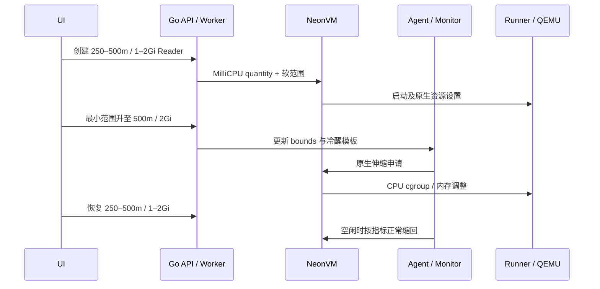

# 小数 CPU：逻辑计算预算与 QEMU 配额

## 范围与已核对前置条件

本功能面向新建 Endpoint，扩展控制面的整核限制，沿用 NeonVM/agent 伸缩协议。现场核验发现旧 runner 的 CPU 更新只改变缓存值；已在精确匹配部署镜像的 autoscaling fork 分支修复，见 [源码核验与修复](RUNNER-CPU-QUOTA-FIX.md)。Neon Rust 源码未修改。实际 Linux/UI 验收见 [交付记录](DELIVERY-2026-10-15-FRACTIONAL-CPU.md)；Go/CRD dry-run 不代表运行时伸缩已通过。

现场只读检查确认 agent 的 computeUnit 是 `0.25 CPU / 1Gi`，三个 agent Pod 使用相同自有公开 digest。API server 对保留的真实 VM 模板分别做整核与 `250m` dry-run，两者均接受，未创建 VM。CRD 表面同时包含 integer 和 int-or-string 不能单凭字段外观判定不支持小数，服务端检查结果单独保留。

源码依据：autoscaling 中 MilliCPU 序列化（neonvm API）、agent goalCU 和资源夹限、runner_cpu_limits、runner/cgroup。runner 的 cpuLimitOvercommitFactor 当前为 **4**。

## 资源模型与合同

API 使用 `min_cpu_milli`、`max_cpu_milli`，单位是毫核。VM quantity 对整核保留原 JSON integer（1、2），小数使用字符串 `250m`/`500m`/`750m`；bounds annotation 同样保留精度。禁止先除以 1000 截断成 0。冷醒 route template 保存相同边界。

保留原有整核兼容配置。新小数预览配置要求最小/最大 CPU 与内存按 `250m / 1Gi` 匹配，并限制在现有实验环境的 3GiB 内存上限：

| 逻辑 CPU | 配比内存 | QEMU cgroup quota/period（4 倍） |
| --- | --- | --- |
| 250m | 1Gi | 100000 / 100000，即 1 核时间预算 |
| 500m | 2Gi | 200000 / 100000，即 2 核时间预算 |
| 750m | 3Gi | 300000 / 100000，即 3 核时间预算 |

范围组合必须有序且两端均符合配比。原整核配置兼容，不据此声称已迁移成相同比例的官网 CU 产品套餐。OpenAPI 0.35.1 的 AutoscalingBounds oneOf 明确可接受组合。

**逻辑 CPU 预算不是严格 Guest CPU 硬隔离**。QEMU 包括虚拟化/I/O 开销，guest vCPU 数量还有向上取整行为；不能只显示 250m 就宣称 PostgreSQL 被硬限为 0.25 核，也不能把 /cpu_current 当作原始内核配额。生产公平性、严格计量与争用隔离仍需独立验收。

创建时 VM 的 min/max 是不可原地越过的硬件范围。已有 min=1 的 VM 不能直接改成 250m；应创建新 Endpoint 并正常切换连接。控制面继续保留 live-max 不得低于当前分配等安全检查。降低软最小值后，应等待 agent/monitor 正常缩回，不强写 use、QMP、cgroup 或关闭安全检查。

## UI 与操作

项目分支 → 创建 Endpoint → 选择 Writer 或 Reader → 计算资源预设 → `0.25–0.5 vCPU / 1–2 GiB`。当前单分支只允许一个 Writer，可以用新的 Reader 隔离验证。Reader 使用该分支已有数据库角色密码和自己的 Proxy selector。

Compute 页支持新毫核选项。扩大/缩小的范围通过持久 Operation、VM annotation 与冷醒模板协调；它不直接篡改 agent 的 use 值。只能配置创建容量之内的范围。

新建小数 Endpoint 的 Worker 必须确认实际 runner Pod 属于该 VM、未设置 skip-cgroup-management，且有可写的对应 host cgroup 挂载，才允许通过就绪检查。部署前在统一 Helm 的 neonvm 子 Chart 明确启用 controller.runnerCgroupEnabled，并使用已修复的 runner digest。该开关默认 false 兼容旧安装；默认值不构成小数 CPU 的运行支持声明。启用前核对节点 cgroup v2 与所用控制器版本；不要手工修改正在运行的 QEMU cgroup。

## 分层验收

新 `fractional-cpu.spec.ts` 从 UI 创建独立 Reader，验证真实只读 SQL、250→500→250 目标、冷醒保留边界和最终缩零。受影响的 Go bounds 检查仅定向复测，没有重跑旧全量。

`tools/observe-fractional-cpu.mjs` 在受信任 Linux 运维端运行，浏览器 Job 不挂载 kubeconfig。它校验固定项目/Endpoint 标签、VM UID、runner ownerReference 和 Pod UID，再读取 VM status、runner /cpu_current 与该 runner 对应 QEMU cgroup 的 cpu.max。输出分别记录逻辑 CPU、实际 quota/period 和 overcommit，不从 UI 数字推断底层已完成。

输入 marker/result 置于受保护目录；observer 只执行 GET、runner 状态读取和明确的 cgroup 只读命令，无 SQL、Kube patch 或 Secret 读取。公共 live-e2e 为该切片单独接入 observer，退出时显式停止。私有本地编排仅负责传入既有授权 fixture，不进入公开仓库。

内存 status 与 QEMU RSS 需区分：逻辑/已热插内存回到 1Gi 不等于已通过所有物理 RAM 回收、压力、缓存与 OOM 场景。因此完整内存缩回门槛不能被一条 UI 数值关闭。
