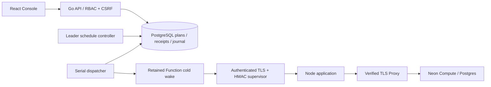
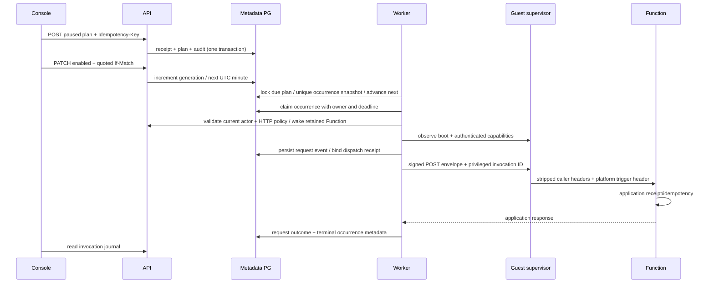

# Functions 定时触发器

## 1. 范围与官方目标

本实现对齐官方 Functions [触发器概览](https://neon.com/docs/compute/functions/triggers/overview)
与 [schedule](https://neon.com/docs/compute/functions/triggers/schedule) 的核心语义：
五字段数字 Cron、UTC、最短一分钟、函数 slug/path、可启停的计划、稳定调用 ID、
POST envelope 和平台设置的 `X-Neon-Trigger-Invocation-Id`。
官方文档另有分支继承语义；本版仅实现分支本地计划，`inherited=false`。
Functions 分支复制/恢复尚未开放，不能把数据模型预留当作继承已实现。

这是自托管 API，不声称与 Neon SaaS API 的路径/计费合同完全相同。
代码进入 0.47.0；实际镜像、迁移、现场结果以对应 delivery 为准。
没有实际通过的部分保持未验收。HA、外部执行栅栏、Exactly-once 和可信公网 TLS
不属于本次完成证明。

## 2. 架构与流程



调度在控制面 Worker，不要求用户 Compute 或函数 VM 常驻。
Worker 保持数据库会话领导租约；每 5 秒在事务内锁定最多 16 个到期计划，
以数据库 `clock_timestamp()` 计算下一个 UTC 分钟；独立调度循环逐个执行。
一个控制器同一时间只有一个活动派发，适合资源受限环境。



## 3. 数据模型

迁移 `039_function_schedule_triggers.sql` 为前向增量；运行升级前备份元数据库。

| 表 | 身份与归属 | 可变状态 / 约束 |
|---|---|---|
| `function_triggers` | `(branch_id,id)` 主键；Function/project/branch/org 外键；`origin_branch_id` 预留继承 | ready/deleted；generation 单调更新；enabled 的 ready 计划才有 next_run_at；分支内有效名称唯一；软删除 |
| `function_trigger_requests` | actor/project/branch/HMAC(key) 主键 | HMAC 请求指纹及原始提交回执；审计同事务；不保存客户请求/响应正文 |
| `function_trigger_invocations` | `fti_` + SHA-256；`(trigger_id,branch_id,scheduled_at)` 唯一 | 不可变路由快照、计划版本、次数、租约、请求日志引用、HTTP/字节/固定诊断码；终态不可重写 |
| `function_request_events` | 原日志模型的实例/部署/boot 归属 | 新 channel=`schedule`；不采集客户正文/环境/凭据 |

Occurrence ID 从协议域、branch、trigger 和计划 UTC 分钟生成；它不是密码。
允许同项目未来分支副本保留原 trigger ID，分支仍参与去重。当前未创建这种副本。
禁止修改已经排队 occurrence 的路由/名称/目标/时间；PATCH 不追改旧队列。
计划与执行历史保留，删除不触发物理 GC。最多 16 个有效计划/分支、128 个/集群；
每 actor/分支一小时最多 100 次新配置变更。精确重放不计新变更。
快照固定 Function ID、slug、路径和计划参数；执行时解析该 Function 当前发布版本，
实际 deployment/instance 归属保存在请求日志。它不把排队时的旧代码版本固定到未来。

## 4. API 合同

前缀：`/api/v1/projects/{project}/branches/{branch}/functions-triggers`。
完整闭合模型和 Swagger 见 [OpenAPI](../contracts/openapi-v1.json) 与 `/api/docs`。

| Method / suffix | 输入 | 回执 |
|---|---|---|
| GET `/` | limit 1..100，after 稳定 ID | items / next_after / limit / scheduling_enabled |
| POST `/` | type=schedule、name、function_slug、schedule.cron；path 默认 `/`，enabled 默认 true | 201 `{trigger}`，ETag |
| GET `/{trigger}` | 当前授权分支 | 200 `{trigger}`，ETag |
| PATCH `/{trigger}` | type=schedule；其余字段按需合并 | 200 新版本 `{trigger}`，ETag |
| DELETE `/{trigger}` | 无 body | 204，ETag；保留排队调用和历史 |
| GET `/{trigger}/invocations` | limit / after 绑定分支+trigger 的游标 | 倒序元数据，包括 deleted 计划历史 |

写入需要 Editor 或 Admin；Session 需要 CSRF Cookie/header；自动化可用授权 API Key。
所有 mutation 都要求 `Idempotency-Key`；PATCH/DELETE 另要求规范的带引号
`If-Match: "3"`。状态 428 缺版本、412 旧版本、409 key 冲突/名称冲突、
422 不合格输入、429 限流、503 能力/存储不可用。精确重放先于旧版本检查，
返回原回执，不把已删除计划重新创建。

示例：

```json
{"type":"schedule","name":"minute rollup","function_slug":"rollup","function_path":"/scheduled","schedule":{"cron":"*/5 * * * *"},"enabled":false}
```

name 为 trim 后非空的单行 1..256 Unicode 字符且最多 1024 UTF-8 字节；
不允许控制字符。path 为应用相对路径，最多 2048 字节，无 query/fragment/反斜杠/
点段。Cron 只接受 ASCII 数字、五字段、范围/列表/步长；星期 0/7 均为周日。
日和星期均受限时按 OR 匹配；任何一个为 wildcard 时按标准 wildcard 规则匹配。
无秒、宏、年份、名称或 timezone 输入。无效/永不发生的日历表达式拒绝。

启用需 operator 开关、已部署的目标和当前授权 HTTP policy。保存禁用配置不会
探测 Guest 或唤醒 VM；已有目标异常时仍应允许暂停原计划。配置创建者和 HTTP
策略所有者均须保有有效权限；派发前重新校验用户未 disabled 与当前项目权限。
删除/禁止后创建的配置不产生新队列；已经排队的快照可能仍执行。

## 5. 调度、故障与可信边界

| 情形 | 行为 |
|---|---|
| 首次到期 | 唯一入队，保存快照，推进下次未来分钟 |
| 控制面停机错过超过两分钟 | 为该到期点写 skipped / schedule_misfire，不逐分钟补发；推进到未来 |
| 明确未派发、目标暂不可用 | 最多三次，每次间隔至少 15 秒；保持同 invocation_id |
| 网络调用已开始、结果丢失/超大响应 | outcome_unknown，不自动重放 |
| dispatching owner 过期 | outcome_unknown / dispatch_lease_expired，不推断“没有执行” |
| HTTP 2xx 且完整有界响应 | succeeded，仅代表传输回执；业务结果由应用验证 |
| 非 2xx | failed / application_response_failed，不盲重试副作用 |
| 目标或授权被撤销 | skipped 或明确失败，不改投其他 Function |
| Guest 过旧或能力/boot 不匹配 | trigger_runtime_upgrade_required，在派发之前拒绝 |

单次派发截止 240 秒，包含最多 180 秒冷醒；租约 300 秒。响应最多 1 MiB，
只存状态和字节，不存正文。执行记录与请求日志不能替代业务事务回执。
客户应用必须以 invocation_id 实现业务幂等；内置例子仅使用已有实验表和事务锁，
生产应用推荐独立、具唯一约束的 receipt/outbox 表。

Guest 新增独立的受认证 `/internal/v1/capabilities`，不改变旧 status JSON；
普通 public/Console 请求不能设置 privileged `trigger_invocation_id`。
平台先剥离全部调用者 X-Neon-*，再由通过私有 TLS/HMAC 的 supervisor 注入 header。
仅知道/伪造 header 的普通客户请求不应被示例函数接受。

## 6. 部署与手工复测

1. 保存元数据备份、Helm values/manifest、Secret UID、原镜像 digest；确认资源预算。
2. 用同一源码构建 Go API/Worker、React Web 和更新后的 supervisor。
   完整 rootfs 构建继续使用 `tools/build-functions-vm.sh`；本地快速迭代也可使用
   `tools/derive-functions-vm.sh`，其明确标为仅 supervisor 的派生镜像。
   该流程要求固定 parent/runner digest、源码快照 hash、Linux BuildKit/debugfs；
   保留新 qcow2/OCI/字节校验与父包记录，绝不修改原始 Guest 磁盘。
3. 所有原 Function VM 正常退休后，以新不可变 Secret 克隆原配置，只替换 vm_image。
   保留原 Secret/密钥/父镜像用于回退；不能只改镜像标签而丢掉配置来源。
4. Helm 设置 functions.enabled/publicHTTP.enabled，及
   `functions.schedules.enabled=true`。默认 false。保持 Functions 与 Console 不同
   hostname/IP；私有 Guest TLS 必须验证，实验 HTTP 不等于可信公网 TLS。
5. 在原授权项目 Functions 页创建/选择 Function，以标准 ZIP 部署
   `examples/functions/schedule/index.mjs`（使用 postgres 例子的锁定 pg 依赖）。
   数据库 owner 预先授权 `app.function_probe(marker)`，勿开放共享 PUBLIC 权限。
6. UI 公开 HTTP、启用自动休眠，等待函数和 Compute 归零。新建暂停计划，
   Cron=`* * * * *`、path=`/scheduled`；确认没有唤醒。
7. 启用计划，等待第一条调用入队后暂停。核对原 invocation_id 的 succeeded/HTTP200，
   用应用 `/receipts?trigger=...` 验证真实 SQL 留痕只一条。
8. 对普通公开 POST 伪造相同 X-Neon header，应为 403 且无新增业务行；核对请求
   日志 channel=schedule 对应原 ID。另开旧页面的 PATCH 应为 412。
9. UI 删除计划；历史仍可读。正常退休自有 Function 和 Compute，保留源 ZIP、
   SQL 记录、Secret、失败记录、Operation 和 UID 退休回执。

自动化入口 `web/e2e/functions-schedules.spec.ts`，使用受保护的原 owner fixture、
admin 文件和 Linux 打包 ZIP；一位 worker、零自动重试。公开 workflow 只手工调度
新 slice；本地复测无需等待 GitHub CI。输出包含实际运行版本与 outcome，
未通过时先保留原 ID/请求并修复，不创建替代资源伪装通过。

## 7. 后续边界

### 冷启动失败与恢复

Guest 仅对同一已锁定代码包的 GET 做最多三次尝试，每次重新生成签名、时间戳和
nonce；单次 30 秒、总共 95 秒，仅重试暂时网络故障及 429/502/503/504。
证书、401/404、重定向、大小、摘要、ZIP 验证失败立即终止。不能把这个 GET 重试
用于客户函数 POST，后者的未知结果仍为 outcome_unknown。

元数据库不可用为 `503 artifact_metadata_unavailable`，已确定的无效身份才是 404。
Guest 日志仅输出固定 stage/reason、HTTP 状态、尝试次数；不输出 URL、响应正文、
签名、凭据或环境。VM Running 后 150 秒 Guest 未就绪，Operation 失败为
`function_guest_bootstrap_unavailable`，禁止自动重建候选或重启部分初始化的 Guest。
150 秒是就绪轮询窗口；在途服务观测、后续 SQL 校验及整个 Operation 另有各自
截止时间，不把这个窗口描述为端到端延迟 SLA。

1. 暂停原计划；保存原 trigger/invocation/Function/Operation/VM/Pod UID 和日志。
2. 在 UI **停止函数实例**，等待原退休 Operation 成功和原 VM/Pod UID 消失。
3. 修复后选择同一个 Function 的 **唤醒保留版本**，不上传替代 ZIP，不创建新定义。
4. 等自动休眠后，启用同一暂停计划，下一分钟产生新的合法 invocation_id。
5. 原终态失败回执保持失败；新一分钟单独核对实际 HTTP/SQL 结果。无请求日志的
   旧失败意味着未派发，不代表其失败原因已确认。

复测入口 `web/e2e/functions-runtime-recovery.spec.ts` 只证明原 UID 正常退休和证据
保留，不能单独作为定时调用验收。其后继续 schedule 套件的原 ID checkpoint。
Endpoint 的逻辑 `state` 可仍为 active；归零必须核对
`runtime.observed_state=suspended`、成功退休 Operation 和 VM/Pod 消失。
Function 自动休眠与 Compute 自动休眠是不同策略；不修改原 fixture 的 Compute
策略来伪造自动缩零结果。没有自动 Compute 策略时，通过 UI 正常手动停止并记录。

本层使 UTC 定时调用可持久配置、观察与复测。Functions 分支继承、对象事件触发、
stdout/stderr、WS、计量/独立 edge、跨实例外部 fence、长期 GC、HA/DR 和全链路
可信 TLS 仍逐项实施，不能因本层通过而自动关闭。
