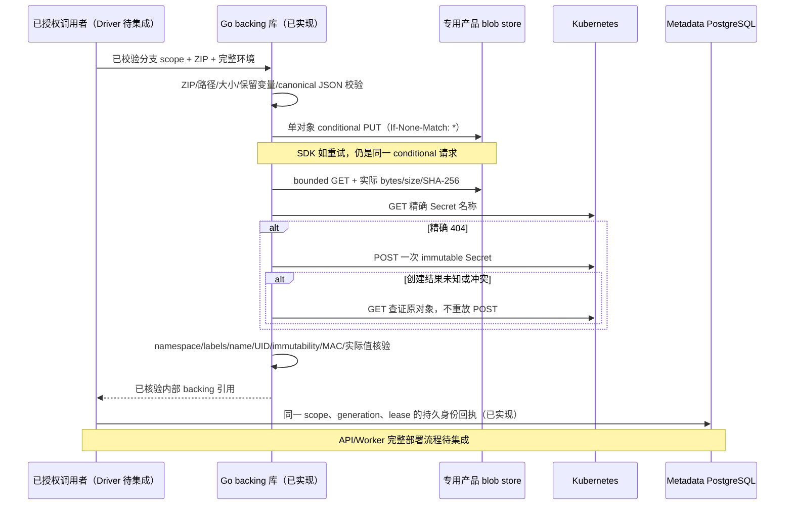

# Functions：不可变代码包和环境存储

## 1. 范围与产品状态

这一层为 Functions Driver 提供实际 Go 存储实现；它不是一个已启用的函数部署服务。
当前公开的 Functions API 和 Console 是只读元数据/历史页面，执行能力仍为 disabled。
候选实例的租约仓库见 [FUNCTIONS-DRIVER.md](FUNCTIONS-DRIVER.md)。不能把代码包上传成功、
Secret 已存在、metadata state=active 或单个 guest 隔离测试解释为产品已经可以执行。

对齐的产品方向是分支上的不可变 Node.js 24 部署、配置变更复用原代码包，以及部署时
注入该分支的服务凭据。官网文档是目标语义，当前源码和具体验收记录是实现依据：
[部署](https://neon.com/docs/compute/functions/deploy)、
[环境变量](https://neon.com/docs/compute/functions/environment-variables)。
本实现没有冒用官网私有后端协议；其内部 backing 合同如下。

## 2. 数据与所有权

| 存储对象 | 身份 | 内容与约束 |
| --- | --- | --- |
| ZIP artifact | `functions/{project}/{branch}/sha256/{digest}.zip` | 原生 project/branch 身份、实际 SHA-256、ZIP 校验、最多 8 MiB |
| environment Secret | `fdp-{16hex}-environment` | 一个 deployment 一份；Opaque、immutable=true；唯一 `environment.json` 数据键 |
| Secret 引用 | namespace/project/branch/deployment/name/实际 UID/内容 MAC | 内部结构；JSON 序列化全部省略，禁止放入公开 deployment 或 Operation |
| 持久身份回执 | `function_deployment_backings`；deployment/function/project/branch 复合 FK | namespace、实际 Secret UID、MAC、密钥版本；整行不可变；没有凭据值 |
| 公开部署摘要 | runtime/digest/bytes/entry/env names | 不包含代码、变量值、对象路径、Secret 名称、UID 或 MAC |

Secret 标签记录 backing-kind、project、branch 和 deployment。HMAC-SHA256 覆盖固定协议
域、namespace、project、branch、deployment 和排序后的完整环境 JSON；使用至少 32 字节
的专用强密钥。内容使用 HMAC，避免低熵变量值可以通过公开普通哈希被猜测。
Secret JSON 必须是 canonical JSON：拒绝重复键、额外 data 键、null、格式/大小越界和
platform reserved 变量。原 UID 一旦进入持久引用，读取时必须匹配；同名新 Secret
不能接管旧部署。

**调用者责任：**这些库函数不验证登录用户，也不替代 Operation lease。先完成组织/分支
授权及父资源准入，再写不可变 backing，最后使用短 metadata 事务提交指向这些已经核验
的对象的 intent。对象 I/O 不放入 PostgreSQL 行锁事务。Migration 020 和
`recordFunctionDeploymentBacking` / `loadFunctionDeploymentBacking` 已实现持久身份回执：
锁定同一个正在 running 的部署 Operation 和当前 Worker lease，核验父资源、目标部署、
generation、artifact 实际摘要/长度/入口/精确路径和 Secret 引用，再记录一次。
重复提交只接受完全相同的 namespace/UID/MAC/密钥版本；进程重启加载原记录。
缺失回执不能通过猜名称回填，历史 migration 和历史 deployment 不改写。
密钥轮换仍须保留历史验证密钥；此仓库保存版本，不提供自动轮换或自动签发 Driver。
该方法只校验持久身份，调用者仍须先通过实际 S3/Kubernetes 核验。

## 3. 创建与恢复流程



所有对象操作有 30 秒 deadline。Artifact 不依赖 ETag 或用户声明的摘要：PUT 成功、
已存在和结果未知都要真实 GET 验证。损坏的已有对象、另一个分支路径、Secret 数据
变化、删除中的 Secret 或 UID 替换都返回固定错误；不自动删除、覆盖、修复或接管。
上传后 metadata admission 失败产生的孤立对象保留，后续 reviewed GC 根据持久引用和
保留期处理；这里没有一个可能误删客户对象的清理捷径。

环境最多 32 个用户键、每值 8 KiB、原始键值总量 32 KiB。canonical JSON 还要满足
128 KiB 限制；最终 bootstrap 加上 SQL/TLS 等字段后，必须再次检查实际序列化长度
不超过 128 KiB。环境本身通过不表示最终 bootstrap 一定可准入。

## 4. 验证层次与可复测命令

默认 Go/race/真实 PostgreSQL 套件在 Linux 上运行。新增 SDK/HTTP 测试验证真实客户端
发出 conditional PUT、丢失 PUT 回复后的读取恢复、实际内容校验，以及 Secret 创建
回复丢失、进程重启重放、替换 UID、跨 namespace/branch、变量篡改、重复 JSON、额外键、
非 immutable 和 authorization read failure。HTTP peer 测试不能代替实际 MinIO/K8s。

真实外部系统测试单独使用 `live` build tag；**输入缺失会失败，不会 skip 后宣称通过**。
默认 CI 不编译 live 文件，不访问生产凭据。

```bash
# 专用产品账户：仅产品 bucket 的 List/Get/Put，禁止使用 Pageserver 或 MinIO root。
# config 文件权限只允许测试进程读取；不要把其内容放入命令行或日志。
export NEON_OBJECT_STORAGE_CONFIG_FILE=/run/product-storage/config.json
export NEON_FUNCTIONS_LIVE_ARTIFACT_TEST=true
cd api
go test -mod=readonly -p=1 -parallel=1 -count=1 -tags=live \
  -run '^TestFunctionArtifactLiveMinIO$' ./internal/control

# 另一个独立测试：预先创建专用短期 SA；仅能 create Secrets 和 GET 本次精确名称。
# 不授权 list/patch/delete Secret，VM、Pod 或业务 metadata。
export NEON_KUBE_NAMESPACE=neon
export NEON_FUNCTIONS_LIVE_ENVIRONMENT_TEST=true
export NEON_FUNCTIONS_LIVE_DEPLOYMENT_ID=fdp_0123456789abcdef # 每次用新的随机身份
go test -mod=readonly -p=1 -parallel=1 -count=1 -tags=live \
  -run '^TestFunctionEnvironmentLiveKubernetes$' ./internal/control
```

第二个测试使用实际 Kubernetes API 创建 immutable Secret，然后在客户端有意丢弃已经
成功的 POST 回复，验证随后的实际 GET 恢复原 UID。只使用随机独立测试 scope 和测试
变量，不把 fake scope 插入业务 metadata。Artifact/Secret 保留并记录实际 digest/UID，
专用测试 SA/Role/RoleBinding 可在归档后按 UID 正常退休。

真实 PostgreSQL 回执测试验证缺失回执拒绝、持久重放/重启、替换 UID/MAC/密钥版本/namespace/
artifact digest/branch 拒绝、直接 SQL 改写被数据库 trigger 拒绝、旧 Worker/过期租约和
父项目删除准入拒绝。这里的测试 UID 是独立 metadata fixture，不冒充集群所有权证明。
实际 Linux 结果见 [本阶段交付](DELIVERY-2026-10-11-FUNCTIONS-BACKING.md)。

## 5. 下一步门槛

仍需：持久回执与部署 API/Worker 的完整集成、私有 CA/bootstrap、实际 VM
所有权证明、分支受限 SQL、真实 guest health、排空/正常退休、原子发布、UI ZIP 上传、
配置更新、调用、回滚、分支复制、自动零与冷醒。后续要补 Function Triggers（cron/对象
事件）、日志、WebSocket 和独立域名。HA、外部栅栏和生产 TLS 都保持独立准入。
本页的内部存储实现不代表这些门槛通过；版本报告必须分别列出测试源码、镜像、外部
系统和具体失败/通过证据。
