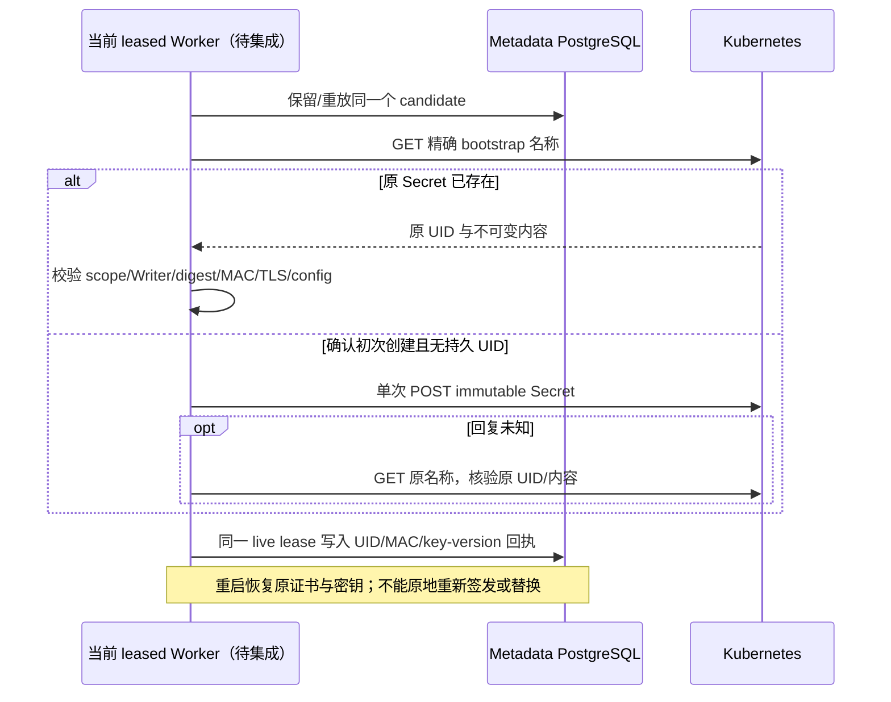

# Functions 实例引导 Secret：不可变身份与恢复

## 1. 范围

本增量实现内部 Go/Kubernetes 与 PostgreSQL 合同，供后续 leased Functions Driver
调用。它不注册部署或调用接口，不创建 VM，不启用 `capabilities.functions`。
Migration 021 只保存引导 Secret 的身份回执；客户环境、私钥、数据库 URL 和密码
不进入元数据表、公共 JSON 或错误信息。

## 2. 合同与数据模型

| 方法 | 输入及结果 | 约束 |
| --- | --- | --- |
| `findFunctionBootstrap` | namespace/name、完整 scope、Function/Writer、bundle digest、MAC key version；返回原 config/UID/MAC 或未创建 | GET 精确名称；只有尚无持久 UID 的 404 表示未创建；权限错误和其他失败关闭准入 |
| `reserveFunctionBootstrap` | 上述引用及已验证 Bootstrap | 先 GET；最多一次 POST；回复丢失/冲突后 GET；已有内容必须完全一致 |
| `readFunctionBootstrap` | 已持久 UID/MAC 的引用 | 实际 UID、不可变属性、所有权标签、内容 MAC 和规范 JSON 均匹配才返回 |
| `recordFunctionBootstrap` | 当前 Operation/Worker lease、candidate target、已验证实际 UID/MAC | 短事务内核验当前代次、backing、scope、Writer、digest；相同回执可重放，不同回执拒绝 |
| `loadFunctionBootstrap` | 当前 lease/target/instance | 仅加载原候选的完整持久回执；缺失时不能猜测或收编同名对象 |

`function_instance_bootstraps` 的主键为 `instance_id`，复合 FK 绑定 function、deployment、
project 和 branch。列包括 namespace、secret name、实际 Kubernetes UID、content MAC、
MAC key version、created_at。整行不可变触发器阻止修改原回执。没有历史回填或伪造 UID。

Secret 必须为 `Opaque`、`immutable=true`、没有 deletionTimestamp，唯一键为
`config.json`，名称为 `fn-{instance hex}-bootstrap`。内容严格解析，最多 128 KiB，
与规范 JSON 字节完全一致。独立 HMAC 域绑定 namespace/name/function/key version 以及
所有引导字段；scope 包含 instance/deployment/project/branch/slug/generation。
SQL username 必须为该 Function 的 `fn_{function hex}`，Writer 和 bundle 必须精确匹配。
TLS、SAN、URL、keys 和环境限制沿用 [guest 合同](FUNCTIONS-GUEST.md)。

## 3. 恢复流程

Worker 必须先查原 Secret，再决定是否生成新 leaf/key，避免 crash 后换身份。
查获内容仍必须满足 Driver 的受信 CA、代理、网络和配置策略。MAC 校验不是权限准入的
替代品，候选仓库也不是实际集群所有权的替代品。Kubernetes/证书/SQL I/O 不发生在
metadata 事务中；事务最多 5 秒，外部引导读/创建整体最多 30 秒。
持久 UID 对象缺失或被替换时拒绝恢复，不删除、patch 或静默重建同名 Secret。

## 4. 验证和下一阶段

默认 Go 测试覆盖 POST 成功后丢回复、重启恢复原 keys/cert、跨 scope/Writer、内容/UID/
MAC/key-version/immutable/deletion/额外键篡改拒绝、弱 key、读取失败和持久对象缺失。
真实 PostgreSQL 测试覆盖回执重放、复合 FK、不可变触发器、旧 lease 和旧代次。
Linux `dataapi-quality-20261011084958` 全量结果为 **553 pass / 0 fail / 0 skip**，
归档 SHA-256 `d7c3c39306291fed2bd29288860981dd9475147f26e32f37d9dc1c175bc93742`。

实际 Linux Job `functions-foundation-20261011085455` 为 **3 pass / 0 fail / 0 skip**：
实际 MinIO 条件创建/原字节保留、实际 environment Secret 和 bootstrap Secret 的
POST 丢回复/原 UID 恢复。bootstrap UID 为 `5166da57-b1a3-4b77-9a32-3bd8e740c12a`，
environment UID 为 `f6bad736-a0ea-44c4-85de-1dee4733eb17`，两个不可变 Secret 保留。
这三个测试没有创建 VM 或执行真实 SQL，也没有操作业务 metadata。

实际 Kubernetes 测试使用 build tag `live` 和显式 opt-in，独立 SA 仅可 create Secret
以及 get 本次两个精确名称，不能 list/patch/delete 或操作 VM。它验证真实 POST 丢回复
后原 UID 和引导内容恢复；与默认测试、实际 SQL 和完整产品验收分别记录。

下一阶段仍须接通：artifact TLS 服务、私有 CA 生命周期、受限 SQL 身份与授权、Worker
调谐、实际 VM/Service UID、guest TLS/status/SQL、原子发布/排空/正常退休、UI ZIP 部署/
调用/回滚、关闭与冷醒。外部 fencing、HA/DR 与全链路可信 TLS 继续独立验收。
