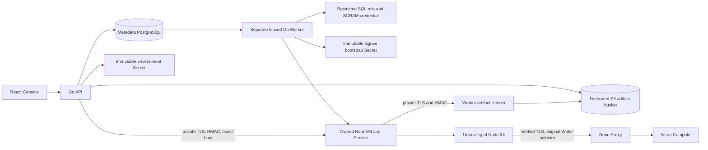
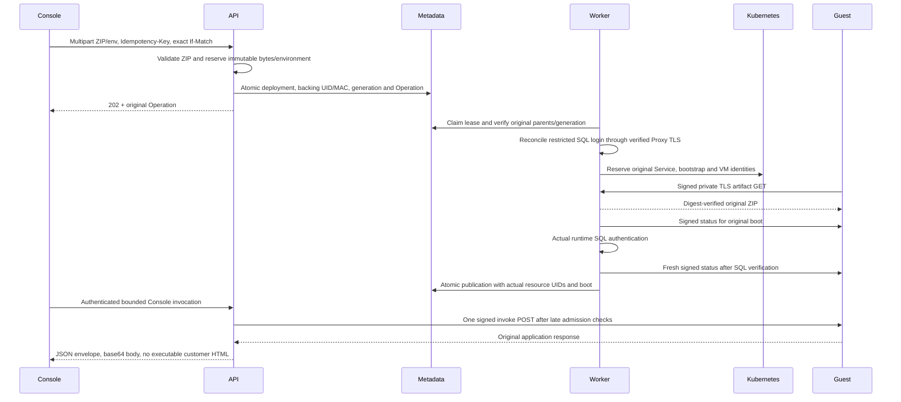

# Native Functions: deployment and acceptance

## 1. Scope and release status

This slice adds a real Go API/Worker deployment Driver and React authoring UI to
the existing isolated Node.js 24 microVM runtime. It is a preview, disabled by
default. Source implementation, disposable metadata tests and live product
acceptance are distinct gates. Do not mark this document as a successful live
acceptance receipt; retain the actual Linux test result and source/image/chart
identities separately.

Neon's current product includes branch-local Functions, Postgres, Auth, Object
Storage and AI Gateway. The official [Functions introduction](https://neon.com/blog/neon-functions-backend-logic-next-to-your-data)
describes functions beside their branch data; the [GA announcement](https://neon.com/blog/neon-backend-is-ga)
also covers shared branching semantics. Our first executable slice implements
immutable code/environment deployments, explicit restricted SQL credentials,
authenticated Console invocation and manual instance retirement. Public raw
HTTP/SSE/WebSocket ingress, automatic idle suspension/wake, triggers, seamless
rolling deployments, branch cloning of function environments, issuer/key rotation
and external execution fencing remain subsequent gates. They are not implied by
a successful Console invocation. Real AI provider inference requires credentials
and is deferred until the operator supplies them.

## 2. Architecture



Customer code never executes inside API, Worker, the Console origin or a normal
privileged Compute Pod. Worker-only issuer private keys are not mounted into API
or Web. Immutable Secret receipts persist actual namespace, UID, MAC and key
version. Credential values never enter metadata, API responses, audit events or
test result files. The preview currently shares namespace Secret RBAC between
API and Worker; stronger per-service credentials and an external execution fence
remain production admission requirements.



## 3. API and data model

The bundled OpenAPI 0.12 contract is authoritative. Existing reads are retained.
All paths below are relative to
`/api/v1/projects/{project}/branches/{branch}/functions`.

| Method/path | Input | Result |
|---|---|---|
| `POST /` | `slug`, `database_name`, `sql_schema`; Idempotency-Key | 202, metadata-only succeeded create Operation |
| `POST /{slug}/deployments` | multipart `zip`, `runtime=nodejs24`, optional JSON-string `environment`; Idempotency-Key + exact numeric If-Match | 202, queued deployment Operation |
| `POST /{slug}/console-invoke` | method, relative path, headers, optional UTF-8 body | 200 JSON with original `status_code`, headers, base64 body and request ID |
| `POST /{slug}/suspend` | explicit `acknowledge_background_work_stop=true`; key/version | 202, retire original instance; source/environment/SQL login retained |
| `DELETE /{slug}` | same explicit acknowledgment/key/version | 202, retire original instance and disable owned SQL login; data/history/backings retained |

Definitions expose `version_token` as the exact bigint string. JavaScript clients
must not round the numeric `version` and send the rounded result as If-Match.
Active deployment updates require an explicit manual stop first. A deployment
with no ZIP reuses only the exact previous completed immutable source. Omitting
environment or submitting `{}` retains that source's environment. A nonempty
value sets/replaces the named variable; an empty value removes that name. UI
submits its displayed environment patch and never retrieves stored values.

Model tables: `function_definitions`, `function_deployments`,
`function_instances`, `function_deployment_backings`,
`function_instance_bootstraps`, `function_sql_credentials`, standard `operations`,
`operation_steps`, `idempotency_keys` and `audit_events`. M23 permits a new
definition to reuse a deleted branch-local slug while retaining the old immutable
identity and distinct SQL role. Global preview capacity is two non-retired guests;
failed/draining instances still consume it. A failed health check cannot release
capacity without proof of actual original VM and Runner absence.

## 4. Operator configuration on Linux

Prerequisites: original managed Neon branch/Writer; product Object Storage with a
dedicated bucket-restricted credential; cached immutable Functions guest image;
NeonVM controllers and scheduler; one separate API and one Worker. The Helm
profile defaults this feature to disabled and rejects combined/multiple-instance
deployment until external fencing is admitted.

Generate new issuer material once using the API image's operator utility. Run it
with a private mounted directory writable by UID 65532, specifying a fresh child
directory. It rejects existing targets and never overwrites keys:

```sh
/opt/neon-control/functions-trust \
  --output-dir /private/functions-trust-v1 \
  --artifact-hostname neon-control-functions-artifact.neon.svc.cluster.local
```

Retain these five files with restricted access: `guest-ca.crt`, `guest-ca.key`,
`artifact-tls.crt`, `artifact-tls.key`, `backing-mac`. Do not regenerate or delete
them during retries. Create two existing Kubernetes Secrets from files:

```sh
kubectl -n neon create secret generic neon-functions-common-v1 \
  --from-file=config.json=/private/functions-config-v1.json \
  --from-file=guest-ca.crt=/private/functions-trust-v1/guest-ca.crt \
  --from-file=backing-mac=/private/functions-trust-v1/backing-mac
kubectl -n neon create secret generic neon-functions-issuer-v1 \
  --from-file=guest-ca.key=/private/functions-trust-v1/guest-ca.key \
  --from-file=artifact-tls.crt=/private/functions-trust-v1/artifact-tls.crt \
  --from-file=artifact-tls.key=/private/functions-trust-v1/artifact-tls.key
```

`config.json` has no inline key material. Replace example private IPs, node,
guest image digest and Proxy certificate DNS identity with verified deployment
inputs; Proxy IP is fixed and must match the desired cluster:

```json
{
  "version": 1,
  "key_version": "functions-v1",
  "mac_key_file": "/run/functions-common/backing-mac",
  "vm_image": "docker.io/OWNER/control-functions-vm@sha256:REPLACE_WITH_VERIFIED_DIGEST",
  "node_name": "k8s-master-02",
  "proxy_address": "192.168.146.100:30432",
  "proxy_hostname": "lab.neon.local",
  "proxy_ca_file": "/run/functions-proxy/ca.crt",
  "dns_address": "REPLACE_WITH_COREDNS_CLUSTER_IP",
  "artifact_origin": "https://neon-control-functions-artifact.neon.svc.cluster.local:8790",
  "artifact_bind": ":8790",
  "guest_ca_file": "/run/functions-common/guest-ca.crt",
  "guest_key_file": "/run/functions-issuer/guest-ca.key",
  "artifact_certificate_file": "/run/functions-issuer/artifact-tls.crt",
  "artifact_key_file": "/run/functions-issuer/artifact-tls.key"
}
```

Helm values under the control-plane chart:

```yaml
functions:
  enabled: true
  existingConfigSecret: neon-functions-common-v1
  existingIssuerSecret: neon-functions-issuer-v1
  proxyCASecret: neon-proxy-tls
  proxyCAKey: tls.crt
worker:
  enabled: true
  replicaCount: 1
api:
  replicaCount: 1
objectStorage:
  enabled: true
  existingSecret: YOUR_EXISTING_PRODUCT_STORAGE_SECRET
```

API receives config/MAC/public CAs; only Worker receives issuer/leaf private keys.
The artifact Service is ClusterIP 8790 and private TLS. Node's database hostname
is pinned to the original Proxy IP in guest `/etc/hosts`. Runtime SQL uses explicit
CA/hostname and the recorded Writer selector, never a customer-supplied DSN.
Current guest leaf certificates last two hours; renewal is not yet implemented.
Retire/redeploy explicitly before expiry. This limit prevents a production or
continuous-availability claim.

## 5. Explicit SQL owner prerequisites and UI test

The Driver cannot silently revoke PUBLIC permissions, elevate a user or rewrite
the provisioning principal's GUC. For a fresh **owned test database**, create the
`app` schema/table and explicitly authorize the trusted `control_probe` principal:

```sql
ALTER ROLE control_probe CREATEROLE;
REVOKE TEMP ON DATABASE fn_native FROM PUBLIC;
REVOKE ALL ON SCHEMA public FROM PUBLIC;
GRANT CONNECT ON DATABASE fn_native TO control_probe WITH GRANT OPTION;
GRANT USAGE ON SCHEMA app TO control_probe WITH GRANT OPTION;
GRANT SELECT,INSERT,UPDATE,DELETE ON ALL TABLES IN SCHEMA app
  TO control_probe WITH GRANT OPTION;
GRANT USAGE,SELECT,UPDATE ON ALL SEQUENCES IN SCHEMA app
  TO control_probe WITH GRANT OPTION;
```

Review schema ownership, security-definer functions, table/column/sequence grants,
PUBLIC defaults and RLS before applying equivalent grants to existing databases.
The Function role is `fn_<immutable-definition-id>`, NOSUPERUSER, NOBYPASSRLS,
non-owning and non-CREATE/TEMP. It gets DML on eligible existing ordinary tables
and sequence access, with bounded statement/idle transactions. Roles are shared
across databases on the PostgreSQL instance: the current-database checks alone
do **not** prove exclusive single-database access through PUBLIC CONNECT defaults.

Build the example **on Linux**, install pinned production dependencies without
npm scripts, then generate an artifact outside the source tree:

```sh
cd examples/functions/postgres
npm ci --ignore-scripts --omit=dev
cd ../../..
node tools/package-function-example.mjs examples/functions/postgres /private/example.zip
```

Console: create definition (`hello`, `fn_native`, `app`), upload the ZIP, set
`{"APP_MESSAGE":"first-version"}`, deploy and follow the original Operation.
Invoke `/` to read SQL identity/count; `POST /write` with `{"marker":"test-1"}`
to write once; `/deny` verifies another schema is denied; `/html` demonstrates
the non-executable JSON envelope; `/error` preserves application HTTP 500. Stop,
clear ZIP selection, change environment and redeploy; verify previous data and
SQL role remain. Delete and verify original guest retirement/NOLOGIN. Finally
suspend the owned test Compute to preserve capacity. Retain fixtures and evidence.

Linux Playwright suite: `web/e2e/functions-native.spec.ts`, with protected
`NEON_E2E_ADMIN_PASSWORD_FILE`, `NEON_E2E_PRIVATE_DIR` and
`NEON_E2E_FUNCTION_ZIP`. Run it serially against the actual Helm deployment.
Do not substitute the older read-only Functions metadata suite for execution
acceptance. Do not automatically replay a failed/unknown invocation: it may
already have committed application writes.

## 6. Recovery and next gates

Replay the original idempotency key/body, operation and immutable receipts.
Unknown Kubernetes create responses are resolved with GET of the original full
spec. A recorded UID never authorizes a same-name replacement. Manual stop may
recover an initial unrecorded UID only after complete reserved spec/bootstrap
identity verification and a leased metadata commit. It uses normal UID/RV deletion,
then verifies original VM and Runner absence before releasing capacity. No force
deletion or backing/data GC is performed. Repeated failed proof remains failed.

Next ordered slices: isolated public Functions ingress and SDK; guarded explicit
wake and idle semantics; function/log/invocation metrics; immutable deployment
clone/PITR coordination; triggers; provider-backed AI integration after credentials;
external fencing and HA/DR; issuer rotation and fully trusted end-to-end transport.
Each needs independent implementation and focused actual acceptance before its
capability is enabled. Infrastructure resource constraints can limit concurrent
load/HA testing, but do not justify skipping serial functional acceptance.
