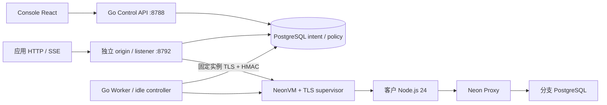
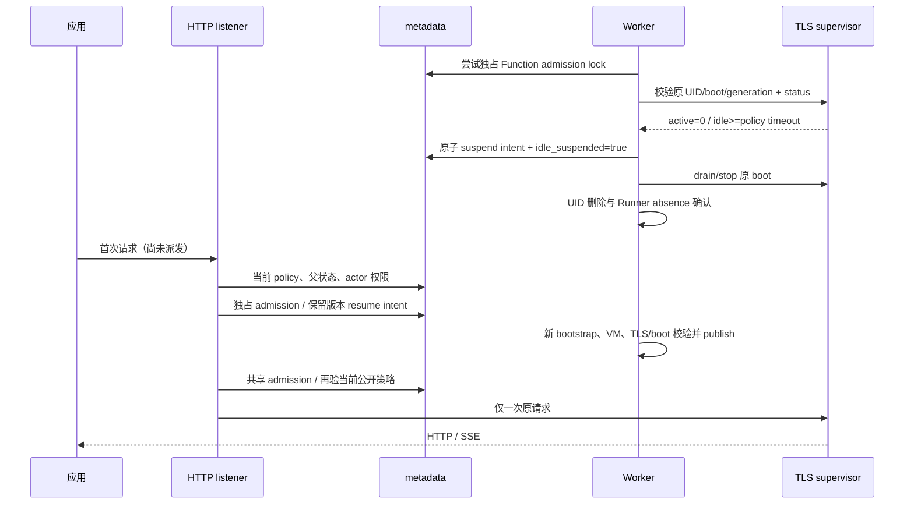

# Functions 公共 HTTP/SSE 与自动休眠

## 1. 目标与边界

官方以分支隔离的 Node.js 24、HTTP/SSE/WS、空闲回收及首次请求启动为目标，
参见 [Functions overview](https://neon.com/docs/compute/functions/overview) 和
[runtime limits](https://neon.com/docs/compute/functions/reference/runtime-limits)。
本文对应本地 Go/React 的 HTTP/SSE 增量。已有定义默认私有；公网域名配置后置。
验收状态以精确源码、镜像、Helm 和浏览器交付报告为准，不能以本文当作生产证书。

本增量**不提供 WebSocket、Cookie、Cron/对象事件触发、透明部署切换、无限流式时长、
完整函数日志/计费、分支复制/PITR 联动、多实例 HA 或外部 epoch 栅栏**。
API 与公开 Functions listener 是同一个 Go 进程的独立端口；没有独立最小权限
Functions edge 进程。生产部署隔离、全链路 TLS 和负载/故障准入仍须单独交付。

## 2. 架构



Console 原路径只返回 JSON envelope。公开服务没有 `/api/*`、Console 静态资源或
Console 会话鉴权。`Host` 必须与运营方配置 origin 完全匹配。实验室使用与 Console
不同节点的 IP（Console .100，Functions .101）；端口本身不能隔离 Cookie，不能
以移除 HTTP headers 代替 HTML/JavaScript 的主机隔离。Helm 拒绝相同 hostname/IP。
公开入口额外移除请求 Cookie 和响应 Set-Cookie/Clear-Site-Data。
应用可自行验证 Bearer/JWT；公开开关意味着匿名流量
能够进入函数，必须明确确认。函数返回 HTML 仅在 Functions origin 执行。

## 3. 数据与 API

迁移 028 增加 `function_http_policies`：function_id、public_enabled、idle_enabled、
idle_suspended、actor_id、updated_at。超时继续使用 definition.idle_timeout_seconds。
`function_policy_requests` 保存 actor/key hash、请求指纹和元数据回复，不保存请求 body。
所有变更和审计、幂等回复同一事务。版本使用字符串 token，避免 JavaScript 大整数截断。

`PATCH /api/v1/projects/{project}/branches/{branch}/functions/{slug}/http-policy`
需要当前 Editor 权限、CSRF（Console 会话）、Idempotency-Key、数字 If-Match。

```json
{
  "public_enabled": true,
  "idle_enabled": true,
  "idle_timeout_seconds": 60,
  "acknowledge_public_access_and_background_eviction": true
}
```

200 返回 function_id、version_token 和策略；相同 key/input 重放同一回复；409 key
输入冲突；412 版本过期；428 缺少版本；422 非法策略；503 未配置入口或元数据不可用。
只能在 active/suspended 状态编辑；现有部署/操作必须先收敛。

公开地址 `{origin}/functions/v1/{branch}/{slug}`，支持子路径/query、GET/HEAD/POST/
PUT/PATCH/DELETE/OPTIONS、真实状态/正文/Location、SSE flush。请求正文上限 1 MiB，
headers 16 KiB；每个调用最多 15 分钟。本版本没有 request streaming 或 WS upgrade。
Header 中代理与平台身份不传入 Node；不自动跟随应用重定向。
公开入口合同见 `contracts/functions-http-v1.json`；Control Swagger 仍使用
`contracts/openapi-v1.json`，包含完整 policy mutation 和返回类型。

策略 owner 必须未禁用且持续拥有当前项目 Editor 权限，项目/组织/分支必须 ready/active。
每次请求重新检查；跨分支路径匹配原 scope。响应不泄漏 manager 地址、密钥或 SQL URL。
503 可发生在 dispatch 前；502 outcome_unknown 表示执行结果未知，**不能自动重放写入**。

## 4. 休眠、冷醒与失败恢复



公开和 Console 调用都持有同一 PostgreSQL **会话级共享 advisory lock**，直到正文/
stream 结束；Idle controller 每 5 秒尝试独占锁，锁不到就跳过。专用连接不可在锁定
状态返还 pool；unlock 失败关闭物理连接。controller 仍在既有 Worker leadership 下运行。
每个进程按 metadata pool 大小限制持锁数量，并保留查询连接余量；池满或独占回收
期间拒绝新 admission，返回 dispatch 前的 503，避免所有连接持锁后互相等待查询。
原 supervisor 的 active count/last activity 是回收依据，不信任客户 Node 的后台计数。
运营方明确开启策略时承认后台任务可能因 idle eviction 结束；不虚称支持持久任务队列。
客户 Node 不就绪时仍按认证 supervisor 的原身份/调用计数/有效活动时间判断，观察
失败则不停止。候选按 ID 分批遍历，避免首批繁忙函数饿死后续检查；具体准入和
新增复测见[异常客户进程的空闲回收](FUNCTION-UNHEALTHY-IDLE.md)。

手动 suspend 原子清除 idle_suspended，公开请求不会把主动停止的函数重新拉起。
自动 suspend 同一事务设置 marker，避免 crash 后留下不可识别的自动休眠状态。
冷启动等待最多 180 秒，等待期间不会执行客户请求；只收敛一个原版本的 durable resume
Operation。quota/原 Operation 失败不派发请求、不自动重放失败调用。保留代码、env 和
受限 SQL 身份，不恢复旧进程内存。数据库 compute 的休眠独立由 Proxy/adapter 管理。

该锁只约束合作的 API/Worker。数据库连接丢失、分区中的旧客户端、guest 外部 epoch、
跨进程关闭竞争及 HA 故障认证仍是独立门槛，不等同于已通过 compute 缩零生产栅栏。

## 5. Helm 与复测

`functions.publicHTTP.enabled=true` 必须同时启用 Functions，且 origin 与 Console/Auth
不同 hostname/IP。默认 ClusterIP；本地可以 NodePort 30892 + 显式 labHTTP。不要将 Functions raw
响应代理到 Console nginx。公网应有独立 hostname/TLS edge；`https` origin 不会让
Go listener 自动生成证书，TLS 必须由显式可信 ingress termination 提供。

```yaml
functions:
  publicHTTP:
    enabled: true
    origin: http://192.168.146.101:30892
    labHTTP: true
    serviceType: NodePort
    nodePort: 30892
```

Linux 真实 UI 套件 `web/e2e/functions-http.spec.ts` 创建自有 edge Function，部署已锁
pg SDK + `examples/functions/http/index.mjs`；从 UI 开启入口、验证 replay/隔离/真实 SQL
单次写入、40 秒 SSE 阻止 30 秒 idle、自动 suspend、首次 HTTP 冷醒保留 SQL 数据与
新实例、手动停止拒绝自动醒、正常删除自有 VM 并缩 SQL compute 为 0。数据和所有
失败/成功记录保留。流程采用 1 worker / 0 自动重试，不与 Linux 构建或压力测试并发。

打包与运行命令见受保护的 `.github/workflows/live-e2e.yml`；准备已有 owner fixture，
只提供 project/branch/writer IDs 和受保护的密码文件路径，不把凭据写入报告或仓库。
Go 的 `TestFunctionHTTPPolicyAndDistributedAdmission` 使用独立 control_ci schema 验证
跨连接共享/独占互斥；不使用现场元数据或客户数据库。
