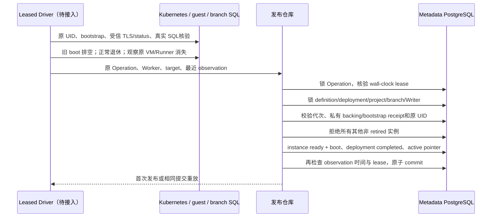

# Functions：资源恢复与原子发布

## 1. 范围与产品状态

本增量提供 Go Driver 内部代码：`functions_resources.go` 与 `functions_publish.go`。
前者创建或恢复独立 Service/NeonVM，后者在 PostgreSQL 原子发布已经完成外部核验的候选。
它们尚未接入 Worker action、公共部署/调用 API 或执行 UI；Functions capability 保持 false。
OpenAPI 不新增未注册的部署接口。实际测试结果以对应交付报告为准。

设计面向官方 [Functions](https://neon.com/docs/compute/functions/overview) 和
[运行约束](https://neon.com/docs/compute/functions/reference/runtime-limits)：Node.js 24、
分支绑定、独立 microVM、2048 MiB nominal memory。本版本限制一个当前实例、一个替换候选，
且全平台预览 VM 上限为 2；没有官网多 isolate、100 并发、WebSocket 和 trigger 的准入证明。

## 2. 资源合同

`functionRuntimePlan` 仅供可信 leased Driver 构造，不能由客户 multipart/JSON 指定。

| 输入 | 约束 |
| --- | --- |
| Target | 原 Function/Project/Branch/Deployment/generation/slug；来自已锁定的 intent |
| Instance | 已持久保留的 fni 身份、VM/Service/bootstrap 名称及已有 UID；仅 provisioning/starting |
| Bootstrap | Migration 021 的原 namespace/UID/MAC/key version；原完整 Scope、Writer、bundle digest |
| Image | 平台配置中的固定 sha256 digest；不可接受客户 image/command/runner override |
| NodeName | 可选平台 placement；不是客户可填写的调度字段 |

`reserveFunctionRuntimeResource(ctx, key, plan, kind)` 中 kind 仅 service/vm。
返回原资源 UID；Service 额外返回实际分配的 private IPv4 ClusterIP。返回值不表示 ready。
运行规格固定 1 CPU、2 × 1 GiB memory slots、2 GiB root disk、默认镜像 entry、
SSH disabled、额外网络 disabled、独立 9090 manager、只读 bootstrap Secret disk。
它没有客户 env、shell/init/runner override、额外磁盘或公开管理 NodePort。

每次请求先重读原 bootstrap 并校验不可变性、MAC、UID、完整 Scope 和有效证书，
再 GET 原运行资源。只在确证 404 且没有持久 UID 时发送一次 POST。回复未知或 409
只 GET 原名字；完整 execution spec/标签/UID 不匹配则拒绝。已有 UID 对应资源丢失
不能成为同名重建许可。此方法不 PATCH/DELETE、不改变部署、不给出 SQL/健康结论。

Service 仅允许 ClusterIP/单 IPv4；精确 selector/manager port 不可变。比较时只移除
API 分配的地址及明确安全的默认字段；NodePort、externalIPs、附加 selector/port 被拒绝。
VM 完整规格比较，未知字段拒绝；正常 schema 演进应先更新合同和真实 CRD 验证，
不能仅凭标签或注释声称正确。CRD 的 admission dry-run 不生成运行 VM或持久 UID 回执。

Secret name 引用无法在 Kubernetes 卷中原子绑定 UID；本代码在创建前查证 UID，
不宣称解决查证后的同名 Secret 替换或迟到 Worker 写入。这仍需要外部 admission/fencing。

## 3. 发布合同与一致性

`publishFunctionInstance(ctx, operation, worker, target, observation)` 返回 `replayed, error`。
observation 是私有字段，不接受公共请求。调用者必须先核验实际 VM/Service/bootstrap
所有权、受信 guest TLS/signed status、真实受限分支 SQL以及旧实例的实际退休。
把格式正确的 UUID 或 JSON 填入结构体不构成这些证明。

事务最多 5 秒，不包含 Kubernetes/HTTP/S3/guest SQL I/O。观察时间必须在数据库
wall clock 最近 30 秒内，允许最多 2 秒未来偏差，提交前再次检查。Node 必须 ready、
root manager 非 draining、runtime/scope/generation/boot 完整匹配；不信任客户后台计数。
旧 ready/draining/failed/provisioning/starting 实例均阻止发布，不由健康错误隐式释放预算。
仅在真正退休后，调用方才可持久记录 retired；本发布方法不提供退休捷径。

首次提交同时更新 instance/deployment/definition。保留已受理的 version/generation，
不再创造新 intent。提交回复丢失或 Worker 重启只能在原 Operation 仍 running 且租约
有效、部署仍是当前 active、无新 target、原 UID/boot 仍相同时重放；终态 Operation、
新代次、不同 boot、被删除的父资源均拒绝。重放是历史 commit 确认，不是新健康观察，
因此不把原观察重新包装为 fresh。重新开始 guest boot 必须有新的实例流程。

当前保守替换流程可能短暂中断服务；未实现 invocation ledger/跨 ingress 栅栏，
因此不能宣称无中断部署、HA 或外部原子路由切换。

## 4. 验证边界与下一步

专用 control_ci PostgreSQL 测试覆盖原子状态、丢回复后的原 boot 重放、多连接并发重放、
外来 scope/UID、过期观察、旧 Worker/代次、旧非退休实例以及真实行锁等待期间租约过期
后的回滚。测试中的 UUID/guest status 是 metadata fixture；不计为 K8s/VM/SQL 验收。

HTTP 客户端测试覆盖原 POST 成功但回复损坏、GET恢复、重启、已持久资源丢失、
503 不授权创建、异地 scope/UID和执行规格注入。独立 `live` 测试使用真实 API server
创建 Service/immutable bootstrap、丢 Service POST 回复后恢复原 UID，验证实际 CRD
dry-run 默认化；该测试不创建 VM、不执行 SQL、不插入业务 Functions metadata。

后续接入顺序：持久受限 SQL身份/分支 manifest → Worker 私有 CA/平台配置 → artifact
TLS 服务 → 真实 VM启动/SQL验证 → leased action和失败退休 → invocation/admission
ledger →公共 API与 ZIP/config-only/调用/回滚 UI → 分支复制与零/冷醒 → WS/trigger/日志。
全部证明完成前 Functions 执行入口保持关闭。独立全链路 TLS、HA/DR 和外部 fencing
仍需单独实现、故障注入和验收。

## 5. 本增量实际验证

最终 Linux Job `dataapi-quality-20261011124348`：**593 pass / 0 fail / 0 skip**，
包含实际专用 PostgreSQL、race、vet、格式、构建和 opt-in live-tag 编译。源归档
SHA-256 `2e92b5036188bb65e48eba7364d03f123a1251074c23796dac006af5e6c494e4`；
Pod UID `4eb02dc1-742a-48e9-8550-a1db1b0916ed`。没有访问 live metadata。

同一归档的实际 Kubernetes/MinIO Job `functions-foundation-20261011124840`：
**3 pass / 0 fail / 0 skip**。实际验证 content-addressed artifact 保留、immutable
environment Secret、bootstrap/ClusterIP Service、Service POST 已受理却丢回复后
GET 原 UID、重启与外来 UID 拒绝，以及 own-fork CRD 的完整 dry-run 准入。
实际 Service UID `3e97babd-e726-429e-86a3-cdda717b2f8a`，bootstrap UID
`9b58b3e4-1e07-4b6a-bcb1-68b7dda18f33`，environment UID
`66ebbfed-9c76-46c4-8dd6-807c35cd4102`；对象/Secrets/Service 留作复测。
**没有持久 VM、guest 启动、真实函数 SQL、公开部署/调用或执行 UI 的证明。**

首个真实 runtime backing Job `functions-foundation-20261011113859` 保持失败。
实际 API server dry-run 差异只有 `spec.podResources` 从未给出变为 `{}`；own-fork
typed admission webhook 序列化该空结构体。代码改为显式空 map并注释来源，没有
放宽完整 spec比较，不接受客户 CPU/RAM/runner/资源注入，没有修改 autoscaling fork。
修正后以上最终全量和同归档真实 dry-run 通过。另一个首轮 Go gate 的 fixture
map[string]string 与实际 HTTP decoded map[string]any 不一致也留有失败回执；纠正
测试输入的 JSON round-trip，未降低安全验证。

恢复 TypeScript 的 Linux格式/类型/构建、17 Web 测试、3 Chart/8 RBAC 检查通过；
准确的运行 UI 和恢复边界见 [本版回归](DELIVERY-2026-10-11-FUNCTIONS-BACKING.md#33-当前运行发行与逐套回归)。
新的内部 Go代码与已部署 baseline 区分；公开发布及镜像切换按实际 CI/版本锁另记。

官网 website 原始文档于 2026-10-11 再读，overview/limits/deploy 的 updatedOn
仍为 2026-10-02、2026-09-16、2026-10-09。官方长期流、不同 timeout 预算、多 isolate
与触发器目标保持在实现计划中，当前固定单实例基础层不宣称已经匹配。
