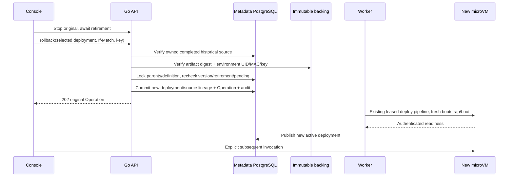

# Functions 历史部署恢复

> 历史增量合同：公开 HTTP/SSE、自动休眠/冷醒已在后续 0.1.28 独立验收；本文旧增量的排除范围不代表最新运行状态。最新范围以 [PRODUCTION-GATES](PRODUCTION-GATES.md) 与对应版本交付为准。

## 1. 产品与安全边界

显式恢复属于分支 Function 的部署生命周期。它复制所选已完成部署的不可变代码和
环境配置，创建新的部署/generation/boot，不复用旧 VM、进程内存或旧引导凭据。
用户须先正常停止原实例，所有候选已退休，定义处于 suspended。此功能不回滚
PostgreSQL 数据，不自动重放请求，不恢复数据库备份，不提供无中断热切换。

## 2. API 与数据模型

`POST /api/v1/projects/{project}/branches/{branch}/functions/{slug}/rollback`

Editor/Admin + CSRF；必需 `Idempotency-Key` 和当前字符串版本的数值 `If-Match`。
唯一请求字段：`{"deployment_id":"fdp_<16hex>"}`。不接受 ZIP、runtime 或环境覆盖。
202 返回原持久 Operation；Worker 仍使用现有 `deploy_function` 六步调谐。
同键/源/版本重放返回同一 Operation，即使已完成；改变源、跨 route 复用键为 409；
新键旧版本为 412；缺版本为 428；格式/额外字段为 422；无归属已完成源为 404。
活动实例或无成功保留源不能恢复，必须先完成停止。

Forward-only migration 025 为 `function_deployments` 增加可空
`source_deployment_id`。复合 FK 绑定相同 Function/project/branch，禁止自引用；
新增 trigger 要求来源已完成，并禁止修改该 lineage。普通部署/显式唤醒保持 NULL。
部署历史 API/UI 展示来源 ID，不展示 Secret 内容。恢复生成新环境 Secret UID/MAC，
原源的 Secret UID/MAC、key version、变量名称清单和 blob digest 均在受理前验证。
不存在以错误环境或丢失代码静默替代的路径；保留源不等于永久保证 backing 存在。

## 3. UI 和验收

历史中已完成版本提供 **恢复此版本**，原实例未停止时禁用。来源被明确显示。
点击仅提交所选 ID；未提交的 ZIP/环境表单不影响恢复。API 是权限最终边界。
Linux isolated PostgreSQL 检查选源归属、完整变量清单、未完成源拒绝、持久 lineage
与不可变性；API 检查认证、Viewer/跨组织拒绝、严格 body 和版本前置条件。

`functions-rollback.spec.ts` 从实际 UI 创建一个受控函数，部署原 SQL 示例并实际写入
一次；停止后部署不同 digest 的 replacement 示例；再停止，从历史恢复原代码/环境，
验证新 boot、保留 SQL 身份和已写数据、来源记录、键重放/冲突/旧版本、正常回收。
`1d4854e` / Helm 0.1.25 已在原 fixture 续测通过九组实际 Linux UI 检查；
SDK/测试来源 `b4d6e27`，控制 API/Console/guest base image 未改变。
见 [精确回执与保留失败](https://github.com/william-lbn/neon-helm/blob/v0.1.25/docs/ACCEPTANCE-2026-10-13-FUNCTIONS-ROLLBACK.md)。
保留原数据、密码、失败和 Operation，不盲目重放写入。

## 4. 部署、演进与剩余门槛

迁移 025 前排空 Functions 操作并保留 metadata/backing/Secret 备份。先完成 API/Worker
升级再开放该新动作；旧 Worker 仍使用 deploy_function，但混合版本和回滚降级未准入。
迁移 forward-only，不删 lineage/历史来降级。无 backing GC、证书/key 轮换、新服务
权限或 fork 修改。按容量串行执行，每次最多一个该测试 guest，最后正常缩零。

自动闲置休眠/冷醒、公开 HTTP/SSE/WS、无中断流量切换、分支克隆、触发器、日志/计量、
分布式栅栏、HA/DR 和全链路可信 TLS 仍是独立功能与生产门槛。
