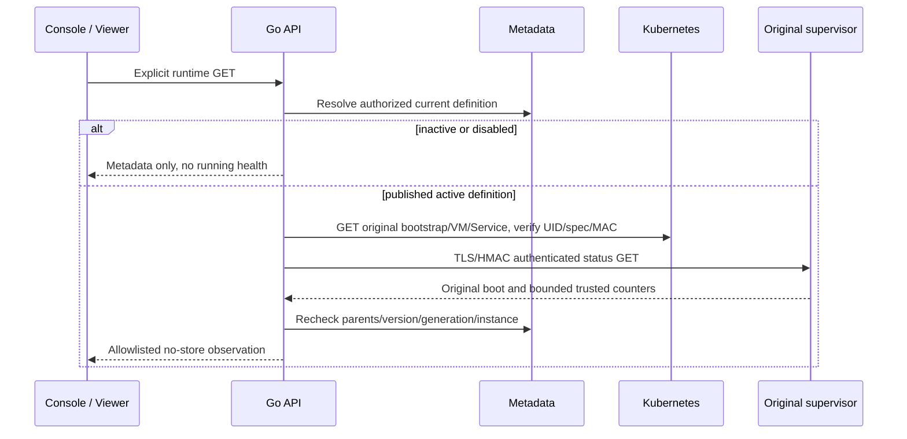

# Functions runtime observation

## 1. Scope

The previous native Functions deployment/invocation slice passed actual Linux
UI acceptance on Helm 0.1.19, runtime `bf0dd9e`. See the
[exact receipt](https://github.com/william-lbn/neon-helm/blob/v0.1.19/docs/ACCEPTANCE-2026-10-12-FUNCTIONS.md).
This next slice adds explicit runtime monitoring and Viewer-safe read access;
its live acceptance is independent and must not be inferred from that baseline.

## 2. Read protocol and model

`GET /api/v1/projects/{project}/branches/{branch}/functions/{slug}/runtime`
is authenticated, project/branch scoped and returns `Cache-Control: no-store`.
OpenAPI 0.13 defines `FunctionRuntimeObservation` and this exact route.

| Field | Meaning |
|---|---|
| `function_id`, `definition_state` | Authorized durable identity/intent |
| `definition_version_token`, `generation_token` | Decimal strings, preserving bigint precision |
| `observed`, `observation_source` | Actual authenticated supervisor or explicit metadata-only state |
| `checked_at` | API observation/check timestamp, not SQL readiness |
| `instance_id`, `deployment_id`, `vm_phase` | Returned only after original identity/specification verification |
| `node_ready`, `draining`, `active_invocations`, `last_activity` | Privileged supervisor observations; not arbitrary customer JSON |
| `background_counters_trusted=false` | Background work is unmetered; observation cannot authorize automatic retirement |

Inactive/disabled definitions return `observed=false`, `metadata_only` and no
invented Node health/counts. This path reads metadata only. Active observations
load the published candidate, require original VM/Service/bootstrap UIDs and
complete immutable execution spec, read the MAC-verified bootstrap, verify
manager TLS/HMAC and boot, then recheck current parents, generation, version and
instance before returning. Failure/changed intent returns a typed 409/503,
never a fabricated healthy state. No customer NodeObservation, environment,
credentials, SQL URL, private IP or underlying transport error is returned.

Observation does not connect SQL, invoke customer code, cold-wake a Compute,
mutate Kubernetes, update invocation timestamps or imply historical metrics,
billing, CPU/RAM metering or automatic suspension. Console invocation reuses the
same identity/freshness checks, validates input before dispatch and still sends
one customer POST without automatic replay.

## 3. Console and focused Linux acceptance

The runtime card is explicitly refreshed, never probed on mount. Changing
function/version clears old health and aborts obsolete requests. Observation
failure clears the previous healthy state. Project Viewers may inspect runtime;
authoring/invocation controls require Editor/Admin, with independent server-side
authorization retained.

`web/e2e/functions-observation.spec.ts` reuses an explicit protected owner fixture
(`project_id`, `branch_id`, `writer_id`, `database_password_file`) outside public
source. It requires one retained row from the prior native test and never clears
data or reissues grants. It creates one new owned monitoring function, observes
unpublished metadata without health, deploys the pinned example, verifies the
actual authenticated supervisor/UI, confirms reads do not count as invocation
activity, invokes one real read, observes changed activity, stops and verifies
old health clears, then confirms paused observation does not wake SQL. Finally
it deletes that owned function and leaves the Writer at zero. Failures remain
separate checkpoints; no automatic test retry is enabled.

The trusted Linux workflow exposes both native and observation suites. Configure
the protected runner's `NEON_E2E_FUNCTIONS_MONITOR_FIXTURE` variable as a Linux
file path; never put its password in a workflow input or public Git. The example
is packaged outside the checkout with pinned dependencies and npm scripts
disabled. Private Windows SSH transport is not part of the product repository.
