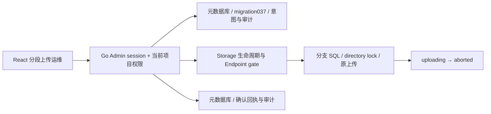
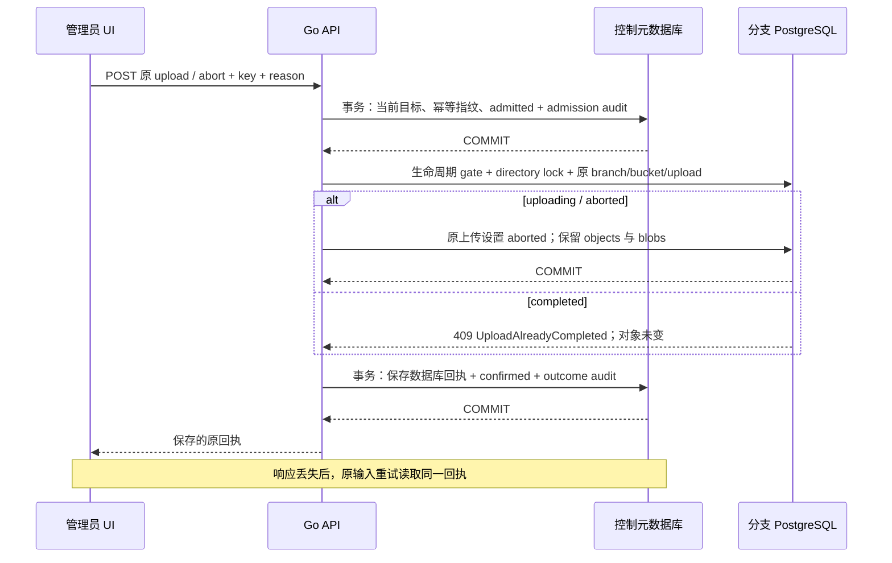

# 分段上传运维、审计恢复与目录分页

## 1. 产品范围

API 0.43.0 / metadata migration 037 / Chart 0.9.33 的实现合同；现场通过状态仍以
[当前交付](DELIVERY-2026-10-16-CURRENT.md)为准。本功能为已撤销/失效身份遗留的
上传提供管理员恢复路径，释放逻辑活动上传与待上传引用配额，保留业务对象和物理字节。
普通上传者仍只管理本人的上传；管理员操作要求当前项目 Admin 的 Console session。

新增能力：

- 本桶跨发起身份的有界活动上传列表，原 upload ID 的终态查询。
- 强制填写原因、先持久意图和审计，再中止原上传；结果未知时可按原输入重试。
- 确认回执与完成审计同事务；已确认重试只返回原回执。
- S3 multipart delimiter 分组、UTF-8 编码、组与实际上传共用页大小，以及同名上传
  按初始化时间的稳定分页；上一页上传完成/中止后仍能继续。

文件上限仍为 8 MiB。管理员中止不转让分片写入/下载权限，不修改 completed 上传
或已发布对象，不物理删除 blob。大对象、进阶 checksums/trailers、物理 GC、独立
网关/完整计量、全链路可信 TLS 和平台 HA/DR 仍是独立工程与验收门槛。

## 2. 组件、模型与权限

`object_multipart_admin_requests` 是元数据库的短操作恢复账本，字段为 id、actor_id、
project_id、branch_id、bucket、upload_id、reason、key_hash、request_hash、request_id、
state、response、status、created_at、finished_at。唯一键为 actor_id + key_hash；
HMAC 使用持久幂等密钥。表不存储 credential secret、文件字节、物理 blob key 或密码。
reason 为 8–512 个 Unicode 字符，拒绝控制符和首尾空白，原样参与请求指纹。

| 状态 | 意义 | 恢复方式 |
|---|---|---|
| admitted | 操作意图及 admission 审计已提交；分支动作可能尚未执行、已执行或结果未知 | 查询原上传状态；按原 Idempotency-Key、目标和 reason 显式重试 |
| confirmed | 已确定分支结果，回执和 confirmation 审计已一起提交 | 重试返回同一份保存的回执，不再次打开 Storage 或执行中止 |

数据库 CHECK 约束状态、回执、HTTP status 和 finished_at 的一致性。每账号每小时
最多 60 个新意图，精确重试不计为新意图。此版本依靠明确的客户端/管理员重试，
没有声称 admitted 记录会被后台 Worker 自动续跑。

权限每次重新检查。Editor/Viewer 返回 403，外项目成员返回 404；全局账号 role
不能代替当前项目授权，API key 不获这个 Console 运维权限。管理员可读发起身份
ID、对象名、上传状态和已确认分片计数/大小，不能通过这个接口读取分片内容。

## 3. 两个数据库之间的恢复语义

这不是分布式两阶段提交。持久 admission 审计在外部动作之前提交，分支中止又是
幂等的；因此中途失联不会留下一个没有 admission 意图的管理员动作。若后置审计
不能提交，原意图保持 admitted，返回 503/未知结果；调用者不得假设上传仍然活动。
重试重新检查当前授权，并与完成共用分支 directory lock，最终确认原结果。

分支事务只改变 `multipart_uploads.state`，不 DELETE `objects` 或分片字节。
上传分片/完成与 admin abort 的竞争在同一分支锁下串行，completed 不可中止。
确认时第一次响应和重放都返回 PostgreSQL 保存的 JSONB 表示，避免往返改变回执。
已确认重放即使 Storage 暂不可用也可读，不重新唤醒 Compute。

保持单个 admission pool 连接；分支 I/O 前释放 intent 事务，分支动作后释放
生命周期连接，再提交 outcome 审计。不会因每个请求持有额外控制池会话而形成满池等待。

## 4. API 与 UI

前缀 `/api/v1/projects/{project}/branches/{branch}/storage/buckets/{bucket}`；实际
[OpenAPI](../contracts/openapi-v1.json)和[生成索引](API.md)为机器合同。

| Method / suffix | 输入 | 输出 |
|---|---|---|
| GET `/multipart-administration` | 可选 upload_id；省略时列活动上传 | items，最多 32；发起身份、状态、时间、part_count/part_bytes，无签名凭据和 blob key |
| POST `/multipart-administration/{upload}/abort` | Idempotency-Key，JSON reason | 原 intent_id/request_id、upload_id、initiator、aborted 与字节保留说明 |

已确认回执重试带 `Idempotency-Replayed: true`。admitted 请求带
`X-Neon-Multipart-Intent`；未知结果需要保留原请求 key/input/ID。同 key 不同目标或
原因 409；completed 409；未知上传 404；缺原因/key 422；限流 429；依赖失败或结果
未确认 503。403/404 不打开分支 SQL，不为无权限请求唤醒 Compute。

UI 在项目管理员的对象桶页面显示“分段上传运维”。加载全部活动上传，填写原因，
对具体原 ID 明确确认后中止；结果未知时先查询原 ID，在当前页面可“确认原中止
回执”复用相同 key。页面重载前应保留原 API 请求 key/input；重载后仍可按原 ID
查询实际状态，使用 API 原输入取回保存的回执。新 key 或修改原因代表新的明确意图。

Storage 状态模型已修正：`s3_compatible` 是配置状态 boolean，不能固定为 false；
客户端还需读取 core-preview 协议、supported/missing 与实际 limits。
`multipart_administration_enabled` 单独表达 Console Driver 能力，项目权限仍独立检查。

## 5. S3 分组和分页

支持 prefix、delimiter、encoding-type=url、key-marker、upload-id-marker 和 1–1000
的 max-uploads。所有分组成员在一条 CommonPrefixes 返回，组和真实上传共同占
页大小；已经处在 marker 之前的整个组被跳过。处理流程参考
[AWS ListMultipartUploads](https://docs.aws.amazon.com/AmazonS3/latest/API/API_ListMultipartUploads.html)。

本实现对同名上传按 created_at、id 排序。返回的 upload ID marker 是不透明位置：
用当前 branch/principal/bucket/key 的保留初始化回执解析其时间，即使该上传已完成
或中止，也能继续下一条；伪造/外身份位置返回 InvalidUploadMarker。调用者应原样
使用 NextKeyMarker 与 NextUploadIdMarker，不自行比较随机 ID。分组页用组名和
空 ID marker 继续，不重复组成员。UTF-8 URL 编码作用于 key、prefix、delimiter 和
key markers；前缀/分隔符拒绝非法 UTF-8、控制符和超长输入。

multipart 控制参数不能无 upload 子资源地落入普通 GET/PUT。未实现的 ListParts
encoding、expected bucket owner、request payer、进阶校验/加密头明确拒绝。完成
Location 按真实 key 编码，问号/井号不能误变成 URL query/fragment。

## 6. 手工验收与证据

1. 登录管理员 UI，在原 fixture 的原数据库/分支启用 Storage，创建专用桶并记录。
2. 从 UI 创建独立分支凭据，用标准 SDK 创建两个同组上传、一个普通对象名上传，
   为其中一条上传一个小分片；不 complete，不产生普通对象。
3. SDK 使用 max-uploads=1、delimiter=/ 实际翻页，确认组只出现一次，marker
   处在组成员之后时不重复组。保存原三个 upload ID，不重新创建测试目标。
4. 从 UI 撤销这个凭据。进入原桶“分段上传运维”，确认仍能看到原 credential ID
   的上传；Editor/Viewer 的同接口必须拒绝。
5. 填写明确原因，中止一条原上传。若故意丢弃响应，查询原 ID 应为 aborted；用
   相同 key/input 取回同一个 intent_id 和原回执，不能产生第二个 admission。
6. 串行中止其余两个原 ID，确认活动列表为空，普通对象列表无任何部分文件；
   物理分片保留。completed 的上传不能被这个接口中止。
7. 保留原 checkpoint、HTTP/Operation/intent ID、SDK 输出、失败和截图；恢复服务
   到测试前状态，测试 Compute 回到 0。只按 UID 退休本轮已终止的临时 Job/Pod。

新增 Linux Go `TestMultipartAdministration*` 使用一次性 control_ci/独立数据库，
验证审计失败关闭、后置失败恢复、当前权限、回执一致性、限额、初始化顺序、
UTF-8/分组分页、同页目标状态变化、原身份中止及释放逻辑配额。
真实 UI 为 `storage-multipart-administration.spec.ts`，配合同源 SDK probe 的
`multipart-administration` 模式；需要受保护的 owner/admin/私有目录输入。

## 7. 后续

与[基础分段上传](OBJECT-STORAGE-MULTIPART.md)一起构成有界产品闭环。继续大对象、
引用安全 GC、完整计量、独立 gateway 和其余 Functions/Auth/生命周期工程；本轮
只关闭有代码与现场证据的切片，不能宣布官网全功能或生产准入已经完成。
