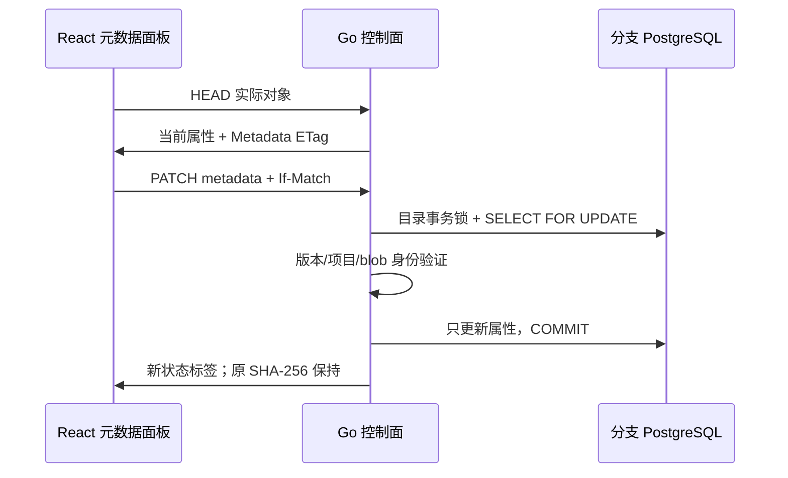

# 条件元数据编辑与 S3 COPY REPLACE

API 0.31.0 / chart 0.9.15 已本地部署，新增 UI 可编辑属性与标准 S3 replacement。文件不可变字节、blob key、内容 SHA-256、目录配额保持；只更新 metadata、可选 Content-Type 和 updated_at。

## 模型和 ETag

HEAD/GET 添加 X-Neon-Metadata-ETag，quoted SHA-256 绑定当前 branch、bucket、key、immutable blob reference、内容 digest、Content-Type 与规范 metadata。它是当前表示的状态标签，不是 secret 或单调操作编号。内容 ETag/SHA-256 沿用原合同；metadata-only 修改不改变内容 ETag。使用 metadata tag 可以检测其他人改属性，避免拿旧内容 ETag 静默覆盖新属性。相同表示的无语义变化可继续匹配。

## 接口

PATCH /api/v1/projects/{project}/branches/{branch}/storage/buckets/{bucket}/objects/metadata?key=...

要求当前 Editor/CSRF、If-Match: 当前 X-Neon-Metadata-ETag。JSON metadata 必需（空对象清空属性）；content_type 可选，省略保持原值。沿用最多 64 条、key+value 2 KiB、ASCII metadata/MIME 类型约束。缺条件 428，当前状态不匹配 412，目标不存在 404，非法 metadata/type/key 422。响应 metadata、content_type、metadata_etag、key、原 sha256。

UI 先读取对象的实际 HEAD，再编辑 JSON，保存当前状态标签。冲突后重新读取；不会自动读取新 ETag 后重放旧修改。SDK 在属性面板外改值后，再次读取会显示真实新值。

## S3

CopyObject x-amz-metadata-directive: REPLACE 支持新目标和同 key 自复制；metadata 替换为本次全部属性，Content-Type 缺省 application/octet-stream。同 key COPY 默认保留不接受，只有明确 REPLACE 可编辑。源 If-Match 与已有目标条件依旧事务验证，错误源版本不能改属性。ACL/Tagging/StorageClass/Encryption 和完整源时间/None-Match 条件仍拒绝，不能虚标全套 COPY。

真实复测新增 storage-metadata-edit.spec.ts：从 UI 上传一个受保护小文件，读取实际属性、更新属性；旧状态 412 且字节保持；实际 MinIO SDK 自复制 REPLACE 之后，读取属性与 bytes/内容 ETag，再从 UI 显示 SDK 实际属性。保留所有 private 原输入与 bucket，最后停服务并缩 Compute 0。新 PostgreSQL 测试通过状态冲突、跨 branch 标签、self replacement 与源版本拒绝；本地 UI 8 项已通过，见 [精确交付](DELIVERY-2026-10-15-METADATA-EDIT.md)；生产门槛独立。
