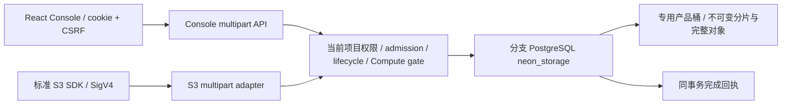
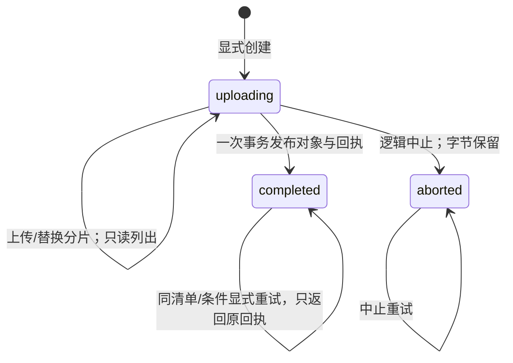
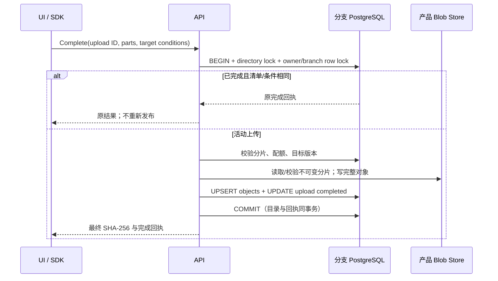

# 分段上传：分支事务、S3 协议与 Console

当前新增容量与流式合同见 [STORAGE-LARGE-OBJECTS.md](STORAGE-LARGE-OBJECTS.md)及 [2026-10-22 有界大对象、Range 与 checksum](DELIVERY-2026-10-22-STORAGE-LARGE-OBJECTS.md)；下文早期版本的 8 MiB 边界属于历史合同。
## 1. 范围和边界

本合同描述 API 0.43.0 / Chart 0.9.33 的分段上传实现。验收状态和实际运行摘要以
[当前交付](DELIVERY-2026-10-16-CURRENT.md)为准；本文件本身不是测试通过证明。
产品字节仍存放在专用对象桶，Pageserver 的底层桶和管理员根凭据不参与。

实现 CreateMultipartUpload、UploadPart、UploadPartCopy、CompleteMultipartUpload、
AbortMultipartUpload、ListMultipartUploads、ListParts。完成前分片不出现在对象目录；
只有完整校验并提交后才通过普通 GET/HEAD/List 可见。S3 ETag 是不透明标识：本实现
分片为 MD5，最终对象仍为 SHA-256，不把最终 ETag 解释为整个文件的 MD5。
对应协议参考 [AWS multipart 概览](https://docs.aws.amazon.com/AmazonS3/latest/userguide/mpuoverview.html)
及 [CompleteMultipartUpload](https://docs.aws.amazon.com/AmazonS3/latest/API/API_CompleteMultipartUpload.html)。

当前资源合同明确为：单对象/单上传已确认分片合计 **8 MiB**，分支可见对象总量
100 MiB，待上传分片引用总量另限 100 MiB；每分支最多 32 个活动上传，每上传
最多存储 1,000 个分片，分片号允许 1–10,000 且不要求连续。除最后一片外至少
5 MiB。覆盖一个分片号会替换其逻辑引用，原不可变字节保留。配额统计不等于
物理容量计量，失败/覆盖/中止的物理字节仍属于引用安全 GC 的独立缺口。

这不是官网快照的 5 GiB 大对象能力。ListMultipartUploads delimiter 分组和管理员逻辑中止已补齐；进阶 checksum/trailer、分片写入权接管、自动到期回收和物理删除仍有独立门槛。
不得通过更换创建账号或清理历史对象绕过配额。凭据轮换/撤销前可先完成或中止原上传；当前管理员可按[运维合同](MULTIPART-ADMINISTRATION.md)恢复逻辑中止权限，不能把分片写入权转交给新凭据。

## 2. 架构与状态

两张表由 `assets/storage-multipart.sql` 定义，并通过已受控的 Object Storage
Driver 增量安装，不修改 Neon 核心代码。`openObjectStorage` 校验项目 schema
标记和 installation generation 后再演进；已有对象、metadata、CORS 和克隆引用保留。
API admission 持有项目→分支→服务的共享生命周期锁和 Endpoint probe gate，直到
有界 I/O 请求结束；禁用/删除遵循现有排他生命周期。

| 模型 | 键与字段 | 作用 |
|---|---|---|
| `multipart_uploads` | id、branch_id、principal、bucket/key、content_type、metadata、expected_sha256/size、request_key/hash、state、completion_hash、result_sha256/size、created/updated_at | 目标与文件绑定、创建幂等、可重读完成回执 |
| `multipart_parts` | upload_id + part_number、不可变 blob_key、SHA-256、MD5 ETag、size、updated_at | 同号替换、续传和按清单校验 |
| 现有 `objects` | bucket/key → blob_key、SHA-256、size、内容类型/metadata | 完成后普通对象访问的唯一目录 |

`principal` 为 `user:<user ID>` 或 `credential:<credential ID>`。两种入口不互相
冒充身份。每次请求重新经过当前授权，不保存一个永久绕过权限的上传 URL。
列表仅返回当前 principal 的活动上传；列表和详情不返回物理 blob key 或签名密钥。
同一数据库继承到新分支后，上传行因 branch_id 不匹配不可续传；已发布对象仍按
原目录的分支克隆语义共享字节。恢复到新分支同理；原地 PITR 是独立生命周期门槛。

## 3. 并发、失败与原子发布

所有分段变更复用 `storageDirectoryLock`，与普通 PUT/COPY/DELETE/配额检查串行。
锁在分支数据库；不依赖某个 API 进程的内存互斥。完成请求按严格递增的分片号和
对应 ETag 选择内容，非最终片最小值、合计大小、完整文件摘要和目标条件全部校验。
读取每个不可变分片时再次验证 SHA-256，随后写一个新不可变完整对象。

若事务失败，目录和完成回执都不提交，写入过的不可变字节保留。若 COMMIT 或响应
结果未知，调用者先读取原 upload ID，显式重试同清单/条件。成功回执重放不会重新
检查今天的目标并再次发布，因此后来的对象修改不会被旧完成重试覆盖。换清单或
换条件返回 409。中止、分片上传与完成使用同一锁，完成后继续写分片或中止返回
NoSuchUpload。中止只封闭逻辑上传，不承诺物理擦除。

## 4. Console API

完整标准模型和错误状态在 [OpenAPI](../contracts/openapi-v1.json) 及 [API 索引](API.md)。
以下路径前缀为 `/api/v1/projects/{project}/branches/{branch}/storage/buckets/{bucket}`。
所有 Console 操作要求当前 Editor/Admin；变更走既有 cookie/CSRF 规则。

| Method / suffix | 输入 | 输出/约束 |
|---|---|---|
| GET `/multipart-uploads` | 无 | 当前用户活动上传，至多 32 条；不会列出其他用户/S3 credential 上传 |
| POST `/multipart-uploads` | `Idempotency-Key`，key、sha256、size；可选 content_type、metadata | 201 原上传；相同 key/输入重放不重开中止上传；不同输入 409 |
| GET `/multipart-uploads/{upload}` | 原 ID | upload 与已确认分片；完成/中止仍可查 |
| PUT `/multipart-uploads/{upload}/parts/{part}` | 二进制；可选 Content-MD5 | 已确认分片号、ETag、SHA-256、size、时间 |
| POST `/multipart-uploads/{upload}/complete` | `parts:[{part_number,etag}]`，If-Match 或 If-None-Match | 完成回执；Console UI 固定新建语义 If-None-Match `*` |
| DELETE `/multipart-uploads/{upload}` | 原 ID | 204 逻辑中止；对已中止可重试 |

400 包括输入/顺序/摘要错误，404 隐藏外账号/外分支和未知 ID，409 表示幂等/完成
内容冲突，412 是目标条件失败，413 是单对象上限，428 是缺少发布条件，429 是
配额，503 表示依赖失败或结果未知。不得以 503 推断请求一定未提交。

S3 入口沿用部署的 `/s3/{branch}` 和分支凭据，也支持 credential anchor 根入口。
上传分片、复制分片、完成、中止需 storage:write；复制来源另需 storage:read；
列出需 storage:read。XML 严格拒绝重复字段、未知节点、外部 namespace、DTD 和
尾随第二文档。签名在访问目录前验证；复制来源只能是本分支对象，不解析外部 URL。

## 5. 手工 UI 与 SDK 复测

1. 从 Console 登录，进入原项目的对象存储页面，选择已启用的原数据库/分支。
2. 创建专用测试桶并记录名称，保留已有桶与数据。
3. 在“分段上传与续传”选择 5–8 MiB 文件及新对象名，点“开始分段上传”。
4. 在第二片前暂停或断开网络，记录原 upload ID。确认对象目录尚无该对象。
5. 恢复网络/重载页面，选回原桶，“加载我的分段上传”，选原 ID 并重新选择原文件。
   “继续所选上传”验证完整文件 SHA-256，只补缺失/不匹配片；已确认片不重传。
6. 完成后下载完整文件，对照 SHA-256 和大小；重试原完成请求不得重新覆盖对象。
7. 用另一个新对象测试中止：原 ID 变为 aborted，后续分片不得写入，原业务对象保留。
8. 为 SDK 创建专用分支凭据并写入 Linux 权限 0600 文件，勿写命令行/聊天/公开日志。
   运行 [真实 SDK probe](../api/cmd/storage-sdk-probe/multipart.go) 对应的 `multipart`
   模式；其七类实际签名操作验证分片、来源范围复制、分页、完成字节和中止。
9. 从 Console 再读取 SDK 发布的对象。保存 checkpoint、HTTP/Operation ID、原始
   失败、截图与摘要。结束后回到测试前服务状态，测试 Compute 回到 0。

新增串行 UI suite 为 `web/e2e/storage-multipart.spec.ts`，需要已有 owner fixture、
管理员密码文件、私有目录及与候选源码一致的 Linux SDK probe。它不是公共匿名
环境的破坏性压力脚本。Linux Go 的 `TestMultipart*` 使用一次性 control_ci 数据库
隔离验证事务回滚/原回执/账号与分支隔离；不连接业务元数据库执行测试 DDL。

## 6. 交付原则

UI、实际 S3 SDK、事务测试、机器合同、手工步骤与部署摘要必须同步；只有当前
交付记录有现场通过证据才能关闭基础切片。大对象、GC、独立 Storage gateway、
自动回收/完整计量和全链路可信 TLS 继续按剩余清单逐项推进。
