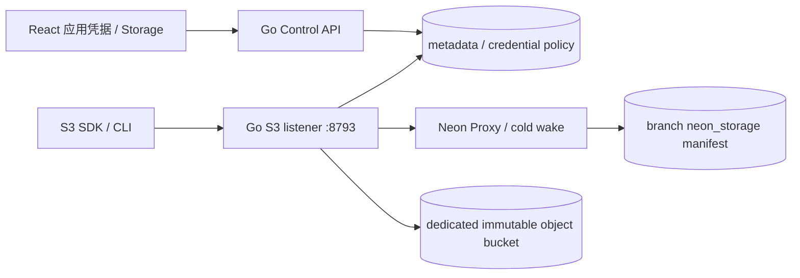

# Object Storage S3 基础兼容预览

## 1. 目标、当前范围和官网差异

官网 [Object Storage](https://neon.com/docs/storage/overview) 以随数据库分支演进的
S3 服务为目标，[认证](https://neon.com/docs/storage/authentication) 使用统一凭据的
`storage:read` / `storage:write`，Access Key ID=`token_id`，Secret=`s3_secret_access_key`。
本增量实现这个接口方向，继续复用 branch PostgreSQL `neon_storage` 清单和已经
部署的专用不可变 blob bucket；不会把 MinIO root/Pageserver 凭据交给应用。

**这是基础协议预览，不是官网完整 S3 准入。** 支持 List/Create/Delete/HeadBucket、
GetBucketLocation、ListObjects/V2（平铺列表）、Put/Get/Head/DeleteObject、单 Range、
条件写、SigV4 Header 和预签名 GET。尚缺 multipart、server COPY、bulk delete、
层级 delimiter/CORS、完整 user metadata/checksum、anonymous public_read、STS、
SigV4 checksum trailers 与预签名 PUT；单对象仍 8 MiB，分支 100 MiB/1000 objects。
官网最大单对象 5 GiB，不能用当前实验室配额声称等价。物理 GC/HA/DR/TLS 另行准入。

## 2. 组件、密钥与模型



该 listener 和 API 同进程；独立最小权限 S3 data-plane 服务仍未实现。
迁移 029 扩展统一凭据 scopes，并增加 `backend_storage_signing`：credential_id、
generation、key_version、sealed_token、updated_at。只对 storage-scoped credentials
保存版本化、目的隔离 AES-GCM envelope；AAD 绑定 credential ID/generation。
明文 API token 和 S3 secret 不保存于 metadata/replay/audit/Operation payload。
AI gateway 的受限 metadata role 没有新表 SELECT 权限。

S3 secret 使用 API token 的目的隔离 HMAC 派生，创建/轮换返回一次；列表、重放不
回显。轮换保持 token_id，原子更新 token hash、generation 和 envelope，旧 S3 key
及预签名 URL 随即失效。撤销/到期、issuer disabled/权限下降、项目/组织/branch
状态、祖先 lineage 都在每次请求重新检查。write scope 包含 read。丢失首次响应
需显式轮换，不通过 idempotency replay 重新取得 secret。

复用标准 credentials POST/GET/rotate/DELETE，OpenAPI 0.21.0 定义 scopes 和一次性
S3 返回字段。Model constraints 仅用于 AI scope；纯 storage 不接受 model restrictions。
现有 AI-only credentials 语义保留；scope 数量最多 3、未知/重复值拒绝。

## 3. 请求与一致性

S3 root endpoint 根据签名 key 的 anchor branch 选清单。显式 branch base URL
`{origin}/s3/{branch}` 支持 self_and_descendants 的标准路径式调用；JS/AWS CLI
使用 forcePathStyle。普通 MinIO SDK 可使用 root endpoint 操作 key 的 anchor branch。
Region 必须匹配配置，实验室默认 us-east-2。签名绑定 method、decoded path 的标准
URI 编码、scalar query、Host、sorted signed headers 和 SHA256 body；重复 query
拒绝，不接受 SDK/proxy 对重复排序的不同解释。Header 时间窗 ±5 分钟；presign
最长 86400 秒，但凭据到期/撤销先结束授权。实现有界的 `STREAMING-AWS4-HMAC-SHA256-PAYLOAD`，
验证 seed、每块与末尾零块的链式签名，确认完整 decoded length 后才访问 SQL/blob。
解码配额 8 MiB、wire overhead 最多 1 MiB、最多 4096 块；不接受 trailers/unsigned write/STS。
锁定 MinIO SDK 的普通 HTTP PutObject 会使用这种逐块签名，不能只用 SignV4 helper 验证兼容。
算法参考 [AWS chained signing](https://docs.aws.amazon.com/AmazonS3/latest/API/sigv4-streaming.html)
和 [MinIO 7.2.0 streaming signer](https://github.com/minio/minio-go/blob/v7.2.0/pkg/signer/request-signature-streaming.go)。

S3 的普通 PUT 是授权的 unconditional overwrite；存在 If-Match/If-None-Match 时
应用真实 precondition。它不伪造 Console REST v1 强制版本条件。清单变更由 branch
SQL transaction + directory advisory lock 串行，blob 先持久化再 publish；失败可
留下无引用 blob，不能立即 GC，其他分支和 PITR 可能仍引用。GET/HEAD 使用清单
中的 immutable blob、真实 ETag/Last-Modified；HTTP ServeContent 提供 Range/条件读。
XML 错误、sandbox/attachment、固定 authority 避免 Console 身份或客户 HTML 混入。

Metadata project/branch/service share locks 持续到操作结束，阻止合作的 disable/delete。
SQL compute 已 suspended 时也允许真实授权访问，由 Proxy/adapter 冷醒；这不等于
compute 外部 epoch fence 已完成。usage 更新在释放 admission 后进行，避免满 pool
持锁等另一查询连接。当前 usage 只是 last_used_at，不是可信财务计量。

## 4. Helm 与手工 SDK

```yaml
objectStorage:
  enabled: true
  existingSecret: neon-product-blob-store
  s3:
    enabled: true
    origin: http://192.168.146.100:30893
    region: us-east-2
    labHTTP: true
    serviceType: NodePort
    nodePort: 30893
```

必须启用版本化 backendCredentials；现有 object backing Secret 保留，不创建 root
credentials。TLS origin 需要独立可信 ingress termination；Go listener 本身不自动
签发证书。生产完整 TLS/least privilege/NetworkPolicy 仍是门槛。

UI：Storage 启用分支清单 → 应用凭据选择 S3 只读/读写 → 立即保存两项凭据 →
S3 SDK endpoint/region/forcePathStyle → 上传/下载 → 轮换验证旧 key 拒绝 → 撤销验证。
完整软件支持矩阵见 API discovery 的 `s3_supported` / `s3_missing`，不要猜测兼容性。

## 5. 验收与保留

`internal/s3protocol` 与实际锁定 MinIO SDK signer 验证 UTF-8 URI、hash、Header/
query/authority tamper、presign expiry。真实 PG integration 验证 signing ciphertext、
一次性 replay、lineage/read/write、rotation generation/revoke 与跨 purpose 拒绝。

`cmd/storage-sdk-probe` 是 Linux 验收工具，正式 CI 编译并记录 source_commit/hash，
不进入 runtime image。只读 0600 config 文件；CLI stdout 仅 stage/checks，不输出
secret、signed URL、对象正文或 provider errors；可记录 HTTP 状态数字。Transport 在首次 mutation 后
拒绝 SDK 自动重发；unknown outcome 必须由运营人员检查原请求。`continue_write` 先确认原有
自有 bucket 和 primary key 不存在，再执行一次 PUT；存在对象或未知响应必须停止检查。

`web/e2e/s3-storage.spec.ts` 从 SQL/UI 开始真实配置、签发密钥，随后调用该 Go SDK
工具验 Put/Get/Head/List/Range/presign、只读拒写、原地轮换和撤销。辅助对象/空
bucket 验证 DELETE，主对象/清单、physical bytes、SQL 数据和所有记录保留；最后
正常停用服务/密钥、compute=0。现场结论必须以精确源码的后续交付回执为准。
