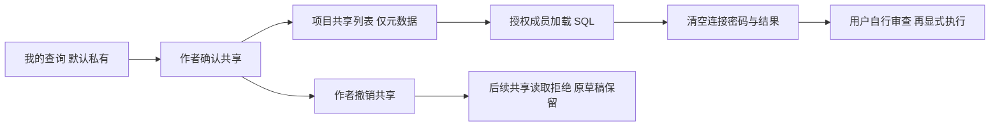

# 项目内共享 SQL 查询

## 产品与权限

个人保存查询默认私有，旧记录迁移后保持私有。作者可在 SQL 工作台显式“共享到项目”，也可“撤销项目共享”。共享仅允许该项目拥有 SQL 编辑权限的成员读取，Viewer 和其他组织不获得访问权。读取者可把文本加载到自己的编辑器或另存自己的副本；编辑、删除和共享策略修改仍只允许作者。项目管理员身份不自动授予其他人的私有草稿访问权。

共享 SQL 是平台的团队协作扩展，不宣称 Neon 当前托管控制台具有完全相同的共享权限模型。已有个人保存、Explain/Analyze 和官方项目查询历史分别是独立能力，后者仍未实现；不得把共享草稿称作执行历史。

## 数据与 API 合同

Migration 031 增加 `saved_queries.is_shared boolean NOT NULL DEFAULT false` 和共享索引。保留原 owner/project 归属、加密 SQL、密钥版本、content_generation、generation、tombstone 与审计。只修改共享状态时，generation 增加；SQL 密文及其 AAD 对应的 content_generation 不变。不同作者读取共享查询时，使用数据库中真正 owner_id 验证 AAD，不能用访问者身份替换。

| 方法 / 路径 | 输入与行为 |
| --- | --- |
| GET `/api/v1/projects/{project}/saved-queries?view=personal` | 默认个人元数据列表，最多 50；兼容旧省略参数的请求 |
| GET 同路径 `?view=shared` | 当前项目的共享元数据，最多 50；不包含 SQL |
| GET `.../saved-queries/{query}` | 作者或该项目 SQL Editor+ 读取共享文本；返回 `can_edit`、`is_shared`、SQL 与 ETag；no-store |
| POST `.../saved-queries/{query}/sharing` | 作者；`{"shared":true}` 或 false；必需 If-Match 与 Idempotency-Key；修改回执不含 SQL |

所有变更使用原有 Console 身份、CSRF 和项目授权。共享/撤销使用同一作者锁、项目状态锁、行锁与事务；修改、幂等回执和审计一并提交。不匹配 generation 返回 412，不同输入复用 key 返回 409，缺 If-Match 返回 428，缺显式 boolean 返回 422；非作者变更返回 404。

旧保存/更新接口的请求哈希和默认输入不变。相同幂等 key 的重放返回原次操作结果，它不是当前共享状态查询；客户端应刷新列表或 detail。删除原查询后共享读也不可用。

## UI 流程

SQL 工作台 → 保存查询 → 我的查询 → 选择查询 → 共享到项目。确认前提示 SQL 不应包含凭据或敏感内容。切到“项目共享”可以选择并加载。只有作者看到可用的修改/删除/共享操作，其他成员可加载和另存；后端独立检查权限，不能依赖按钮禁用保护。

加载不会执行 SQL、连接数据库或唤醒 compute，并清空连接密码。撤销只阻止后续读取，已经被授权读取并复制的 SQL 无法追回。平台不会共享连接密码或 SQL 结果；SQL 文本自身可能含敏感常量，作者必须审查后共享。

## 本地验收与范围

新增 `TestSavedQueryExplicitSharingIsolationAndRevoke` 使用真实临时 PostgreSQL、多用户、多组织和真实路由，验证默认私有、共享后其他 Editor 可读、真实 owner AAD 解密、只读者不能改原稿、Viewer/跨组织拒绝、幂等/冲突/版本检查、撤销立即拒绝后续读取、原 SQL 密文不变。

新增 `web/e2e/shared-queries.spec.ts` 验证真实 Console 页面创建私有草稿、显式共享、共享视图、加载原 SQL/清空密码、旧版本拒绝、撤销、作者草稿仍在及最后 tombstone 删除。测试不执行 SQL；通过 Linux 实际 Pod/VM 观察确认零 compute，不重跑旧保存查询套件。精确结果另见对应版本交付文档。

当前共享列表只返回最新 50 条，尚无团队分页、公开链接、跨项目共享、多人实时协作或评论。不能因为此切片通过而关闭完整 SQL Editor、查询历史、多租户攻击矩阵或生产准入门槛。
