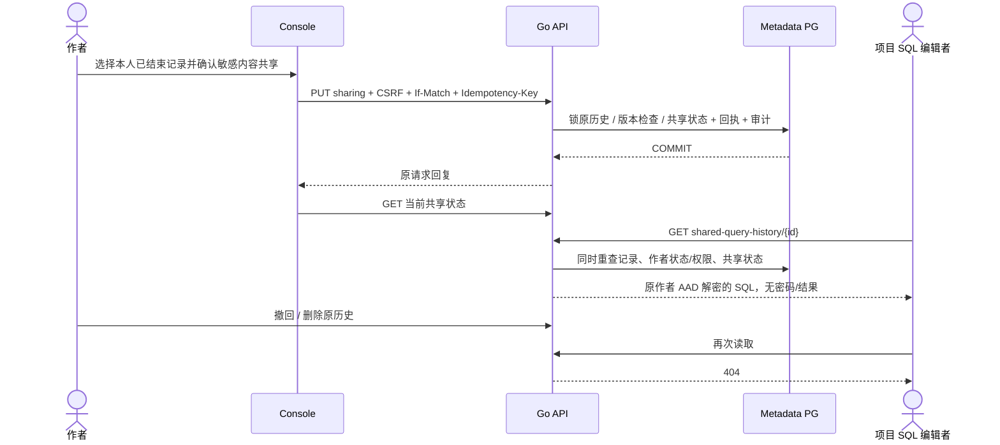

# 显式项目共享 SQL 执行历史

## 1. 产品范围

API 0.41.1 / migration 036 / Chart 0.9.31。个人执行历史默认仍只有本人可读。
作者可对一条已确认结束的历史明确共享、撤回。当前项目 Editor/Admin 可读取共享 SQL
和原执行元数据，不取得连接密码、数据库结果或执行授权。加载到编辑器不执行 SQL，
不提供数据库密码，也不通过共享接口重新提交 SQL。

只有 `completed`、`failed`、`not_submitted` 且 `finished_at` 不为空可以共享。
进行中、结果未知或缺少完成回执返回 409。SQL 可能含敏感常量，UI 必须显示警示并
要求作者明确勾选本条共享确认；默认采集/保留不等于同意项目共享。

撤回只阻止后续服务端读取，不能收回其他成员已经复制或下载的内容。共享不延长个人
保留期限；原历史被本人删除或到期清理时，共享同时失效，不保留第二份文本副本。
新授权是对当前权限的引用，不是可转交给任意外部用户的公开链接。

## 2. 数据模型与授权

`sql_query_history` 新增 `shared_at timestamptz NULL`、`share_generation bigint DEFAULT 0`。
NULL 表示私有。原有 AES-GCM 密文和 project/owner/history ID AAD 保持，不为读者重封装
或复制 SQL。共享详情使用原作者的 AAD 解密，明文不写回元数据库或幂等/审计记录。

`sql_history_sharing_requests` 主键为 owner_id/history_id/key_hash，保存 HMAC 请求指纹、
非敏感回复及 created_at；history_id 外键 ON DELETE CASCADE。事务持原历史行锁，
检查原作者、版本、终态，更新共享状态与版本，写幂等回执和审计后共同提交。审计失败
回滚共享变更。每条历史每小时最多 60 次新变更；重放不再次变更 generation。

每次共享读取的同一个 PG statement 同时检查作者未停用、仍属于项目组织，以及组织
角色/项目授权相加后的 SQL 权限至少 Editor。读者也须当前项目 Editor+。成员停用、
移除或降权影响后续请求；恢复权限后仍按当前共享状态判断。全局账户 role 不提升
项目权限。Console session 是当前唯一认证方式，API Key 不能读取/管理共享历史。

分页按 started_at/id 倒序，一页 25 条，游标携带项目与当前读者，跨读者/项目拒绝。
列表仅含元数据、作者用户名、共享版本和时间，不含 SQL、key_version 或 sealed_sql。
详情未授权/已撤回/已删除统一 404，所有响应 no-store。

## 3. API

| 方法 | 路径 | 合同 |
|---|---|---|
| GET | `/api/v1/projects/{project}/query-history/{history}/sharing` | 本人读取 shared 状态、version_token、shared_at；ETag 为 quoted version |
| PUT | 同上 | Cookie/CSRF、Idempotency-Key、If-Match；`shared` 必填，启用还需 `acknowledge_sensitive_sql_sharing=true` |
| GET | `/api/v1/projects/{project}/shared-query-history` | 项目共享元数据分页；可选 cursor |
| GET | `/api/v1/projects/{project}/shared-query-history/{history}` | 重新授权后返回原 SQL、执行元数据；不执行 SQL |

PUT 同 key/input 返回原非敏感回复，不重做旧变更；不同输入 409、过期版本 412、缺少
版本 428、确认/格式不正确 422、超过频率 429。503 表示结果未确认，保留原 key/input
重试或 GET 当前状态核对。**旧成功回复不是当前共享状态**，UI 在 PUT/重放后 GET
最新状态；一次已撤回共享不会被旧幂等请求重新开启。

运维关闭历史功能时，新共享 503、列表 enabled=false、共享详情 404；本人仍可撤回。
缺解密 keyring 时详情 503，绝不返回密文或假成功；密钥轮换仍须保留旧版本。



## 4. 手工与自动复测

Linux 一次性 control_ci：

```bash
cd api
go test -race ./internal/control -run '^TestSQLHistorySharing' -count=1
go test ./internal/control -run '^TestOpenAPI' -count=1
```

真实 UI 使用保留的 SQL owner fixture、已完成并关闭 MFA 的专用测试账号；账号密码
只在受保护文件，不上传截图/DOM/trace。该 suite 为账号临时添加 Collaborator 和单个
项目 Editor，最后通过 UI 撤销项目授权与临时组织成员，不更改原组织访问或密码。

```bash
export NEON_E2E_BASE_URL=http://192.168.146.100:30788
export NEON_E2E_ADMIN_PASSWORD_FILE=/secure/admin-password
export NEON_E2E_SQL_SCRIPT_FIXTURE=/secure/sql-owner-fixture.json
export NEON_E2E_CONSOLE_ACCOUNT_FIXTURE=/secure/completed-console-test-account.json
export NEON_E2E_PRIVATE_DIR=/secure/new-attempt/private
export NEON_E2E_ARTIFACTS=/secure/new-attempt/evidence
npm --prefix web run test:e2e -- history-sharing.spec.ts
```

从 UI 执行一次无写入 SELECT，保存原历史回执，缩到 0，再验证默认私有、作者确认、
其他 Editor 实际加载、撤回、旧幂等重放、权限撤回/恢复。最终原历史保持私有且不删，
Compute 保持 0。`history-sharing-checkpoint.json` 记录原请求与临时访问；失败保留它。
SQL 已尝试但缺 history_id 时不得重复提交，先检查原响应/请求日志。可通过受保护
`NEON_E2E_HISTORY_SHARE_RESUME` 指定同范围原 checkpoint；不能重建账号掩盖失败。

实现/实际通过以[当前交付](DELIVERY-2026-10-16-CURRENT.md)为准。撤回不等于安全擦盘、
合规销毁或已经传给读者的数据可召回；这些能力不在本功能中声称完成。
