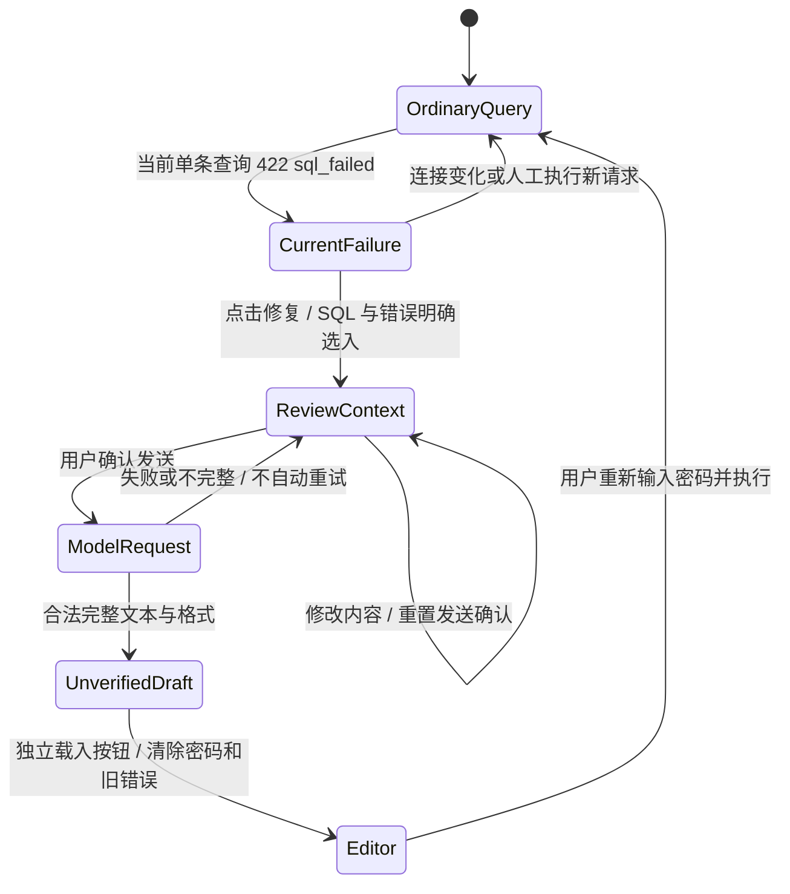

# SQL AI 修错：显式上下文、独立草稿、人工提交

## 1. 产品合同

在[SQL 助手](SQL-ASSISTANT.md)上增加失败 SQL 的修复入口。对齐
[官方 SQL Editor 的 AI 功能](https://neon.com/docs/get-started/query-with-neon-sql-editor#ai-features)
中“失败查询后请求修正”的使用场景；模型、授权和内部实现属于本项目。
本地模型只是建议来源，不是数据库执行器。不会自动执行原请求、修复结果或更改权限。

本切片没有新增 API/Worker、数据库表或迁移。后端仍为 Go/PostgreSQL；浏览器
继续使用现有 Console AI 入口和 Proxy Query API，准确现场状态见
[当前交付](DELIVERY-2026-10-16-CURRENT.md)。

## 2. 状态与数据

Workbench 仅为单条普通查询的 `422 / sql_failed` 响应保存本页内存上下文：
`{sql,code,message,requestId}`。它不证明原 SQL 从未执行；界面提醒写入结果须先核验。
网络、超时、取消或其他结果未知分类不触发修复入口；脚本和 Explain/Analyze 不进入
本切片。项目/Endpoint/角色/数据库变化清除该上下文；编辑器 SQL 不匹配时不提供修复。
历史中的原失败记录、request_id 和已发生的数据库效果保持。

点击“修复当前 SQL”只选择 `sql_fix` 目的，填入说明、勾选当前 SQL 和错误上下文。
用户仍须审阅完整请求并单独确认发送；变化后确认失效。所选错误可能含标识或
字面量，必须检查。若内容不适合发送，可使用普通 SQL 草稿模式自行提供删减的说明。

`sql_fix` 要求同时选入 SQL 与错误；消息中的 `user_selected_error` 只投影
`code,message`，不包含 request_id、连接密码/目标/其他错误对象字段。错误代码为
1–64 个小写字母/下划线；消息非空、最多 1024 UTF-8 字节、拒绝不允许的控制符。
既有 SQL/总消息/响应限制继续有效。取消选入错误后生成按钮禁用，不自动重试模型。

## 3. 语义和故障边界

模型收到固定安全说明、独立参考 JSON、用户请求；仅建议 SQL 文本。
草稿仍需经过既有格式检查；这些检查不证明语法、权限或结果正确，更不证明适合
重发写操作。载入时清除单次数据库密码；只有用户再次提交才调用 Query API。
成功执行或加载新草稿后旧错误提示清除。旧请求的持久历史独立保留。

估算/实际值提示由确定性 UI 状态生成：Explain 明确没有实际执行耗时/行数；
Analyze 才有实际样本，并提示循环/父子包含关系。此标签不依赖模型输出。
即便模型把估算 cost 误称作毫秒，也不能把该文本当作 PG 实测或已验证优化。

## 4. 手工复测

1. 当前 Editor 权限账号进入原测试连接，输入 `SELEC 43::integer AS ai_fix_value`，
   使用真实数据库密码提交。应看到真实 PG 失败、本次 request_id、密码清除；
   不应发生模型调用或自动 SQL 重试。
2. 修改编辑器 SQL，旧失败修复按钮应隐藏；恢复原文本后可进入修复。点击按钮，
   检查当前 SQL 和错误与原请求一致。发送预览不得带入数据库密码/角色/库。
3. 未确认时生成禁用。确认后取消勾选错误，应重置确认并禁用生成；再明确选入、
   检查敏感内容、重新确认后请求本地真实模型。
4. 审阅模型草稿；非预期语句不得执行。草稿出现时 SQL 请求计数不增加。单独载入后
   密码仍为空，旧错误提示消失；人工输入密码执行应返回 43。
5. 人工 Explain 修复后的查询，切到计划建议，检查固定“仅估算”提示；切换本身
   不调用模型。停止测试 Compute，保留原失败历史、原模型响应与业务数据。

新增公开检查：`web/tests/sql-ai-repair.test.ts` 和
`web/e2e/sql-ai-repair.spec.ts`。后者使用受保护原 Owner fixture、真实 Go Gateway/
Ollama 和 Neon Proxy；可信 Linux workflow `product_suite` 可选。原始模型响应只
进入维护者私有目录，公共结果仅保存状态、计数与 ID；本页不把模型建议准确率标为认证。
