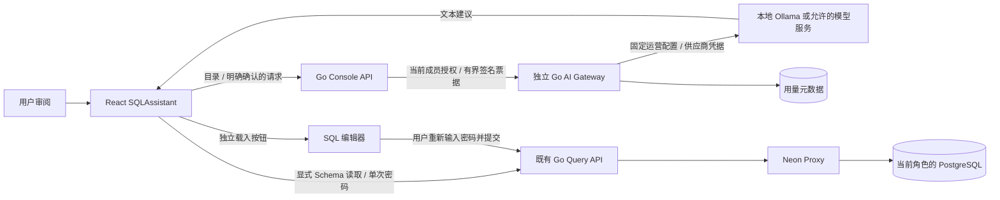
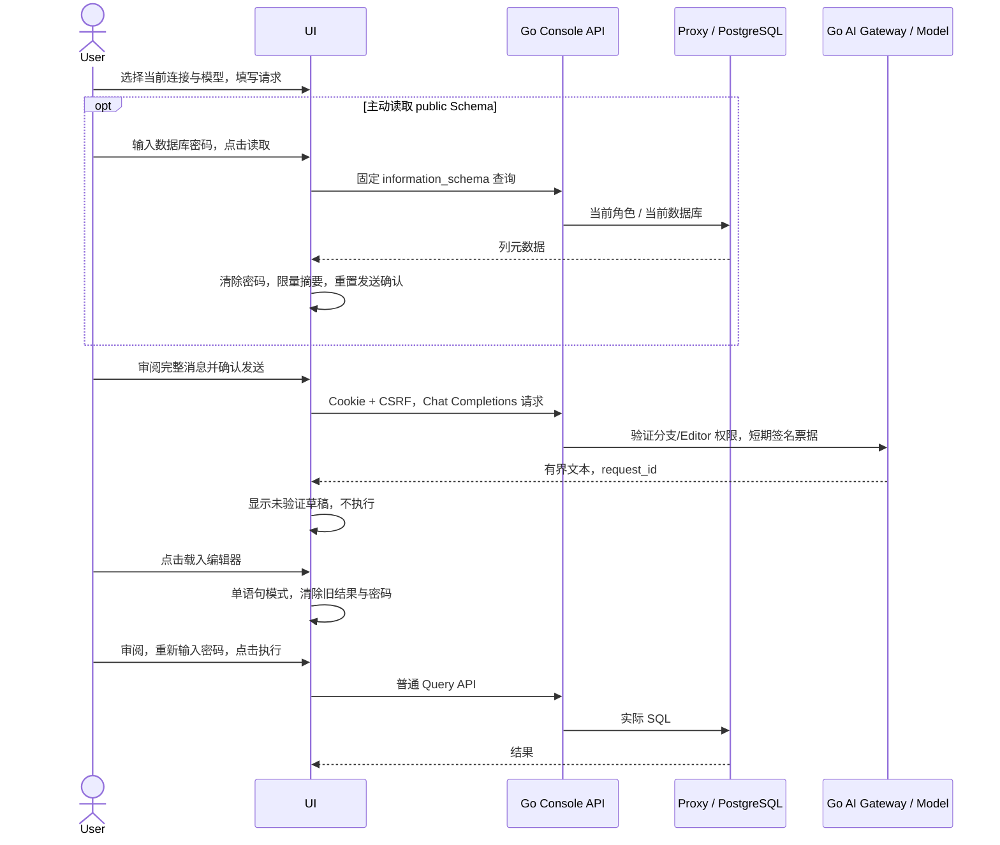

# SQL AI 助手：受控上下文与人工执行

## 1. 目标和边界

SQL 工作台在既有 Go AI Gateway 上提供 SQL 草稿与执行计划建议。模型输出是未验证
的建议，用户必须审阅、显式载入编辑器、重新输入数据库密码并人工执行。生成与
载入都不执行 SQL。产品后端仍为 Go/PostgreSQL，前端为 React/TypeScript。

对齐依据是本地官方 website 快照 `c0d49cbb6979b2ce79ea502d62dbc40780a923b0`
的 `content/docs/get-started/query-with-neon-sql-editor.md`，以及
[官方 SQL Editor 文档](https://neon.com/docs/get-started/query-with-neon-sql-editor)。
官网描述浏览器查询、历史、保存、Explain/Analyze 和自然语言生成；本实现保持独立
合同，不声称复制其私有后端或模型策略。计划解释遵守
[PostgreSQL EXPLAIN](https://www.postgresql.org/docs/16/sql-explain.html)：Analyze 会
执行查询，估算成本不是毫秒，节点实际值可能按循环统计，父节点时间包含子节点。

## 2. 组件和流程

## 3. 接口、模型和限制

本切片不新增控制表或服务器 API。沿用 OpenAPI 中的：

| 接口 | 用途 / 授权 |
|---|---|
| `GET /api/v1/projects/{project}/branches/{branch}/ai-gateway` | 当前分支公开模型目录；不含供应商密钥 |
| `POST .../ai-gateway/request` | Console Cookie、CSRF、当前 Editor 权限；不接受控制 API key 代替用户会话 |
| `POST /api/v1/projects/{project}/endpoints/{endpoint}/query` | 当前连接密码与角色；实际 Proxy 路径，沿用查询授权和个人历史策略 |

请求使用 `model`、`messages[{role,content}]`、`max_tokens`、`temperature:0`、
`stream:false`。完整编码体在界面预览；每次模型、目的或实际消息变化都重置确认。
`max_tokens` 为模型上限与 768 的较小值。请求说明最多 2000 UTF-8 字节，选入的 SQL
与 Schema 各最多 4096 字节；消息合计最多 14000 字节，编码体最多 30000 字节。
服务端仍执行自己的长度、协议、授权和速率检查。

消息顺序为固定 system 规则、独立 JSON 参考元数据、用户的自然语言请求。SQL 草稿
提示要求单一 SQL 围栏；避免小模型把嵌套请求 JSON 当作输出模板复述。兼容读取器
仍可接受完整的闭合草稿 JSON，拒绝未知字段与缺失必需字段，不从截断文本抢救 SQL。

响应只接受一个正常 `stop` 的 assistant 文本 choice；拒绝 tool calls、拒答、截断、
控制符和超限响应。读取响应体最多 65536 字节，模型文本最多 16384 字节。
草稿接受闭合 JSON `{sql,explanation,warnings}` 或单一 SQL 文本/围栏；SQL 最多
8192 字节。这只是格式检查，**不证明 SQL 的语法、权限、单语句性或安全性**。
后续 Query API 继续执行实际语句限制。模型文本作为文本渲染，不当作 HTML/链接。

### 3.1 Schema 摘要

默认不读数据库。主动读取使用固定 SQL，从 `information_schema.columns` 仅选择
`public` 下的 schema/table/column/type/nullable/udt 字段，按表与列顺序 LIMIT 61。
目录受当前 PostgreSQL 角色可见性限制，不读取数据行、默认表达式或注释。
返回仅含 `source:role_filtered_information_schema`、`schema:public`、`truncated`
与 `columns[{table,column,type,nullable,udt}]`；最多 60 列、4000 字节序列化摘要。
截断明确标记。加载后仍需审阅并确认向模型发送；手工 Schema 是用户明确提供的内容。

该查询可能冷醒 Compute，并按既有策略产生个人查询历史。密码只进入普通 Query API，
请求后清除；密码、连接角色/数据库和普通结果行没有进入 AI 构造器的输入模型。
表列标识仍可能敏感；此功能不声称自动识别或脱敏用户选入的 SQL/Schema 字面量。

### 3.2 计划建议

只使用当前连接范围、当前编辑器 SQL 对应的最近 Explain/Analyze 响应。白名单摘要
最多 20 节点、8 层、4096 字节；包括节点路径、运算符和明确的数值指标。
关系/索引名、过滤条件、输出表达式、原始 SQL 与未知 JSON 字段不进入摘要。
Explain 不发送实际行数/时间；Analyze 才发送相应观察值。建议不是已测试的调优结论。
编辑 SQL 使旧计划不适用；改变项目/Endpoint/角色/数据库或刷新清除助手上下文。

## 4. 故障与隐私

模型服务调用仍由运营配置固定目标和 SSRF 边界；浏览器没有供应商密钥或目标 URL。
继承现有 AI 用量账本，不保存提示/模型输出到控制库。页面内草稿与建议仅在内存，
若用户执行或主动保存 SQL，则适用工作台历史/保存查询的独立策略。

取消或上下文变化会终止浏览器等待并丢弃过期响应。供应商可能已经处理请求；不
自动重试、不推断用量为零。页面保留本次 request_id 以便运维核对。失败不能自动
载入草稿；普通 SQL 工作台继续可用。受控 Schema 读取失败也不触发模型请求。

## 5. 手工验收

1. 配置已有独立 Go AI Gateway 与本地 Ollama 文本模型，保持固定目标/协议限制。
   登录有当前项目 Editor 权限的 Console，进入 SQL 工作台并选定 Endpoint/角色/库。
2. 填写 `生成 SELECT 42::integer AS ai_draft_value`。检查发送预览默认不含编辑器
   SQL/密码/角色/数据库；未确认时生成按钮禁用，尚无 SQL/模型 POST。
3. 可输入数据库密码、展开 Schema、点击加载。Network 中只出现固定只读目录查询；
   原编辑器不变、密码清除，摘要标注来源/截断，发送确认重置。先检查再确认。
4. 点击生成。查看真实模型响应和 request_id，确认没有因生成提交普通 SQL。若返回
   非预期 SQL，停止该草稿的执行并保留失败回执，不为通过而修改模型输出。
5. 点击载入，确认密码仍为空。人工审阅并输入密码执行，实际 Proxy 返回 42。
6. 人工执行一次 Explain，选择计划建议。预览应省略查询字面量和实际运行指标。
   单独确认请求模型；建议出现时数据库请求数不增加。
7. 改变连接范围或刷新，确认上下文/草稿/建议被清除。将测试 Compute 缩到 0，保留
   原 fixture、私密输出和失败记录。公网供应商、动态供应商管理和预算另设验收。

公开新增自动化：`web/tests/sql-assistant.test.ts`、
`web/e2e/sql-assistant.spec.ts`。后者使用受保护的原 Owner fixture、真实模型与 Proxy，
单 worker、零自动重试；执行入口见可信 Linux live workflow 的 `product_suite`。
实际运行版本和通过范围以[当前交付](DELIVERY-2026-10-16-CURRENT.md)为准。
