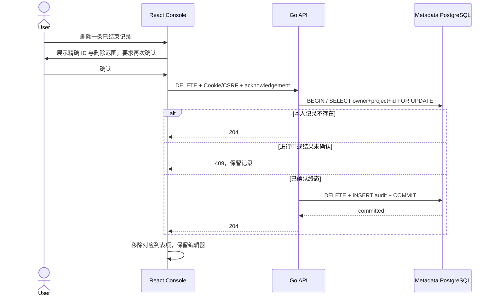

# 个人 SQL 历史单条删除

## 目标与安全边界

API 0.40.0 / migration 035（本功能无需新迁移）/ Chart 0.9.28。
与[个人历史策略](SQL-HISTORY-POLICY.md)共用加密历史模型。删除本人一条历史不执行、
重发或撤销 SQL，不修改数据库数据、保存查询或编辑器内容。仅 Console session、有效
CSRF 和当前项目 Editor+ 可以操作；项目 Admin 也不能删除他人的个人记录。

只允许 `finished_at IS NOT NULL` 且 outcome 为 `completed`、`failed` 或 `not_submitted`。
进行中、结果未知和缺少完成回执的记录返回 409 并保留，必须先核验原数据库执行结果。
不能以超时推定 SQL 失败。本功能不提供结果未知记录的强制删除或人工定性。

## API 与数据模型

```http
DELETE /api/v1/projects/{project}/query-history/{history}?acknowledge_history_deletion=true
Cookie: neon_v2_session=...; neon_v2_csrf=...
X-CSRF-Token: ...
```

不发送 request body。确认参数必须恰好出现一次且为 `true`，否则 422。
成功 204、无 response body，`Cache-Control: no-store`。无本人记录或他人 ID 同样 204，
避免泄露他人历史是否存在；项目权限仍按 401/403/404 检查。API Key 返回 403。
503 表示提交结果未确认：重新读取历史或对**同一 ID**重复 DELETE，不能重发 SQL。

`sql_query_history` 的 ID 不复用。事务以 project_id/owner_id/id 精确选择并持行锁，
检查终态，DELETE，再向现有 `audit_events` 写入 `delete_sql_history`，最后 COMMIT。
审计仅含 actor、记录 ID、操作、结果和 request_id，不含 SQL 或密码。审计失败回滚
删除。并发 DELETE 和自动到期清理以记录行锁协调；原记录消失后重复 DELETE 返回
204，不重复审计。删除不依赖 SQL 解密 keyring 或采集开关，避免停用采集后无法管理
本人的已有记录。



这是元数据库 DELETE，不等于安全擦盘。WAL、备份、数据库死元组与维护者测试证据
仍有各自保留策略，不通过本接口删除。

## UI 与复测

SQL 编辑器“我的执行历史”中，只有已确认终态的记录可点“删除记录”。二次确认显示
精确 ID、不会撤销 SQL 的说明和备份保留说明。取消不发送 DELETE。结果未知的记录
显示禁用删除按钮；后端独立执行同样检查，不能靠修改页面绕过。

Linux Go 测试使用一次性 `control_ci`，不得指向业务元数据库：

```bash
cd api
go test -race ./internal/control -run '^TestSQLHistoryDelete' -count=1
go test ./internal/control -run '^TestOpenAPI' -count=1
```

受保护 Linux 浏览器环境使用已有 SQL owner fixture 和管理员密码文件：

```bash
export NEON_E2E_BASE_URL=http://192.168.146.100:30788
export NEON_E2E_ADMIN_PASSWORD_FILE=/secure/admin-password
export NEON_E2E_SQL_SCRIPT_FIXTURE=/secure/sql-owner-fixture.json
export NEON_E2E_ARTIFACTS=/secure/new-attempt/evidence
npm --prefix web run test:e2e -- history-delete.spec.ts
```

该 suite 先枚举并记录原历史 ID，只通过 UI 新提交一次无写入 SELECT，将新记录的原始
详情写入证据后，把 Compute 缩为 0，再验证取消、确认、重试、重载和原历史集合保持。
只删除**本次创建的那条**测试历史；所有其他历史与原始证据保持。若 SQL 提交/完成不
确认，停止并核对原请求，不重建 fixture 或盲目重新执行。
