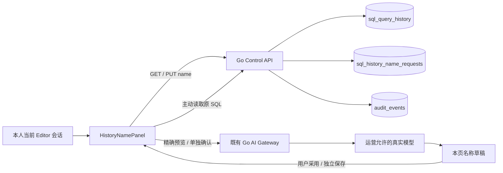
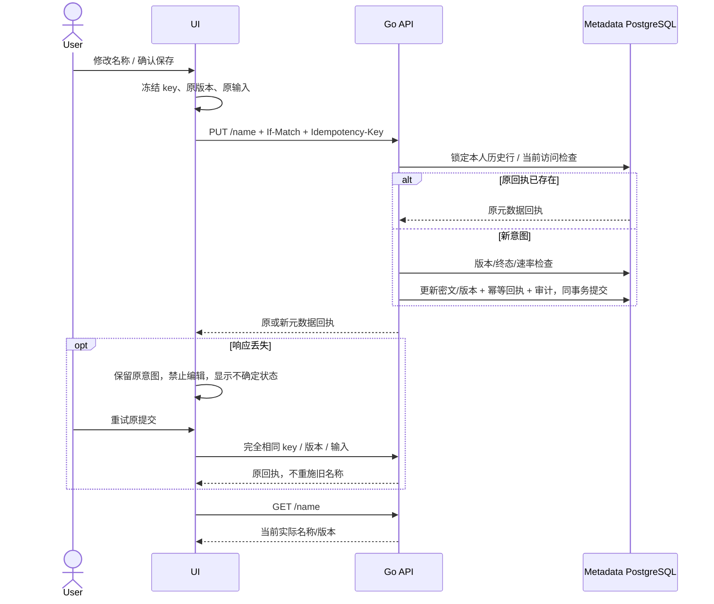

# 个人执行历史名称与显式 AI 建议

## 1. 范围

为已有个人执行历史附加加密名称，支持手工保存、清除、真实模型建议、人工采用、
并发冲突和响应丢失恢复。它与历史 SQL、执行状态、共享设置分别建模，命名不重放
SQL、不改变原数据库结果、不唤醒 Compute。产品后端为 Go/PostgreSQL，UI 为 React/TypeScript。

对齐[官方 SQL Editor 的查询命名场景](https://neon.com/docs/get-started/query-with-neon-sql-editor#ai-features)。
当前提供明确请求/确认的 AI 建议，**没有默认自动发送每条查询**；后台自动命名、
个人长期自动授权策略和模型准确性有独立后续门槛。生效版本及现场证据见
[当前交付](DELIVERY-2026-10-16-CURRENT.md)。

## 2. 组件、数据模型与权限

迁移 **038** 在 `sql_query_history` 增加：

| 字段 | 语义 |
|---|---|
| `name_generation` | 从 0 开始的独立单调版本；名称变更/清除均递增，与共享版本分开 |
| `name_key_version` | 加密密钥版本；未命名时 NULL |
| `sealed_name` | AEAD 密文；未命名时 NULL，非空时 29–268 字节 |
| `name_updated_at` | 最后变更时间；初始 NULL，变更后必须存在 |

名称最多 80 个 Unicode 字符、240 UTF-8 字节，拒绝前后空白、控制符及 Unicode
换行/段落分隔符。空字符串表示明确清除。AES-GCM 沿用现有密钥环，AAD 为独立
`[sql-history-name-v1,project,owner,history]`，不能与 SQL 信封或其他账号/记录互换。
元数据 PostgreSQL 属于信任边界；不声称 AEAD 能防止有数据库管理权限者回滚整份数据库。

`sql_history_name_requests` 保存 owner/history、HMAC key/input hash、元数据回执、
创建时间。复合外键约束 history/owner，随原历史删除级联。回执只包含 ID、版本、
has_name 和时间；审计也不保存名称、SQL、提示或模型输出明文。

个人历史列表/详情仅为本人解密名称；共享历史采用独立投影，**不共享个人名称**。
Admin 身份不授予读取他人个人名称的权限。操作要求当前项目 Editor+、Console
Cookie；写操作还需 CSRF，API key 被拒绝。此次同时修正旧个人历史读取曾允许
issuer API key 的实现：列表/详情也要求 Console 会话，与公开会话合同保持一致。
API key 的普通资源 API 不受此限制影响。

## 3. 接口合同

基路径：`/api/v1/projects/{project}/query-history/{history}`。

| 方法/路径 | 输入 | 成功输出 |
|---|---|---|
| `GET /name` | 当前本人会话 | `{history_id,name:string|null,version_token,updated_at}`，ETag 为引号包裹版本 |
| `PUT /name` | `{name:string}`、Idempotency-Key、If-Match、CSRF | `{history_id,has_name,version_token,updated_at}`；不含名称明文 |
| 既有历史列表/详情 | 本人会话 | 新增 `name`、`name_version_token`、`name_updated_at`；不暴露密文/密钥版本 |

If-Match 必须是当前十进制版本的强引号形式，如 `"0"`，不接受弱标签或 `"00"`。
Idempotency-Key 8–128 字节。同 key/同输入返回原回执；换内容返回 409。当前名称
版本不符返回 412；必须读取最新状态后明确提交新意图。每个 owner/history 每小时
最多 60 次新变更，精确回放不消耗新配额。完整字段、闭合 JSON Schema 和状态码
以 OpenAPI 0.46.0 与自动生成 [API 操作索引](API.md)为准。

错误包括：401 未登录；403 权限不足/API key；404 外账号或无当前访问权；409 原
执行结果未确认/幂等冲突；412 旧版本；422 名称/版本/key 无效；428 缺 If-Match；
429 新变更限额；503 密钥/元数据/审计/结果未确认。没有“改名成功便说明原 SQL 成功”的语义。

## 4. 事务与故障恢复

审计失败使名称和回执一起回滚；提交响应不确定时不能假定失败。UI 可以精确重试
原提交或读取当前状态。回执是历史操作结果，不能拿旧回执覆盖更新后的名称。
412/409 要求重载；不会静默使用新版本强行覆盖。浏览器刷新可能丢失本页未确认
意图，持久服务端回执仍保留，可通过原 key/API 或当前状态核对；不会自动补发 SQL。

只允许修改已确认的 completed/failed/not_submitted 历史。admitted/outcome_unknown
保持，不因命名改变执行定性。清除名称不删历史；删除/保留清理实际移除原行时，
名称与回执随外键删除，备份/WAL 仍遵循各自保留策略。共享引用自然失效的旧语义保持。

## 5. AI 数据流

1. 用户主动读取选中的本人历史 SQL；不是当前未保存编辑器文本，不需要数据库密码。
2. 完整 SQL 最多 9 KiB；截断历史只提供手工命名。JSON 编码后的消息/请求也受
   14000/30000 字节限制，避免大量转义绕过后端界限。
3. 用户选择实际模型，审阅精确消息并明确确认发送。目录/历史读取均为元数据操作。
4. 沿用 Go Gateway 的 Console/分支授权、运营固定上游、用量与无自动重试约束。
   最多 64 输出 tokens；共用 65536 字节响应解码器，拒绝无效 UTF-8、不完整响应、
   截断/工具调用/多 choice。标题还需满足有界单行格式。
5. 模型只是名称建议，可能不准确或含不适合的字面量；必须审阅。“采用”只填入
   输入框，不保存。用户独立保存才执行名字 PUT。没有自动模型调用或自动保存。

提示/模型输出只留在本页内存；保存后的个人名称加密。变化重置确认，关闭上下文
丢弃过期响应。取消等待不等于供应商没有计费，请按 request_id 核对既有 AI 用量。

## 6. 手工复测与维护

1. 使用当前 Editor 账号，在 SQL 工作台选一条本人、未截断、已确认的历史，点击
   “名称”。检查历史 ID 和初始版本，手工命名保存、刷新，再清除；原 SQL/状态保持。
2. 两个浏览器页面打开同一旧版本，页面 A 保存后页面 B 提交应 412；B 读取当前
   名称后看到 A 的结果。不得自动覆盖。
3. 模拟 A 已在服务器成功提交但浏览器丢弃响应，保留原 key/输入。UI 应锁定表单，
   精确重试取回原回执，版本只增长一次；随后 GET 当前状态。
4. 展开 AI 部分，明确读取原历史 SQL。检查它与编辑器未保存文本分开、无连接
   密码或结果数据。选择可用模型（本地验收为 local-sql / Qwen 1.5B），确认发送。
5. 模型返回时名称不应已写入；采用后也不应自动保存。手工保存并重载，确认原
   history ID 上名称持久化。全过程不得出现普通 Query API 或新 Compute/VM。
6. 另账号/Viewer/API key/被撤销成员分别验证拒绝；已共享 SQL 的读者不能读取作者
   私有名称。保留原记录、失败、加密密钥版本和模型回执，再按 UID 退休临时测试资源。

公开测试位于 `sql_history_names*_test.go`、`web/tests/history-names.test.ts` 和
`web/e2e/history-names.spec.ts`。可信 Linux workflow `product_suite` 支持独立运行；
真实 UI fixture 要指向保留的原 history ID/SQL SHA-256，不创建替代业务记录来绕过失败。
