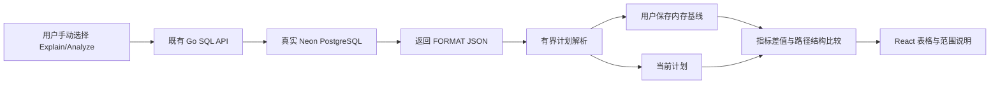

# 本地执行计划比较

## 1. 范围

API 0.41.1 / Web UI 验收 0.41.0 / Chart 0.9.31。基于已有 Go SQL API 返回的真实 EXPLAIN JSON，在
React/TypeScript 中比较两份用户手动取得的计划。没有新增执行接口，没有自动 SQL、
自动 Analyze、模型请求或 SQL 改写，也不将计划保存在 localStorage/服务器。

用户先手动 Explain/Analyze，再“设为比较基线”，修改查询并手动取得下一份计划。
选择基线、比较、清除不发送 SQL。切换项目、Endpoint、数据库角色/数据库，重载或
退出页面会清空基线；不会把另一连接的旧计划默认带入新上下文。

## 2. 数据模型与计算

基线只保存已解析且有界的 QueryPlan、是否 Analyze 和本页面 sequence。沿用原解析器
每份最多 200 节点、32 层、已知数值与有界字符串；不复制整个原始 SQL/计划 JSON。
比较结构最多 200 行，达到限制明确显示不完整说明，原 JSON 仍由原结果面板提供。

| 类别 | 指标 / 语义 |
|---|---|
| 双方都有的估算 | 根节点累计 cost、估算输出行数、规划 ms |
| 双方均为 Analyze | execution ms、根节点实际行/循环、循环次数、实际 ms/循环 |
| 差值 | 当前−基线；百分比为差值/基线，基线 0 不做除法 |
| 结构 | 按树路径展示同算子、算子/关系/索引变化、新增路径、移除路径 |

Explain 不能被虚构出实际执行指标。路径相同不是同一物理操作的证明，节点可能重排；
父子累计成本/时间有包含关系，不相加，也不据单次耗时差自动声称性能提升。两次请求
不保证同一数据快照，缓存、统计信息、参数和负载可能变化，诊断由使用者进一步确认。
这些语义对齐 [PostgreSQL 16 Using EXPLAIN](https://www.postgresql.org/docs/16/using-explain.html)
与 [EXPLAIN](https://www.postgresql.org/docs/16/sql-explain.html)：cost 是规划器单位；
ANALYZE 会实际执行语句；循环节点的实际行数/耗时按每次执行报告。



## 3. 验证

纯 TypeScript 测试检查单位、Explain/Analyze 分离、基线 0、根/子时间不相加、
结构变更与节点/数值限制。在 Linux 上执行：

```bash
cd web
node --test tests/plan-comparison.test.ts
```

真实浏览器环境沿用受保护 admin 密码和 SQL owner fixture：

```bash
export NEON_E2E_BASE_URL=http://192.168.146.100:30788
export NEON_E2E_ADMIN_PASSWORD_FILE=/secure/admin-password
export NEON_E2E_SQL_SCRIPT_FIXTURE=/secure/sql-owner-fixture.json
export NEON_E2E_ARTIFACTS=/secure/new-attempt/evidence
npm --prefix web run test:e2e -- plan-comparison.spec.ts
```

四次用户主动 SQL 请求：两份 Explain 比较 LIMIT 7→3，再两份只读 Analyze 比较
LIMIT 3→2。检查基线保存无额外请求、估算差值、实际指标门槛、真实实际行差值、
清除/连接变化/重载无持久基线，最后将本测试 writer 缩到 0。所有历史和证据保留。
真实回执见[当前交付](DELIVERY-2026-10-16-CURRENT.md)。

这是 Q03 的计划比较切片，AI SQL、自动建议、长期计划仓库仍为独立未完成需求，
不能以有比较表格声称 SQL 智能优化产品已完成。
