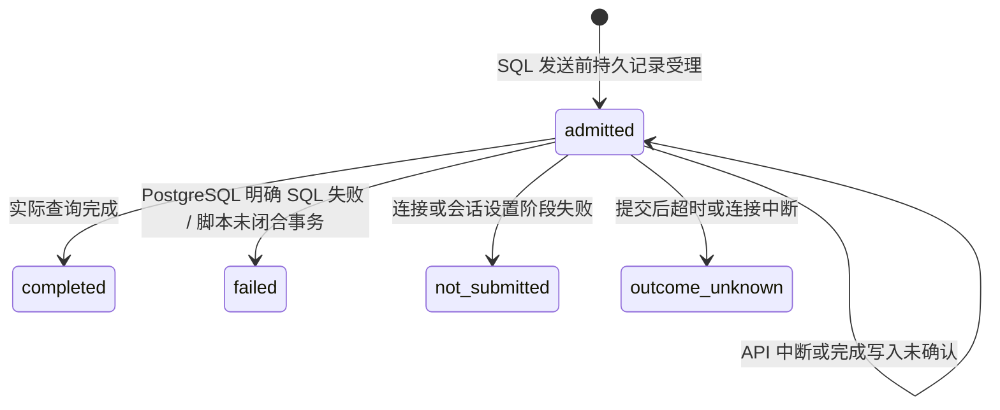

# SQL 执行历史（个人，加密，显式启用）

## 1. 范围与官方目标

官方 [SQL Editor](https://neon.com/docs/get-started/query-with-neon-sql-editor) 提供项目查询历史；克隆的 website 文档同路径说明历史正文按 9 KB 截断。本实现先完成**个人历史**：同项目其他用户（包括管理员）无法读取正文。它不是项目共享历史，也不同于手工保存草稿或团队共享查询。项目级历史授权仍需单独设计，不因本切片而宣称与官网全部 SQL Editor 相同。

单条查询与 SQL 脚本两条入口都记录实际受理请求，包含 Explain/Analyze 入口最终提交的 SQL。不会记录独立 psql、Data API 或 Functions 内部查询，也不会从 PostgreSQL 日志抓取全部数据库活动。

## 2. 启用与数据保护

Helm `sqlHistory.enabled` 默认 false。先配置 `backendCredentials.enabled=true` 和保留旧版本的密钥环，再显式开启历史。该开关有 Helm 布尔 schema 和加密前置检查。API 环境变量为 `NEON_V2_SQL_HISTORY_ENABLED=true`；Worker 不执行 SQL，不需要此开关。

```yaml
backendCredentials:
  enabled: true
  existingSecret: your-retained-versioned-keyring
sqlHistory:
  enabled: true
```

密钥环沿用现有 Backend 密钥规范，不能临时生成后丢弃或覆盖旧版本。SQL 通过现有 AES-GCM SQL 存储原语加密，历史 AAD 独立绑定用途 `sql-query-history-v1`、project、owner 和 history ID；不能把草稿密文或其他用户记录移入后解密。元数据、列表与完成回执没有 SQL 文本、连接密码或结果行。正文可能含用户自行写入的敏感字面量；启用之前应告知使用者。

这是 opt-in 预览能力，不提供无限保存的生产承诺；自动过期、清除/保留策略、后台密钥迁移和项目级审计访问仍是独立门槛。关闭记录不会删除已保留数据，再启用后仍可读取原记录。

## 3. 模型与状态

Migration 032：`sql_query_history` 绑定 project、owner、endpoint、branch（复合 FK），保存模式 single/script、数据库/角色名、加密正文、密钥版本、原始字节数、截断标记、受理时间、完成期限/时间、耗时和 SQLSTATE。没有密码、结果集或原始错误消息字段。



超期仍为 admitted 的记录增加 `completion_unconfirmed=true`，UI 显示“结果未确认”。不能假定它没有执行或已经回滚。脚本 failed 也不意味着更早的显式 COMMIT 已回滚。平台永不因历史状态自动重发 SQL。

启用历史后，受理写入失败返回 503 `history_unavailable`，明确未提交用户 SQL。完成记录使用独立五秒元数据库超时，即使客户端断开也尝试写完；如果完成写入失败，保留原 admitted 记录，原 SQL 响应附带 `X-Neon-SQL-History-State: unconfirmed`，不能把已执行 SQL 变成可重试请求。

成功受理的响应通过 `X-Neon-SQL-History-ID` 标识原请求历史；它不是幂等或重试 Token。耗时从受理计算，包含连接/冷醒预算，和 Functions 的请求执行日志含义不同。

## 4. API 与正文截断

| 方法 / 路径 | 行为 |
| --- | --- |
| GET `/api/v1/projects/{project}/query-history` | 当前项目 Editor+，只列当前用户元数据；25 条，新到旧；关闭时 enabled=false / 空列表 |
| GET 同路径 `?cursor=...` | owner/project 绑定 keyset；范围不符或错误 cursor 返回 422；无 OFFSET 漂移 |
| GET `.../query-history/{history}` | 授权用户只能读取自己记录的正文；其他用户 404；no-store；不执行 SQL 或唤醒 compute |

完整请求、响应、状态和响应头见 OpenAPI 0.34.0。文本预算为 **9 KiB UTF-8 字节**，包括 `-- QUERY TRUNCATED` 前缀；保证不切断 Unicode 字符。记录 original_bytes 与 truncated；历史副本不一定是完整可执行 SQL，不可无提示重放。

## 5. UI 与手动验收

1. 在 SQL 工作台选择授权的 Endpoint、数据库和角色，输入密码并执行一个新查询。
2. “我的执行历史”显示受理/完成状态、目标、模式、SQLSTATE 和包含冷醒的耗时；不在列表展示 SQL。
3. 点击“加载到编辑器”：按历史目标恢复现存 Endpoint、角色和数据库，清空连接密码与结果；不执行 SQL。原 Endpoint 已删除时拒绝自动恢复目标。
4. 对大于 9 KiB 的查询，历史条目标记“截断”；加载后再次提示需补全、审查。
5. 请求失败时区分 SQL 明确失败与未提交/未知结果；根据原数据核验，不点击重复执行作为恢复手段。
6. 正常缩零 compute，刷新历史和读取正文仍可完成；Pod/VM 观察确认未冷醒。

新 Playwright 套件 `web/e2e/query-history.spec.ts` 只提交三个新请求：单条成功、脚本 SQL 失败、Unicode 长查询成功。随后正常缩零，验证历史刷新/加载不触发 SQL 请求及 compute。真实 PG 定向测试另验证多用户权限、密文/AAD、分页、完成只记一次、未知状态与旧密钥；不重跑已验收的 SQL parser 或保存查询套件。
