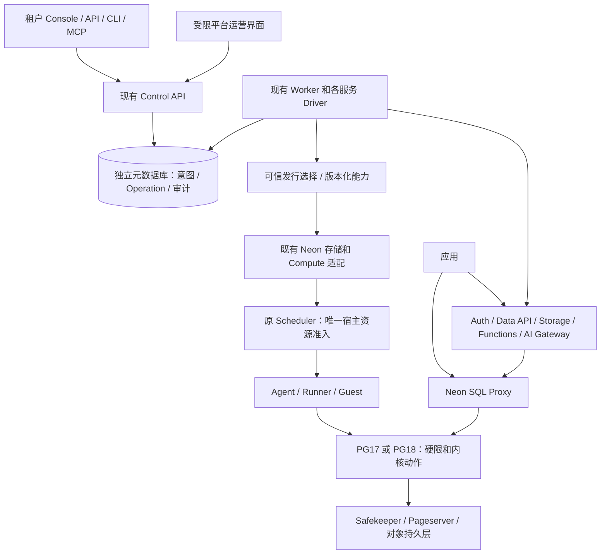

# 平台总方案与演进规划

状态：执行中；最后核对 2026-11-07。本文是当前唯一总方案入口，不是功能完成或生产放行声明。

## 1. 目标、范围和文档优先级

建设基于 Neon 开源数据面、可自托管运营的完整 Backend 平台；租户可管理数据库及 Auth、Data API、Object Storage、Functions、AI Gateway，并通过同一控制面使用本项目的 PG 动态共享缓冲区与真实 normal 安全降限。上层业务采用统一合同，当前验收 PG17、PG18，PG16 不开发、不验证、不计入放行。本轮不开发 AI Agent OS；为其提供现成的身份、资源、分支、配额、审计及自动化接口。

最新用户决定 → 本文及[发行与运维方案](平台发行与运维管理.md) → 已发布的 OpenAPI、前向迁移和版本化组件合同 → 对应提交的实际验收证据。旧文档保留技术细节和失败历史，带日期的“尚未实现/已完成/后置”只代表当时版本，不继续作为当前状态。任何修订不得口头取消真实硬限、数据保留、跨租户隔离或 Unknown 处理。

- 业务代码基线：GitHub main `e15e6c79f4c5b80eb004050eeafea866ffd30c0e` 的五项增量已整合至原功能分支。
- 当前功能分支：`codex/dsga-control-plane-v3-20261020`；阶段提交 `2b8b9e3012bb59c7f2ce22a82cfc22d354454173` 已远端核验。后续不换分支、不覆盖 main。
- 官网源码：`neondatabase/website@5e4ffa00144b5c76b6ab9bf507166f877056b431`；官方 OpenAPI 194 个 operation。网站导航 626 个独立入口不等于 626 个产品需求，其中包含教程、外链、旧产品和重复示例。
- PG17/PG18 已各通过四项真实内存动作、普通应用同连接 213/126 笔提交及三份 WAL 验证。控制面新链路仍须独立验收，不能移用这些结果冒充自动供应完成。
- 详细官方差异见[官网对标审查](官网对标与差异审查-20261107.md)，逐项进度见 `控制面验收/20261107-重新启动/官方功能逐项审计.json`。

## 2. 三种事实必须分开

| 事实来源 | 可以确认 | 不能据此确认 |
|---|---|---|
| 官方网站、公开 API、更新日志 | 对外对象、功能语义、限制、交付状态和路线图 | 官方内部运维后台、完整生产配置和每个镜像的源码身份 |
| Neon/Autoscaling/PG 公开源码 | 具体组件实现、协议和依赖；可复用的内核与运行时 | 与官方云服务当前版本完全相同、包含全部托管业务 |
| 本项目发行锁与现场证据 | 我们编译了什么、运行了什么、哪条场景真正通过 | 未执行的功能、所有版本兼容、长期 SLA 或跨地域灾备 |

官方 `neon/control_plane` 明确是本地开发测试工具，不能把同名目录当完整生产控制面。我们的 Console、Worker、运营后台与配置治理是独立产品工作；复用现有自有实现，不重造官方已开源的数据面。

Neon 已公开更大缓存与动态共享缓冲区的发展方向。当前工程依据不能是“官方不会做”。官方固定大 Compute 的大 shared_buffers 与我们已验证的动态 Grow/安全 normal Shrink 不是同一验收对象；后续以上游源码、正式发布和实际能力为准，能替换自有补丁就先验证再收敛。不能把官网摘要中“无需重启”等措辞扩大成任意版本、任意资源变化都无需重启。

## 3. 整体架构和唯一责任

| 责任 | 唯一权威与边界 |
|---|---|
| 组织、项目、分支、服务身份 | 控制面元数据；原资源 ID 不因 Pod/VM 更换而改变 |
| 用户意图、配额、异步操作 | 现有 API/Operation；配额是租户产品预算，不是第二个节点分配器 |
| 节点放置及峰值内存准入 | 原 Scheduler；持久事实增强其恢复，不再叠加并行 Host 分配器 |
| 执行与恢复 | 原 Agent/Runner/Guest 身份和 fencing；只重放已知可重放的原动作 |
| PG 内存边界 | 内核和真实 cgroup 读回；不能用 RSS、常数或 VM 大小替代 normal 安全降限 |
| 持久数据 | Timeline、Safekeeper WAL、Pageserver 和对象存储；Compute 可重建但不是数据所有者 |
| 发行能力 | 受控平台配置/不可变发行清单；租户不得指定任意镜像、节点、Service UID 或证明来源 |
| 应用请求 | SQL Proxy 和各数据服务；不要求管理 API/Worker 每秒在线才能继续安全 SQL |

初期继续使用现有 Go 模块化 API/Worker、React、专用元数据库和服务进程。逻辑分层不自动增加微服务、消息总线、独立调度器或通用工作流引擎。仅在现有实现无法满足已确认的并发或隔离需求时再拆进程。

## 4. 通用对象和版本合同

Organization → Project → Branch → Backend services。项目选择区域与 PG 大版本；分支拥有 Timeline 与服务状态；一个 Writer、独立 Reader；服务 URL、应用凭据、数据生命周期绑定准确分支。新 PG 大版本通过新项目和数据迁移交付，不改旧项目字段、旧 Operation 或旧 Timeline 来伪装原地升级。

复用现有对象字段逐步统一以下语义，而非一次重建数据库模型：

- `spec_version`、期望 generation、原 Operation/幂等键；
- 可信 runtime/release 选择与冻结计划，具体 PG 适配能力；
- observed generation、采集时间、真实物理实例身份和有效来源；
- Ready/Progressing/Degraded/Unknown 等用户可理解条件及原因；条件命名在实现时进入 OpenAPI，不用本文虚构已存在接口；
- 取消、删除、重试、接管、保数据重建按原 Operation 和已发生副作用决定，不按 UI 超时认定失败；
- 旧调用者可继续使用已有公开字段；破坏性变更必须新版本并有明确退役期。新消费者先兼容旧数据，生产者再启用新能力。

兼容性以已测试组合登记，不能承诺任意 N/N-1 或所有 PG 版本通用。上层不分叉指业务流程相同，不代表 PG ABI、扩展、WAL 回放和 Guest 依赖可以不检查。

## 5. PG 内存能力的产品化：当前第一关键路径

当前不是重做内存核心，而是把已验收的执行链纳入正式创建、策略和生命周期。

1. API 校验租户权限/配额/版本能力，冻结计划与 credential refs，事务保存 Operation；重复请求读取原计划，不重新选择当前发行版。
2. 原 Worker 接入 `create_project_dsga_v1`；复用已有 tenant/timeline、凭据、VM、Service、初始化与路由原语。
3. 新生 VM 经真实平台资格采集与签发接入同一 Agent owner 流程。当前 Agent 配置仍有按 VM UID 固定的资格/自动策略映射，这是已观察到的产品化缺口，不能由维护者逐台编辑配置代替交付。
4. 策略写入既有 Owner/Agent 管理合同，持久化期望修订；Scheduler 仍统一准入。需要补共同动态配置入口时同时核对身份、revision CAS、重启恢复和审计，不能把私有 root Unix socket 直接暴露给租户。
5. 分别回读“策略已采纳”和“真实内存动作完成”：PG 缓冲区、normal memory.max、Guest/VM、原动作状态与采集时间。能力配置不等于实例 Ready。
6. 通过原 Proxy 持续 SQL、应用数据/WAL 验证；Mac 断线、控制面重启和等待容量不能使仍安全的 SQL 因管理心跳过期停服。真实不安全和 Unknown 仍由原安全合同处理。
7. 同一个用户场景在 PG17、PG18 分别执行；PG16 不进入选项或本轮验收发行目录。

已形成的本地候选：统一 PG17/18 创建计划、准确版本绑定、向前迁移、公开版本选择与前端选择。Worker、资格和实时策略链尚未接完；创建开关保持关闭。不能把本地元数据库测试或只读 Proxy SQL 记为 C1 完成。

## 6. 完整 Backend 的生命周期

| 能力域 | 保留/复用 | 必须闭合的产品行为 |
|---|---|---|
| Postgres | Neon/Proxy/目录/分支/Reader/恢复现有模块 | 创建、连接、内存策略、冷醒、保数据重建、原生历史点及扩展可用性 |
| Managed Auth | 现有 Better Auth runtime、管理 API 和 UI | 应用用户与 Console 用户分开；分支克隆用户但会话/issuer/cookie 不跨分支；OAuth/邮件真实接入分项验收 |
| Data API | 现有 PostgREST Driver | JWT、GRANT/RLS、数据库角色限制；不能以 SQL 编辑器或 Proxy stub 代替 |
| Object Storage | 现有 S3 网关、不可变 blob 与分支目录 | 对照官方支持矩阵、multipart/签名、撤销、引用安全 GC、真实字节与用量 |
| Functions | 现有 microVM/Node 24、不可变部署、触发器和 edge | 分支环境注入、HTTP/SSE/WS、冷醒、发布回滚、隔离、实际计量；不升级为持久任务系统 |
| AI Gateway | 现有供应商/模型/凭据/协议/预算/账单 | 真实提供方调用、流式/取消、未确定消费对账、组织配额；不能用合成回复称真实推理 |
| Realtime | 单独能力项，官方 Beta | 先核公开实现/自托管路径和 WAL/logical replication 影响；缺实现明确不可用，不能用轮询冒充同一产品 |
| Search | PostgreSQL 扩展能力目录 | 核可获取源码/二进制、许可证、PG ABI 和索引兼容；缺少 Lakebase 扩展时不能把 pgvector 命名为同产品 |

跨产品分支、恢复和删除有统一 Operation，执行仍由原服务 Driver 完成：PG 时间点、Auth 状态、对象目录/引用、Function 不可变版本和秘密代次各自留来源。明确哪些可按 LSN 恢复，哪些需外部快照，不能声称单一数据库事务原子恢复所有外部系统。恢复先保留原分支/历史引用；确认完成后再开放入口，失败按记录恢复，GC 不删除仍被引用内容。

官网 Functions 的子分支继承代码并可直接调用，与本项目历史 `inherit_paused` 策略存在语义差异，需在 C3 明确产品默认与可选安全策略；不能未比较就宣称一致，也不能为了字面一致复制不应跨分支的秘密。

## 7. 租户控制台与平台运营管理

两类用户使用统一后端能力，但权限和展示不同；组织 Admin 不自动成为平台 Operator。

租户：项目/分支/Compute/服务，组织成员与 Key，规格/策略/用量，SQL、日志、备份恢复、维护窗口和操作进度。租户看到可用版本和实际状态，不接触节点 root、Kubernetes 管理凭据或供应商总密钥。

平台运营：发行目录及其证据、区域和服务可用性、容量与预留观察、部署/维护/撤销发布、故障操作接管与审计、供应商及计划/账单、证书与密钥轮换、备份恢复。复用已有平台策略及操作表，按具体权限扩展；不设一个无审计“万能执行 shell”。

当前已有平台 AI 供应商、额度、服务计划、账单对账、Storage GC 的 API/部分 UI；没有发现统一 runtime 发行、升级编排与配置管理控制台。缺口来自对现有路由与源码的核对，不是声称知道 Neon 私有后台。具体模型和落实次序见[发行与运维管理](平台发行与运维管理.md)。

## 8. 发行与长期维护原则

目标是让多数升级成为“受验证发行替换”，不是逐版本重写业务；不能承诺 Autoscaling/Neon 永不改动。

- 每次发布绑定 CP、Neon、Autoscaling、各 PG fork、Guest/kernel/QEMU、扩展、基础 OS、工具链、Helm、迁移、配置 schema 以及准确 image digest。
- 补丁分为上游已有可回收、自有内存增强、临时接线/打包修复；记录原因、测试与移除条件，避免临时兼容永久堆叠。
- PG 小版本/安全修复、基础镜像、Neon/Autoscaling 和 CP 分别有更新节奏，但任何投产组合都必须在兼容矩阵相交；依赖不兼容时不能单独换一个镜像。
- 日常审查安全通知，定期汇总上游差异；紧急修复按实际影响加速，不让“固定季度发布”延误安全修补。普通候选→内部验证→小范围发行→稳定→退役，有可审计的推广记录。
- 首批支持已验收 PG17/PG18；PG 新大版本先内核适配、再扩展/回放打包、再同一 API 端到端。老版本按上游支持期和本产品公告维护，未认证版本不显示可创建。
- PG 大版本、扩展 SQL 对象/索引、元数据库迁移、Pageserver 存储格式可能影响回退。不能把镜像回滚等同于数据回滚；不支持降级时采用已验证的恢复/前向修复路径。
- 上游跟踪与当前 C1 接线分开：现在不盲目把全部组件切到 main 或 latest；发布前必须核当前补丁是否过期及安全差异。

## 9. 阶段与验收终点

| 阶段 | 交付与依赖 | 当前事实 |
|---|---|---|
| C0 基线与共同合同 | 最新业务整合、官网产品/源码边界、版本目录、开发通路 | 已整合和建立通路；官网/当前方案审查已落档，逐项深审继续 |
| C1 共同 Compute 主链 | API/UI 创建 PG17/18→SQL→策略→实际四动作/应用数据 | 本地合同测试通过，正式 Worker/资格/动态策略尚有缺口，真实新项目 E2E 未通过 |
| C2 生命周期 | 分支/Reader/目录、冷醒、保留删除/恢复、真实失败接管 | 复用旧实现，针对内存新后端重新验收受影响路径 |
| C3 完整 Backend | Auth/Data API/Storage/Functions/AI 与分支联合链 | 多模块和历史验收已存在，最新业务增量与新后端联合验收待完成 |
| C4 产品运营 | 权限/Key/SSO、配额账单、监控审计、平台配置、CLI/MCP | 有基础实现；发行管理、版本与实际状态展示等按本方案补齐 |
| C5 统一发行放行 | 同 SHA 镜像、自有 Helm 三节点、安装/受影响升级/恢复、完整场景 | 尚未完成本轮控制面发行，不能以 Pod Ready 或单元测试代替 |

Realtime/Search 的当前公开能力逐项纳入矩阵；不因有外部/私有依赖就删除需求，明确实现方案或阻塞。未来 PG19、跨地域云托管覆盖、未发布路线图与商业认证列长期方向，不自动变成本轮首个闭环前置。

每阶段只增量测试新增/直接受影响路径；C5 联合验收覆盖平台实际承诺的产品行为，不重跑无关 PG 上游或 K8s 平台测试。旧版本回执可引用，必须说明依赖及范围是否变化。

## 10. 开发、真实 K8s 验收和交付

Mac 独立 CP 工作区、开发/测试元数据库；经 118 的 localhost SSH 通路访问真实后端，保留 TLS CA/SNI 与独立服务身份。秘密只在被忽略的保护文件或 Secret 引用。单个开发 Worker 只消费开发元数据库新建资源，避免与既有对象争写。

真实目标始终是 117/118/119；不部署 116。本地链路通过后，Linux 从 GitHub 获取同 SHA，118 增量构建/打包，SSH 预载节点 containerd k8s.io，自有 Helm 固定 digest 与 IfNotPresent。不得把 Mac 未提交业务代码/二进制拷到 Linux 冒充 GitHub 发行。

端到端主场景：
- PG17 和 PG18 各从公开控制面创建新项目；同一应用连接写入，策略调整后核四项内存动作与实际状态，再核已提交数据/WAL。
- 一个最小真实应用使用 Auth 登录、Data API/RLS、Storage 字节、Function 请求、真实 AI 推理；创建子分支检验数据/凭据/代码隔离，恢复/删除保留正确数据。外部提供方尚未配置的项目单列未验收，其他工作继续。
- 运行中途采样日志、错误、Operation/实际资源、CPU/内存/磁盘及退出状态；故障必须定位到具体接口和源码，不把一次超时推断为上游缺陷。
- API/Worker、应用服务与数据面边界的权限、重试、Unknown、证书错误、原物理身份替换是直接受影响的必要负例，不新增无限故障矩阵。

测试复用现有框架，仓库组织单元/组件 API/E2E 清单与中文说明；不额外造测试平台。脱敏结果进 `docs/控制面验收/`，Linux 权威日志/源码镜像锁/退出状态在 `/data/neon-control-plane/`，核心内存证据继续链接原归档。保留有效缓存、数据与唯一失败证据。118 当前 /data 仅约 25 GiB 可用，发布前按实际产物预估空间，已授权的冷归档/重复包可转119，禁止 prune。

## 11. 生产放行不能省略的部分

生产可用需要：真实产品闭环、跨租户隔离、数据与秘密恢复、可信传输、明确单/多实例运行边界、版本兼容、可追溯发行、运维操作和告警。复用已有保护，不新增整机内核绝对上界或独立证明框架。

三节点实验不等于跨故障域 HA/DR、无限容量或长期 SLA。首版实际承诺哪些能力就验收哪些；硬件/外部条件未满足时标明未放行和适用范围，不能为尽快结束删除产品要求。基于本项目的新平台身份交付，不声称官方云内部实现完全一致。

## 12. 变更记录

2026-11-07：覆盖旧暂停条件并重启控制面；明确 PG16 排除；补齐官方开源/托管产品/本项目发行的事实边界、平台运营面、版本演进和完整 Backend 语义；纠正“只追 PG 和基础镜像就足够”的过度假设。保留已验收内存核心与现有服务实现，当前第一执行点仍为 C1，不先扩建新框架。
