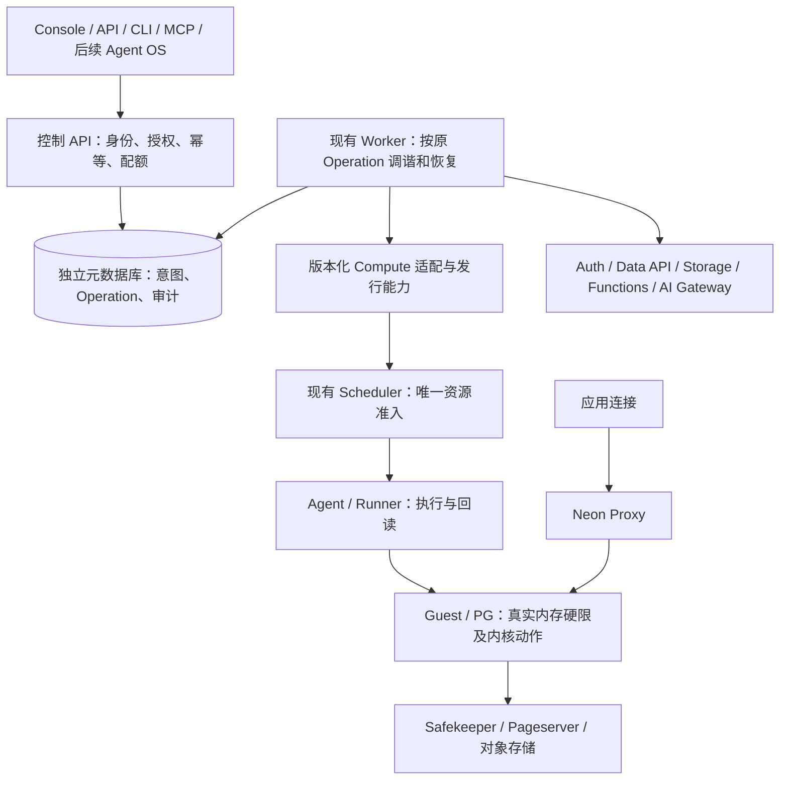

# 控制面完整产品方案与实施计划（2026-11-07）

状态：本轮已重新启动；本文是实施决策与验收合同，不是完成声明。最新源码整合、逐项代码审计及真实验证继续进行。

## 一、目标和基线

交付对标 Neon 当前公开产品能力的自托管产品，并将本项目已验收的 PG 内核动态共享缓冲区和真实 normal 安全在线降限纳入 Compute 的正式产品能力。Console、API、CLI/MCP 和未来 AI Agent OS 使用相同的资源、权限、操作和错误合同。当前不开发 Agent OS 本身。

- 最新自有业务基线：`e15e6c79f4c5b80eb004050eeafea866ffd30c0e`，2026-11-07 从 GitHub 重新获取。
- 已验收内存接线分支基线：`1bcb81b2ca4eb8748d8ca77fe51c91c0a6f0d550`。
- 本轮始终提交到 `codex/dsga-control-plane-v3-20261020`。整合业务基线比该分支新增的五个提交，不改 main、不覆盖用户现有 main 工作区。
- PG17、PG18 各自 Grow / 安全 normal Shrink / Regrow / 自动策略四项已通过，普通应用同连接分别 213 / 126 笔提交及三份 WAL 通过。它们是数据面证据，不能替代控制面功能验收。
- 官方研究在 2026-11-07 冻结来源 URL、获取日期、SHA。当前官方公开 OpenAPI 有 194 个 operation；自有整合后 `/api/v1` 有 312 个 operation。数量和路径不同不能当作功能完成率，也不能声称已经兼容官方 `/api/v2`。

## 二、顶层对象和职责

沿用官方 Organization → Project → Branch → Backend services 的层次。组织负责成员、授权、配额和计费；项目固定区域与 PG 大版本；分支绑定 Timeline 与其服务生命周期；Compute 承载 SQL 执行而不拥有持久数据。数据持久性仍由 Pageserver、Safekeeper 和对象存储提供。

1. 保留现有 Go API/Worker、React、元数据库和异步 Operation。先复用真实模块，不为划分表格就增加服务或第二套工作流框架。
2. 控制面负责用户意图与生命周期，不直接写 PG `memory.max`、QMP 或 Scheduler 的内部计费账本。已有 Scheduler 是资源准入的唯一权威，租户配额和宿主容量是不同维度，不能重复分配同一资源。
3. PG 版本通过平台发行能力选择。冻结镜像 digest、能力版本、出生参数及身份；PG17/PG18 共用上层接口。恢复读取原计划，不按当前环境悄悄升级 PG 大版本。
4. 已实现的凭据准备、创建身份绑定、存储租户/Timeline、初始化观察、资格与路由发布应接入同一正式调谐链。不能长期依赖维护者 CLI 手工接完步骤，也不复制第二套创建代码。
5. SQL 服务可用性和管理动作进度分开。原硬预算仍有效时，控制面重启、Mac 断线或等待扩容不应单独关闭 SQL；真实身份/硬限不成立仍保留原保护。未知结果先读回，不盲目重发写动作。
6. Functions、对象存储等服务通过已有服务实例和 Driver 演进，分支复制/恢复必须检查各服务的数据与凭据语义。开发期间不直接操作既有验收数据来试验 destructive 生命周期。

## 三、PG 内存能力如何成为产品

对用户展示统一的 Compute 规格、允许伸缩范围、策略开关、期望/实际资源、操作状态和原因；不要求用户理解 Owner epoch 或 PG 内部数组。

- 能力目录来自准确发行版本及已通过证据；没有验证的版本/规格不能因为枚举存在就启用。
- 期望状态至少含：规格/版本、VM 范围、PG 缓冲区范围、自动策略及其修订。字段要沿既有 API 扩展，保持旧客户端兼容。
- 实际状态必须注明采集时间和来源：PG 缓冲区、normal 硬限、Guest/VM 分配、当前动作/原操作 ID。采集失败返回 stale/unknown，不填零或自造常数。
- 调整范围、实际伸缩、休眠、重启、删除不能走彼此不兼容的执行路径。以同一持久意图和物理身份绑定协调，明确正在执行时的冲突/等待行为。
- 大版本不感知指上层业务不分叉，不指跳过每个内核的能力验收，也不指现有 PG16 镜像自动具备新能力。

## 四、本轮已查明的接入缺口

| 代码事实 | 影响 | 最小修复方向 |
|---|---|---|
| `dsga_project_handler.go` 能接受 `create_project_dsga_v1`；`worker.go` 未分派该 action | 公开创建不能自动完成已有原语 | 在原 Worker 接入版本化创建调谐；复用身份/凭据/初始化/路由模块 |
| `dsga_creation_plan.go` 和项目策略只接受 PG17 | PG18 核心验收不能直接变为控制面产品支持 | 受验证发行目录驱动选择；旧计划兼容，未认证组合拒绝 |
| `bounds.go` 仍写传统 VM bounds，未接 PG 内存期望/结果 | UI 设置不能代表内核动作完成 | 将策略意图接入已有 Agent 合同，分别观察范围生效和实际资源动作 |
| 当前 Console/公开 API 无独立 PG 内核内存结果投影 | 用户看不到产品新增价值及故障原因 | 补只读投影、操作关联、权限和前端显示 |
| 最新业务 main 的分支 reset 与旧创建保护同处 `createCompute` | 直接覆盖可能绕过内存实例身份保护 | 已保留两侧校验，增加受影响回归后才提交 |

以上是已读代码能确认的缺口；其余功能继续逐项审计，不把旧 README 的未更新文字当实现事实。

## 五、Mac 开发、118 接线与集群回归

用户最新授权以 Mac 为控制面开发、部署和快速回归环境，覆盖旧“业务开发一律 Linux”的控制面限制；Neon/PG/Autoscaling 核心仍以 Linux 为准。

- Mac 独立工作区：`/Users/williamlee/github/control-plane-pg-memory`；固定 Go 1.27.1、Node 24.19.0，仅使用专属工具缓存，不改默认版本。
- Mac 使用独立开发元数据库 `control_dev` 与可丢弃测试库 `control_ci`；不把集群既有元数据库作为迁移测试库。
- 通过 118 建立只监听 Mac `127.0.0.1` 的 SSH 转发。优先复用 Kubernetes 已认证 Service proxy 访问控制依赖；SQL Proxy 保留原服务器名与 CA 校验。所需管理 HTTPS 保留 SNI/CA，禁止用 `insecure-skip-verify` 解决隧道证书问题。
- 不新增 NodePort/LoadBalancer、公网管理入口或宿主路由。断线后先确认实际状态，再恢复观察；已提交的后端动作不因本地进程重启自动重放。
- API/Worker 同源分进程运行。仅一个开发 Worker 消费本地开发元数据库的新资源，避免与既有控制器争写。正式集群安装仍只在 117/118/119。
- 本地通过后同一 Git SHA 增量构建镜像，118 打包、SSH 预载三节点 containerd `k8s.io`，自有 Helm 固定 digest，重跑相同用户场景。

## 六、完整功能分批交付

官方依据、现有代码、历史回执、缺口与本轮结果分栏登记。先完成首条业务链，随后按依赖扩展；不让路线图中尚未发布的功能阻塞当前可交付产品。

| 批次 | 用户闭环与交付 | 验收终点 |
|---|---|---|
| C0 | 最新业务基线、官方功能矩阵、共同架构、Mac 开发通路 | 来源/源码锁、编译、受影响迁移与接口测试、真实连接读回 |
| C1 | 组织/项目创建→PG17 Compute→SQL→内存策略和观测 | 从公开 API/UI 创建；四项实际内存动作及应用数据/WAL；不是维护者手动补步骤 |
| C2 | 分支、Reader、目录、休眠/唤醒、删除/恢复、PG18 同合同 | 原操作重试/未知结果核对、跨租户拒绝、数据与资源一致；不复制 PG17 测试结论 |
| C3 | Auth、Data API、Storage、Functions、AI Gateway | 复用已有基础实现和历史证据，只补真实差距；分支隔离和真实依赖端到端 |
| C4 | 成员/密钥/SSO、用量/配额/账单、监控/审计、SDK/CLI/MCP | API 与 Console 权限一致；明确实际支付/模型/邮件提供方及真实验证范围 |
| C5 | 三节点统一发行与产品回归 | 精确源码/镜像/Helm、受影响升级/恢复、可复现用例和中文交付说明 |

已有五个业务待闭环组重点复核：引用安全 GC、独立 Storage gateway/用量、原分支 reset/PITR、Backend 一致恢复、Functions 独立入口/计量。最新五个提交已实现其中部分，不从头重写。

当前官方文档还列出 Realtime（Beta）和 Lakebase Search。纳入完整能力矩阵，先核实现、许可、可自托管依赖和交付状态；不能把私有托管依赖、Beta、路线图或合规认证混成已实现功能。对标功能语义，不伪称拥有 Neon 商标、商业认证或托管 SLA。

## 七、验证和归档

- 测试目录按单元、组件 API、真实用户端到端组织；每个用例关联需求 ID、代码/镜像身份、前置、输入、实际断言、结果和日志索引。
- 新 PG/内存控制链必须测试权限与跨租户拒绝、同键重放/冲突、未知结果对账、期望/实际一致、真实 SQL 与数据保留。无需重跑未改的 PG 上游全套。
- 已有上层产品能力使用历史证据时明确版本和范围；本轮触及依赖或合同就做对应回归，历史绿色不能掩盖当前失败。
- Mac 原始日志在忽略目录 `.local/` / `artifacts/`；Linux 权威接续索引和非敏感证据在 `/data/neon-control-plane/`；仓库 `docs/控制面验收/` 保存小型脱敏结果，`docs/PG内存自动伸缩回归/` 链接和整理既有核心用例。
- 错误、跳过、未运行、历史通过、本轮通过分开。进度按稳定验收项计数，不按代码行或 API 数估算完成率。
- 阶段中文提交原功能分支，记录动机、兼容、验证及未完成项，推送后核远端 SHA。任务运行中检查日志/退出码/资源，不等结束才看。
- 三节点同机架实验不能证明异地 HA/DR 或长期 SLA。软件必需恢复路径与证据完成后仍准确陈述物理环境边界，不为“生产级”虚构结论。

## 官方依据

- 对象与服务层次：https://neon.com/docs/concepts/the-object-model
- 分支语义：https://neon.com/docs/concepts/branch-your-backend
- Compute 自动伸缩：https://neon.com/docs/introduction/autoscaling
- API 与规范：https://neon.com/docs/reference/api ，https://neon.com/api_spec/release/v2.json
- 产品当前能力：https://neon.com/docs
- Realtime：https://neon.com/docs/realtime/overview
- 搜索扩展：https://neon.com/docs/ai/lakebase-search
- 未来方向（与当前功能分开）：https://neon.com/docs/introduction/roadmap

精确来源哈希见同目录研究索引。方案描述的是本项目工程选择，并非推断 Neon 未公开控制面的内部实现。
